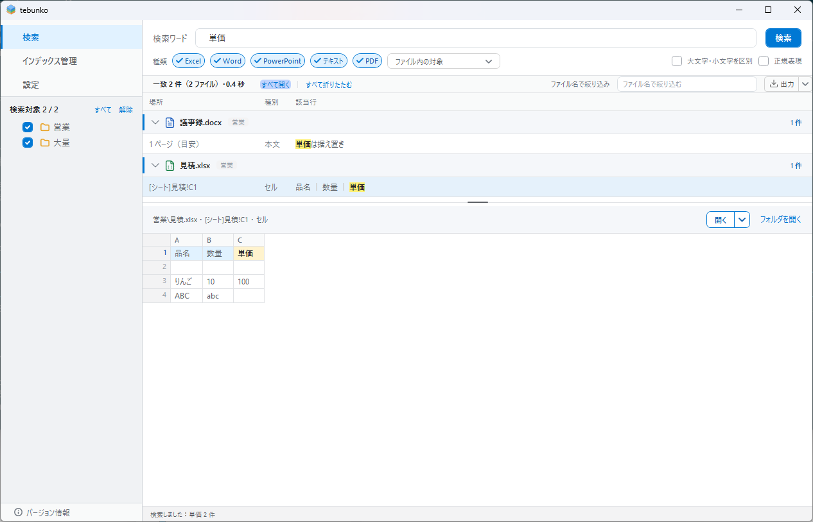
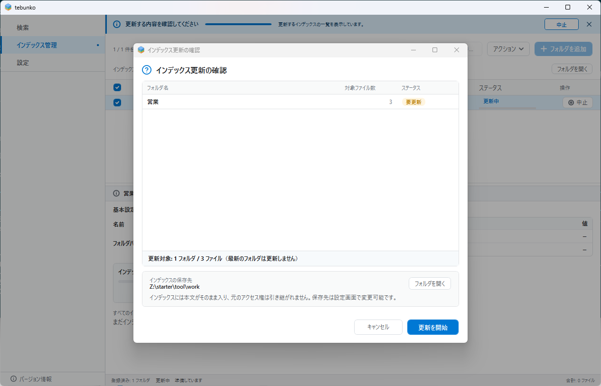
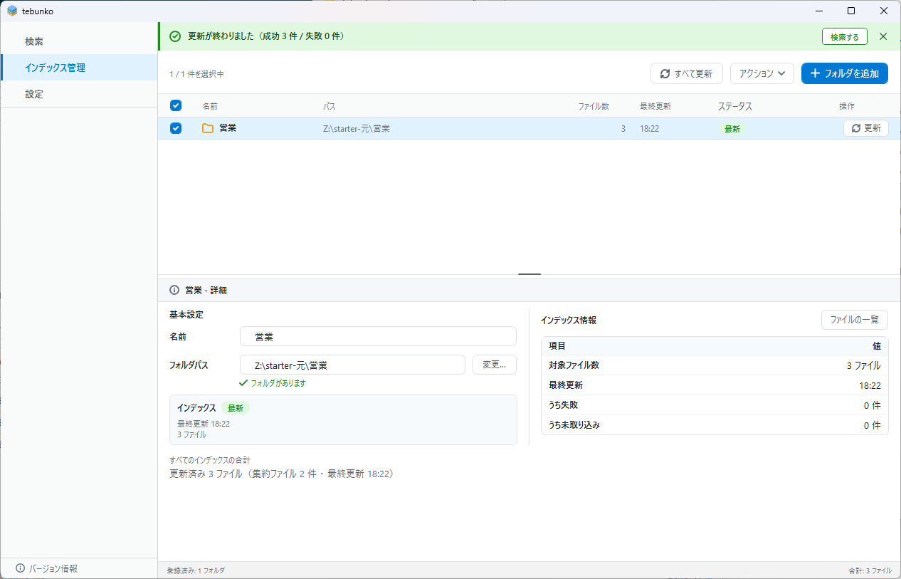



# tebunko

**Search the text inside the Excel, Word, PowerPoint and text files piled up in your folders — fast.**

If you have Office, you can start right away. No installer required, no administrator rights, no network access.

[**日本語**](README.md) ・ [Download](https://github.com/hsgwa/tebunko/releases/latest) ・ [License](LICENSE)

> [!NOTE]
> This page is a short English summary of the Japanese [README](README.md), which is the authoritative version. The screens, messages and documentation are in Japanese only.

## Overview

tebunko extracts the text from the Office files (Excel, Word, PowerPoint), text files and PDFs in the folders you register, and builds a search **index** from it. Searches run against the index, so matches are listed within seconds without opening any file. Double-click a hit to open the original file and edit it as usual. For Excel, the matching cell is selected when the file opens.

- Shows where each hit is: sheet, page or slide, and row.
- Also searches shapes, text boxes and comments.
- Re-indexing reads only the files that changed since last time, and an interrupted run resumes where it stopped.
- Works with network drives and `\\server\share` folders.
- Never modifies your original files (Office files are read as copies, read-only, with macros disabled).

## Requirements

- Windows 10 or 11 (Windows PowerShell 5.1, which is already installed)
- Microsoft Excel (desktop version). Word and PowerPoint are needed only to read the old `.doc` and `.ppt` formats.

Nothing else is needed: no administrator rights, no change to the PowerShell execution policy, no network connection, and no third-party libraries. It does not run on PCs without desktop Excel, on Mac or Linux, or with PowerShell 7 only.

## Quick start

1. Download the zip (`tebunko-<version>.zip`) or the installer (`tebunko-setup-<version>.exe`) from [Releases](https://github.com/hsgwa/tebunko/releases/latest). For the zip, open its properties and check "Unblock" before extracting, then double-click `tebunko.bat`. For the installer, start tebunko from the Start menu. Details are in the Japanese [README](README.md).
2. **Register folders and build the index.** On the index management tab, add the folder you want to search, tick its row and start the update. A confirmation dialog appears first. Progress and remaining time are shown on screen.

   

   

3. **Search.** On the search tab, type a word and press Enter. Hit files appear as headings; click a file name to see the matching rows, and select a row to preview the surrounding lines.
4. **Open and edit.** Double-click a row to open the original file.

## Safety

- The product consists only of PowerShell scripts and screen definitions. It contains no third-party code libraries; the only third-party part is the icon shapes (Lucide). The zip edition contains no executable files (`.exe` or `.dll`).
- It makes no network connections, asks for no administrator rights, changes no registry values, and does not stay resident. The installer edition writes only the uninstall information that makes it appear in the Windows app list.
- These properties are checked by tests and static analysis (PSScriptAnalyzer, CodeQL) in CI on every change.
- The index stores the text of your documents as is and does not inherit the access rights of the original files. Keep the workspace folder (default `%USERPROFILE%\Documents\tebunko_ws`) at the same or stricter access rights than the folders you search.

To report a vulnerability, see [SECURITY.md](.github/SECURITY.md). For questions, see [SUPPORT.md](.github/SUPPORT.md).

## Limitations

- Text inside images (including scanned PDFs), hidden Excel sheets, charts and SmartArt cannot be searched.
- Password-protected files and some PDFs and text files cannot be read.
- Only one search word at a time; results are limited to 10,000 hits by default.
- Changes to the original files appear after the next index update.

The full list is in the Japanese [README](README.md).

## License

[MIT](LICENSE). The only bundled third-party part is the icon shapes ([Lucide](https://lucide.dev)).

Microsoft, Excel, Word, PowerPoint, Windows and PowerShell are trademarks of Microsoft Corporation. tebunko is an independent personal project and is not affiliated with or endorsed by Microsoft Corporation.
