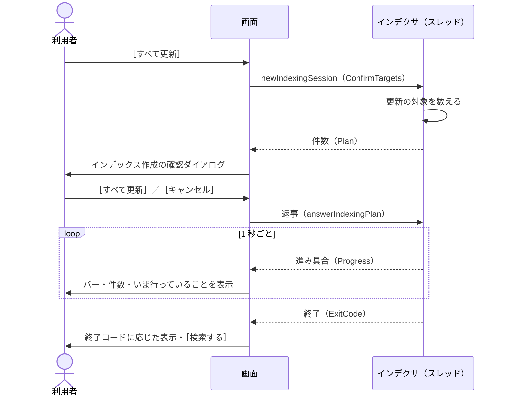
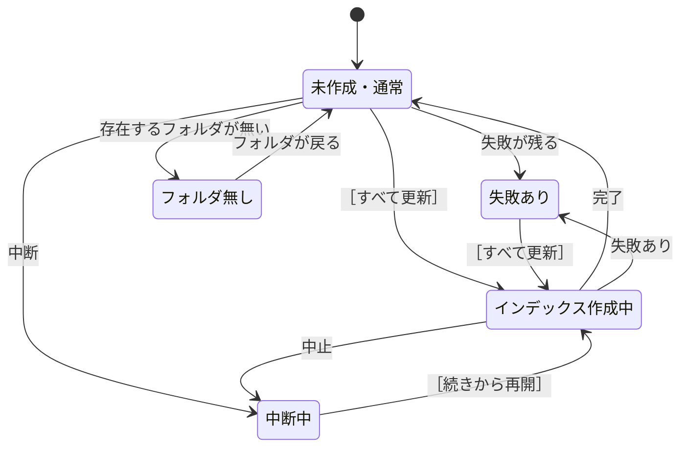

# インデックス作成の実行

扱うこと: ［インデックス管理］タブからインデックス作成を実行するボタンの表示、確認ダイアログ、進み具合の表示、中止・終了・ログ。扱わないこと: インデックスの追加・編集・削除（[インデックス一覧の管理](index-tab.md)）、インデックス作成そのものの流れ（[インデックス作成のメインフロー](../indexing/flow.md)）。先に読むページ: [インデックス一覧の管理](index-tab.md)。

## 実行ボタンの表示

| 状態（[インデックスとインデックス作成の状態](state-flow.md#インデックスとインデックス作成の状態)） | ボタン |
|---|---|
| 未作成・通常 | ［すべて更新］ |
| 中断中 | ［すべて更新］のまま。更新の帯（[更新の帯](#更新の帯)）に `更新を中断しました（残り N 件）` と［続きから再開］を出す |
| 失敗あり | ［すべて更新］。ボタンの下に `前回うまく更新できなかったファイルがあります（原因は、下の「更新に失敗したファイル」で確かめられます）。` を出す。失敗分も更新し直すかは、更新の対象を数えた後の確認のダイアログ（[インデックス更新の確認ダイアログ](#インデックス更新の確認ダイアログ)）のチェックボックスで選ぶ |
| 更新中 | 無効。表示は `更新中…`。更新の帯に進み具合と［中止］を表示する（[更新の進み具合](#更新の進み具合)）。［＋ フォルダを追加］・［アクション ▾］の項目・行の［更新］も無効にする（［中止］は更新の帯と更新中の行にある。どちらも回全体を止める） |
| 更新できるインデックスが無い（1 件も無い・すべて `enabled` が `false`・元のフォルダが無い） | 無効。ボタンの下に理由を出す（インデックスが 1 件も無いときは `フォルダを追加すると更新できます`、そのほかは `更新できるインデックスがありません（行の［更新］で更新できます）。`）。ふだんの説明（押すと何が起きるか）はボタンの ToolTip に置き、ボタンの下には理由・失敗の知らせのときだけ出す |

- インデックス作成は、画面のプロセスの中のスレッドで実行する（`newIndexingSession`。インデクサの司令のスレッドが `scripts\tebunko\indexer.ps1 -Channel <受け渡しの口>` を実行する）。受け渡しの口（`newIndexerChannel -confirmTargets $true`）の `ConfirmTargets` で、更新の対象を数えたところでいったん止まって画面の確認（[インデックス更新の確認ダイアログ](#インデックス更新の確認ダイアログ)）を待つ。別の `powershell.exe` は起動しない（[プロセスとスレッド](../structure/threads.md)）。
- 行の［更新］・メニューの［更新］は、名前の配列を渡して同じ流れで始める（`startIndexing`）。ワークスペースがネットワークにあるときは、始める前に、届くかと前の版のインデックスの有無を裏の列で確かめる（確かめている間は他の操作を止める。届かなければ `ワークスペースに接続できません：<パス>` を出して始めない。[ワークスペースがネットワークにあるとき](network.md#ワークスペースがネットワークにあるとき)）。対象の `enabled` を `true` にして保存してから起動し（確認で取りやめても戻さない）、受け渡しの口の `OnlyNames` に名前を入れる。更新の確認にも、その回のインデックスだけを出す。インデクサが更新できなかった名前（`OnlySkipped`）は、終わりにメッセージで知らせる。
- 更新中の名前・件数・残り時間は `$script:indexingView`（`Name`・`Processed`・`Total`・`Failed`・`Eta`・`Ratio`・`Current`）に値で持ち、更新の帯・詳細の「インデックス」の箱が読む。`Name` は読み取り中のファイル（`<名前>\<相対パス>`）のインデックス名。件数は回全体（インデックスごとの件数は無い）。
- 「インデックス作成中」は、この画面で始めたインデックス作成のスレッドが終わるまでとする（`isIndexing`）。インデックス作成の二重起動を防ぐ。
  - 画面を使わずに起動した `indexer.ps1` と重なった場合は、インデクサがミューテックスで止め、`ほかのインデックス作成が実行中です。…` のエラーで終わる（[中止・終了・ログ](#中止終了ログ)）。

## 更新の帯

画面の上（一覧の上。`xaml/index/index.xaml` の `IndexingProgressPanel`）に、更新の状態を 1 枚の帯で出す。帯は更新を始めたとき・中断が残っているときに出て、種類で色を変える（`setIndexingBanner`。`ui/index/index_detail.ps1`）。

形は、右の領域の上端いっぱいに置いた高さ 40 の 1 行（角丸・外枠・外側の余白は無い。`Banner`）。左端に状態の色の太い線を引き、その右に状態のアイコン（更新中は円に `i`、中断・失敗は円に `!`、終わったは円にチェック）と 1 行の文言を置き、右に帯のボタン（`Banner.Button`）を置く。帯のボタンは高さ 24・余白 左右 10・角丸 4・白地・枠 1 と文字 11 の半太字を帯の線と同じ色にし（色は `setIndexingBanner` が状態で付ける）、幅は文字に合わせる（［続きから再開］は 88、［中止］は 72 を下限にする）。文言は 12 の中太字。帯の下の一覧・詳細の余白は帯が無いときと同じ（`index.xaml` の内側の `Grid`）。更新中だけ、文言の右に細い進みの棒と読み取り中のファイルを同じ 1 行に並べる。

| 種類 | 色 | 文言 | 右側 |
|---|---|---|---|
| 更新中 | 青 | `インデックスを更新しています（N / M 件）`（失敗があれば `・失敗 K 件`）。文言の右にバーと、読み取り中のファイル | `残り約 N 分`・［中止］ |
| 中断 | 黄 | `更新を中断しました（残り N 件）`。残りがあるまま画面を開いたときも出す | ［続きから再開］（［すべて更新］と同じく確認のダイアログから始める） |
| 終わった | 緑（失敗したファイルがある・取りやめ・中止・更新そのものができなかったときは橙） | 終了コードに応じた文言（[中止・終了・ログ](#中止終了ログ)） | ［検索する］（検索の画面へ移る。更新そのものができなかったときは出さない） |

- 中断の帯は、残りが無くなったら消す。帯の消え方は[帯とステータスバー](#帯とステータスバー)に決める。
- 帯の色は、注意が要る終わり方（失敗したファイルがある・中止・取りやめ・更新そのものができなかった）は橙、失敗なく終わったときだけ緑にする（判断は `getIndexingBannerLevel`）。赤は、ワークスペースが使えないなど使えない状態と、一覧の行のバッジ `エラー`・予期しないエラーのダイアログにだけ使う。
- ナビの［インデックス管理］の横の印も更新に合わせて変える（更新中は `● 66%`、中断は `中断`、失敗があるだけなら `失敗`。`getIndexNavBadge`）。

## 帯とステータスバー

帯（`IndexingProgressPanel`）は、更新の状態をこの画面の上に残す。ステータスバー（窓の下。`xaml/shell/status_bar.xaml`）は、直前の操作の結果を 1 行で知らせる。役割を分け、同じことを 2 か所に出さない。

**帯がいつ消えるか**（判断層の `getIndexingBannerView`（中で `getIndexingBannerBehavior` を使う。更新中は残りを 0 と数える）。`Closable`＝閉じるボタン（×）を出すか、`AutoCloseSeconds`＝出してから自動で消えるまでの秒数。0 は自動では消えない）:

| 種類（level） | 閉じるボタン | 自動で消えるまで | 理由 |
|---|---|---|---|
| 更新中（画面では kind が running のもの。判断には run を渡す） | 出す | 消えない | 進み具合はステータスバーと行にも出る。閉じても更新は止まらない（止めるのは帯の［中止］か行の［中止］（帯を閉じたあとは行の［中止］））。終わったときは、閉じていても終わりの帯を出す |
| 成功（ok） | 出す | 8 秒 | 失敗なく終わった知らせは、読めば用が済む |
| 残りがあって更新していないとき（中断の帯のほか、中止・完了の帯も。判断には残りの件数を渡す） | 出す | 消えない | 残りがあるあいだは［続きから再開］を載せて残す。閉じても再開の入口は残る |
| 注意が要る終わり方（warn） | 出す | 消えない | 読み落とさないための知らせは、閉じるまで残す |
| 使えない状態（ng） | 出す | 消えない | 同上 |

- 自動で消える時計は、帯を出すたびに数え直す（`setIndexingBanner`）。別の種類の帯に替わったら、前の時計は止める。
- 閉じるボタン（×。`IndexingBannerClose`）は右端に置く。閉じても記録には影響しない（帯を隠すだけ）。
- 帯はどの種類でも閉じられる。残り（取り込みの Pending）が 1 件以上で更新していないときは、自動では消さない。閉じたあとも、再開の入口（［すべて更新］・行の［更新］・ナビの印）が残る。閉じた帯は、更新を始める・更新が終わる・起動し直すまで出し直さない（状態を読み直しても出さない。`updateIndexingResume`）。

**ステータスバーに何を出すか**（判断層の `getStatusBarView`）:

| 場面 | 出すもの |
|---|---|
| 更新中 | 更新中の 1 行（`更新中: <名前>　N / M 件（失敗 K 件）・残り約 N 分`。`getIndexingStatusLine`）。直前の操作の結果の文は、更新を始めたとき（確認で更新を進めると答えたとき）に消す。確認で取りやめたときは消さない。更新が終わったあとは、新しい操作をするまで空 |
| 更新中でなく、直前の操作の結果がある | その文（追加・変更・削除・エクスポートなどの結果、エラーの理由） |
| どちらも無い | 空 |

- 幅に収まらず `…` で切れたときだけ、全文をツールチップで見せる（`addTrimmedToolTip`）。切れていないときは出さない。
- この画面では、窓の下の右に `登録済み: N フォルダ` と `合計: N ファイル` も出す（[インデックス一覧の管理](index-tab.md)）。
- 帯とステータスバーに同じ知らせを重ねて出さない。更新の結果は帯に、利用者が起こした操作の結果はステータスバーに出す。

**更新以外の帯**（判断層の getNoticeBannerView。1 つの部品 `xaml/shell/notice_banner.xaml` を 3 か所の口に差し、口ごとに <接頭辞>NoticePanel・Icon・Text・Close・Button の名前で持つ）:

| 場面 | 出す場所 | 見た目 | 閉じる | 消えるとき |
|---|---|---|---|---|
| 検索結果の保存に失敗した | 検索画面の上（SearchNotice） | 橙（warn） | ×で閉じる。自動では消えない | 保存をやり直す・作業フォルダを替える |
| インデックスの削除（1 件・まとめて）、まとめてのエクスポートに失敗した | ［インデックス管理］の上（IndexNotice） | 橙（warn） | ×で閉じる。自動では消えない | 次のまとめての操作が失敗なしで終わる・次の 1 件の削除が成功する・作業フォルダを替える |
| 作業フォルダが使えない | 窓の上端（WorkspaceNotice） | 赤（ng） | 閉じられない。［設定を開く］を載せる | 使える状態になる（起動時と作業フォルダの切り替えで確かめる） |

- 失敗の理由は帯に 1 行で出し、全文はツールチップで見せる。削除・まとめての操作の失敗は、メッセージボックスではなくこの帯で知らせる（ステータスバーには同じ文を出す）。名前の変更の失敗は帯に出さず、ステータスバーだけに出す。［すべて更新］の確認のメッセージボックスは変えない。

## 更新し直しの確かめ

前の前の版のインデックス（`index\`。しるしあり）が見つかり、`store\content\` と前の版の `content_index\` がどちらも空のまま［すべて更新］を押すと、更新の対象を数える前に確かめのダイアログを出す（`getReingestConfirm`。`tebunko/ui/indexing_view.ps1`）。

- 判定は `hasLegacyIndex`（前の版のしるしがある）と `contentEmpty`（`store\content\` と `content_index\` がどちらも空）の 2 つの引数だけで決まる（判断層。画面には触らない）。両方が真のときだけ文言を返し、ほかの 3 通りでは確かめを出さない。
- 確かめは共通の確認ダイアログ（[確認ダイアログ](common.md#確認ダイアログshowconfirm)）を使う。見出しは `前の版のインデックスは使えないため、元のファイルをすべて更新し直します。ファイルが多いと時間がかかります。始めますか？`、選択肢は［更新し直す］の 1 つ（＋既定の［キャンセル］）。
- ［キャンセル］（または閉じる）を選ぶと、インデックス作成は始めない。［更新し直す］を選ぶと、通常の流れ（更新の対象を数え、[インデックス更新の確認ダイアログ](#インデックス更新の確認ダイアログ)を出す）に進む。
- 前の前の版のしるしが無い・本文インデックスの置き場が空でない（すでに更新し直した後など）のときは、この確かめを出さずに通常の流れに進む。

## インデックス更新の確認ダイアログ

`tebunko/xaml/dialog_indexing_confirm.xaml`。表題（`インデックス更新の確認`）の下に説明・一覧・合計・注意書き・ボタンを置く。［すべて更新］を押すと、インデクサはまず**更新の対象を数えるだけ**行って止まり（受け渡しの口の `ConfirmTargets`）、インデックスごとの件数を受け渡しの口の `Plan` に入れる（[取り込み対象の決定](../indexing/target-decision.md#取り込み対象の決定createtargetlist)）。
画面は進み具合の段階が `確認` になったらそれを読み、**このダイアログを 1 回だけ開く**。
何件更新するかは元のファイルの更新日時・サイズを調べないと分からないため、数えるのはインデクサで行う（画面は数えている間も固まらない）。

| 部品 | 仕様 |
|---|---|
| 表題 | `インデックス更新の確認`。説明文は、削除予定があるときだけ `［更新を開始］を押すと、設定に無いインデックスも削除します。` を出す（無いときは説明文の欄ごと出さない。`getIndexingConfirmIntro`）。ふだんは、一覧と合計だけを見せる |
| 一覧 | 1 行 1 インデックス（設定の順）。列は「フォルダ名」「対象ファイル数」（右寄せ）「ステータス」（`StatusBadge`）。ボタンは右下に［キャンセル］［更新を開始］の順（主は右）。フォルダ名に カーソルを置くと元のフォルダを、バッジに置くと内訳を ToolTip に出す |
| 「ステータス」の表示 | 更新するファイルがあれば `要更新`（黄）／取り込み対象が 0 件でも、クラウドにだけあるファイル（前回失敗でないもの）が残っていれば `要確認`（黄。内訳は `クラウドにだけある N 件`）／無ければ `最新`（緑。クラウドにだけある前回失敗は、手元の前回失敗と同じく、更新し直す指定が無ければ取り込み対象にならないため、内訳に出して `最新` のまま）／設定の `enabled` が `false` のインデックスは［すべて更新］では出さない（選んだものだけの更新の確認には、選んだインデックスだけを出し、`対象外` の行は出さない）／元のフォルダが見つからなければ `フォルダなし`（赤）／設定から外れたインデックスは `削除予定`（赤。選んだものだけの更新の確認にも必ず出す）。［更新を開始］を押したときだけそのインデックスを削除する（ToolTip に書く）。更新するファイルが無くて削除予定だけのときも、主ボタンを［更新を開始］にして［キャンセル］を残す。フォルダなしのインデックスは数えないため、「対象ファイル数」は `－` |
| バッジの内訳 | `新規 N 件` `更新あり N 件` `前回未完了 N 件` `インデックスが無い・壊れている N 件` `前回失敗 N 件` のうち 1 件以上のものを ` / ` でつなぐ（`要更新` では `更新するファイル N 件（…）`）。どれも 0 件なら `すべて最新です` |
| クラウドにだけあるファイル | OneDrive・SharePoint のオンデマンドで、中身がこの PC に無いファイルが 1 件以上あるときだけ出す（[取り込み対象の決定](../indexing/target-decision.md#クラウドにだけあるファイル)）。警告（警告色）`クラウドにだけあるファイル N 件（合計 X）は、既定ではダウンロードせずに残します。取り込むと、そのすべてをこの PC にダウンロードします。登録するフォルダを、要るものだけに絞ることをおすすめします。`、チェック `クラウドにだけあるファイル N 件もダウンロードして取り込む`（既定は外す）、その下にチェック `次からこの確認を出さずにダウンロードする`（上のチェックを付けたときだけ選べる）。件数と大きさは `getIndexingCloudView`、文言は `indexing_view.ps1` で決める。チェックを付けると合計にその分を足す。クラウドにだけあるファイルしか残らないときも、［閉じる］にせず［更新を開始］とチェックを選べるままにする。欄を出すか・件数・チェックの扱いは、前回失敗の更新し直し（下の行）のチェックと合わせて `getIndexingConfirmView` 1 か所で決める（画面は結果を当てはめるだけ）。前回失敗のうちクラウドにだけあるものは、更新し直すを付けたときだけ数える |
| 前回失敗の更新し直し | 前回失敗し、その後変わっていないファイルが 1 件以上あるときだけチェックボックスを出す。`前回更新に失敗し、その後変わっていないファイル N 件も更新し直す（パスワード付きなど）`。切り替えると合計の表示も変える（既定は外す）。件数は、手元にある前回失敗に、クラウドにだけある前回失敗を足した数。クラウドにだけある前回失敗だけのときも出す（取り込むには、更新し直すに加えてクラウドのチェックを付ける） |
| 合計 | 表と同じ枠の最下行（薄い地・太字）に出す。更新するものがあれば `更新対象: N フォルダ / M ファイル（最新のフォルダは更新しません）`。無ければ `更新が必要なファイルはありません（すべて最新です）。` とし（クラウドにだけあるファイルが残るときは、`更新が必要なファイルはありません。クラウドにだけあるファイル N 件は、ダウンロードせずに残します。`。チェックを付ければ、その件数を足した `更新対象` にする）、注意書き `更新日時が変わらないまま中身が変わったファイルは、更新の対象になりません。そのインデックスを一から作り直すときは、［削除］してから追加し直してください。` を添える |
| 注意書き | 置かない。更新にかかる時間の見込みは、確認の時点では分からないため出さない（更新中は帯の `残り約 N 分` で見せる）。Office のファイルの扱いは[インデックスの仕組み](../../guide/about-index.md)に書いてある |
| ［更新を開始］ | 更新する返事（`answerIndexingPlan`。`@{RetryFailed; IncludeCloud}`）を受け渡しの口に入れ、インデクサの待ちを解く。失敗分も更新し直すかは `RetryFailed`、クラウドにだけあるファイルもダウンロードして取り込むかは `IncludeCloud` で伝える。クラウドのチェックが付いていて、設定 `cloudFiles` がまだ `download` でないときは、先にもう一度確認を出す（件数と合計サイズ・帯域とディスクの空きを使うこと・制限時間（取り込みと同じ値）にダウンロードも含むこと、失敗したファイルは手元に落としてから取り込み直すこと。［キャンセル］なら、この確認のダイアログに戻る）。開始するときに、両方のチェックが付いていれば `cloudFiles` を `download` に、そうでなければ `ask` に保存する（クラウドの欄を出したときだけ。今の設定と同じなら書かない。`getIndexingCloudModeToSave`）。更新するものが全く無いとき（クラウドにだけあるファイルも無いとき）は表示を［閉じる］にし、［キャンセル］は出さない（押してもインデクサはそのまま終わるだけのため） |
| ［キャンセル］ | 取りやめの返事（`answerIndexingPlan` に `$null`）を受け渡しの口に入れる。インデクサは 1 件も更新せずに終了コード 2 で終わる。**取り込み一覧は前回のまま**にする（更新の対象にした行を「未取り込み」で記録すると、次回の表示が中断したように見えるため） |

- インデックスごとの件数を一覧で見せるため、共通の確認ダイアログ（[確認ダイアログ](common.md#確認ダイアログshowconfirm)）ではなく専用のダイアログにする。ボタンの文言を操作そのものにする点は同じ。
- ダイアログを開いている間も進み具合のタイマーは動くため、**開く前に「開いた」ことにして**二重に開かないようにする。
- 返事をしない場合、インデクサは 60 分で取りやめる（待ち続けないため）。確認を待っている間に画面を閉じると、更新を止めてから閉じる（[中止・終了・ログ](#中止終了ログ)）。

## インデックス一覧を変更したとき

確認は出さずにそのまま保存する。
取り込み一覧（`<ワークスペース>\store\ingest_status.tsv`）の行はインデックス名で元のフォルダと対応させるため、元のフォルダの場所を変えても取り込み一覧は作り直さない（[取り込み一覧](../indexing/ingest-list.md)）。
そのため、変更前のフォルダの相対パスのまま新しいフォルダを処理することはない。

## 更新の進み具合

インデックス作成は別のスレッドで動くため、画面は**インデクサが受け渡しの口に入れる進み具合**（`readIndexingProgress`）を 1 秒ごとに読んで表示する（ファイルは読まない）。

| 状況 | 判定（進み具合の段階） | 表示 |
|---|---|---|
| クロール中 | `クロール` | 動き続けるバー。`更新するファイルを調べています…`。下に、インデクサが今していること（`インデックス作成の準備をしています…`・`[<インデックス名>] の対象ファイルを探しています… <パス>`・`更新済みのインデックスを確認しています…`・`更新の記録を書き出しています…`） |
| インデックス作成の確認待ち | `確認` | 動き続けるバー（タスクバーは黄色）。`更新する内容を確認してください`、`更新するインデックスの一覧を表示しています。`。確認のダイアログを開く（[インデックス更新の確認ダイアログ](#インデックス更新の確認ダイアログ)） |
| 更新の開始前 | `取り込み` で処理済みが 0 | 動き続けるバー。`N 件のファイルを更新します`、`読み取り中のファイル：<相対パス>` |
| 更新中 | `取り込み` で処理済みが 1 件以上 | バー（処理済み ÷（処理済み＋残り））、`インデックスを更新しています（14 / 31 件・失敗 1 件）`、`残り約 N 分`（1 分未満は `残り 1 分未満`。最初の 1 件が終わってからの速さで計算）、`読み取り中のファイル：<相対パス>` |
| 後片付け中 | `仕上げ` | 動き続けるバー。`インデックス作成を終えています…`、`Officeアプリを終了しています…` / `更新の記録を書き直しています…` |
| 終わった | インデックス作成のスレッドが終わった | 終了コードに応じて表示する（[中止・終了・ログ](#中止終了ログ)）。状態・件数を読み直す |

- 更新中の行を選んでいるときは、詳細の「インデックス」の箱にも同じ全体の進みを出す（`IndexingProgressBar` の棒・`IndexingCountText` の `N / M 件・残り約 N 分`・`IndexingFileText` の読み取り中のファイル名 1 行）。画面は進み具合を読むたびに、割合・件数・失敗・残り時間・今のファイルを画面側の変数（`indexingView`）に置いて詳細を書き直す（文言は判断層の `getIndexDetailView`）。インデックスごとの件数は無い。行の右端は［中止］になり、［すべて更新］の［中止］と同じく今の更新全体を止める。
- タスクバーのアイコンにも進み具合を表示する（失敗があれば黄色）。**インデックス作成が終わったときは、帯で知らせる**。前面には割り込まず、タスクバーのボタンも光らせない（光らせるには P/Invoke（`FlashWindowEx`）が要るため。[実行時コンパイル（csc.exe）を使わない](implementation.md#実行時コンパイルcscexeを使わない)）。
- **取り込み一覧（`work/store/ingest_status.tsv`）は毎秒読まない**。数万行になると 1 回の読み直しに数秒かかり（5 万行で約 5.8 秒）、1 秒ごとに読むと画面が固まる（「応答なし」になる）。進み具合はインデクサが数えて受け渡しの口に入れる（[インデックス作成のメインフロー](../indexing/flow.md)）。
- 「処理済み」はインデクサが数えた件数（今回の実行で更新したファイルと、更新に失敗したファイル）。前回失敗したファイルを更新し直す場合（確認のダイアログでチェックを付けた場合）も、その分は最初から件数に入る。

## 中止・終了・ログ

- 確認のダイアログを出している間の取りやめは、ダイアログの［キャンセル］で行う（[インデックス更新の確認ダイアログ](#インデックス更新の確認ダイアログ)）。
- インデックス作成中は、更新の帯の右に［中止］を表示する。押すと確認ダイアログ（[確認ダイアログ](common.md#確認ダイアログshowconfirm)）を出す。見出しは `インデックスの更新を中止しますか？`、補足は `更新したところまでは残ります。あとで続きから再開できます。`、ボタンは［中止する］（既定は［キャンセル］）。［中止する］で受け渡しの口の `Stop` を立てる（`requestIndexingStop`）。インデクサは読み取り中のファイルが終わったところで止まり、終了コード 2 で終わる。終わるまでは `中止しています…（読み取り中のファイルが終わるまでお待ちください）` と表示し、待つ間のダイアログ（[待つ間のダイアログ](common.md#待つ間のダイアログshowwaitdialog)）を出す。
- インデックス作成のスレッドが終わったら、終了コード（受け渡しの口の `ExitCode`。`IndexingSession.GetExitCode`）に応じて次のように表示する。

| 終了コード | 表示 |
|---|---|
| 0 | 判断層（`getIndexingEndText`。`indexing_view.ps1`）が、成功・失敗の件数から見出しと説明を決める（利用者の PowerPoint のために取り込めなかったファイルは、失敗の件数に入っている）（上から見て最初に当たるもの）。 ・更新した（成功＋失敗）が 1 件以上: `更新が終わりました（成功 N 件 / 失敗 M 件）`。失敗があれば `失敗したファイルと原因は「更新に失敗したファイル」の一覧で確認できます。` を説明に加える ・どちらも 0 件で、クラウドにだけあるため残したファイルがある: `クラウドにだけあるファイル N 件は、ダウンロードせずに残しました（次のインデックス作成でも確かめます）。` ・どちらも 0 件: `更新が必要なファイルはありませんでした` 残したファイルがあるときは、上の最初の説明にも同じ文を加える（`IndexingSession.GetCloudSkipped`） |
| 2（確認で取りやめた） | `更新を取りやめました`、`更新したファイルはありません。［すべて更新］を押すと、もう一度確認できます。` |
| 2（中止した） | `更新を中止しました（成功 N 件 / 失敗 M 件 / 残り K 件）`、`次回は続きから再開できます。` |
| 1（続けられないエラー。クロール対象フォルダが無い など） | 受け渡しの口の `Error`（`IndexingSession.GetError`。無ければスレッドが止まった理由）を読み、`インデックスを更新できませんでした` とそのメッセージを表示する。同じ内容をエラーのダイアログでも出す |

利用者の PowerPoint のために取り込めなかったファイルは、失敗として「更新に失敗したファイル」の一覧に理由付きで出る（理由の文は [エラーメッセージ](../indexing/errors.md)。[取り込み一覧](../indexing/ingest-list.md#強制終了時間切れからの再開)「PowerPoint が要るファイルの後回し（Postponed）」）。一覧の状態は「未取り込み」のままなので、PowerPoint を閉じてからの次の更新で、失敗分の再取り込みを選ばなくても取り込む。

- インデックス作成が終わると［検索する］を表示する（押すと検索の画面へ移る）。更新の帯にはログを開くボタンを置かない。インデックス作成のログ `work/indexing_log.txt`（`$workspace.IndexingLogFile`。インデクサの実行記録。先頭に版と環境の見出しがある）は、調べるときにフォルダから開く。インデックス作成を始めるたびに、前回の分が `indexing_log_previous.txt` に移る。この移す処理はインデクサの司令のスレッドで走り、画面のスレッドは待たない。画面のエラーの記録 `gui_error_log.txt` を 1 MB 以上のときに `gui_error_log_previous.txt` へ移す処理（`writeErrorLog`）は、エラーを受けた画面のスレッドで走る。ファイルを 1 つ移すだけで、同じエラーの記録は 60 秒に 1 回までなので、画面の応答性への影響は小さい。
- インデックス作成中にウィンドウを閉じようとすると、確認ダイアログ（[確認ダイアログ](common.md#確認ダイアログshowconfirm)）を出す。見出しは `インデックスを更新中です。中止して閉じますか？`、補足は `更新したところまでは残ります。次に起動したときに続きから再開できます。`、ボタンは［中止して閉じる］、キャンセルのボタンは［閉じない］。インデックス作成は画面のプロセスの中で動くため、続けたまま閉じることはできない。［中止して閉じる］を押すと、閉じるのを保留して中止を求め、進み具合欄に `更新を止めています…` と出し、待つ間のダイアログ（[待つ間のダイアログ](common.md#待つ間のダイアログshowwaitdialog)。強制終了までの秒読みつき）を出す。止まったら閉じる。60 秒たっても止まらなければ、インデックス作成が起動した Office だけを止め、さらに 15 秒たっても止まらなければそのまま閉じる（[閉じる](state-flow.md#閉じる)）。
