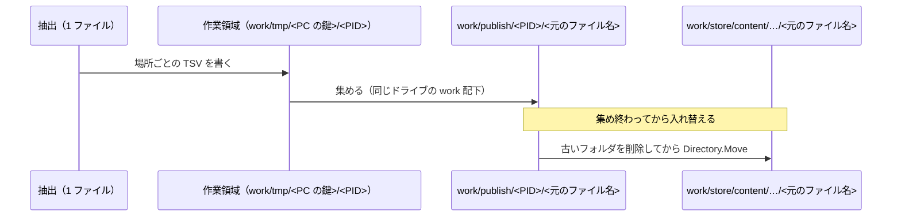
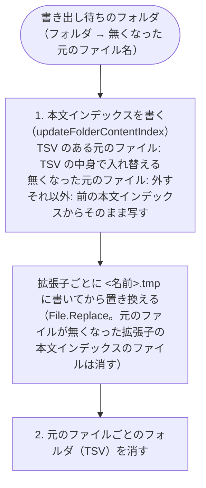
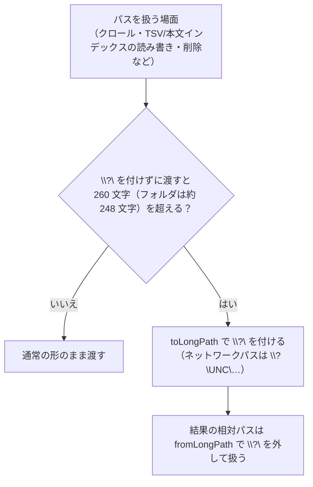

# 入れ替えと書き出し

扱うこと: 取り込んだ TSV をインデックスの一時的な置き場所へ入れ替える手順、フォルダ単位で本文インデックスへ書き出す手順、260 文字を超える長いパスの扱い。扱わないこと: インデックスのファイルの形そのもの（[インデックスのファイルの形](format.md)）。先に読むページ: [インデックスのファイルの形](format.md)、[取り込み一覧](../indexing/ingest-list.md)。

## インデックスへの入れ替え（`publishTsv` / `publishIndexFiles`）

1 ファイルの抽出が終わったら、作業領域（既定は `work/tmp/<PC の鍵>/<PID>`。[データの置き場所とパスの決め方](../structure/data.md)）にできた TSV をインデックスの一時的な置き場所（元のファイル名のフォルダ）へ入れる。このとき、TSV をいったん `work/publish/<PID>/<元のファイル名>` に集め、**集め終わってから**古い `work/store/content/…/<元のファイル名>` を削除してフォルダごと入れ替える。本文インデックスへは、そのフォルダの取り込みが終わってから入れる（下の「本文インデックスへの書き出し」）。

- 1 件ずつインデックスへ移すと、途中で強制終了されたときに**一部のシートだけが入ったインデックス**が残り、検索しても欠けていることに気付けない。まとめて入れ替えれば、「前回のインデックスがそのまま」か「今回の分がそろった状態」のどちらかになる。
- フォルダごと移す（`Directory.Move`）には同じドライブである必要があるため、集める場所は作業領域とは別に `work` の中に置く。別のドライブで移せない場合は、1 件ずつ移す方法に切り替える。
- 削除は、ウイルス対策ソフト・エクスプローラーが一時的に掴んでいることがあるため、少し待って数回試す（`removeDirectoryRetry`）。

## 本文インデックスへの書き出し（`publishIndexFolders`）

取り込んだファイルのフォルダは「書き出し待ち」として覚えておき（`indexer/pending_publish.ps1` の `PendingPublish.Add`）、**そのフォルダに取り込み中のファイルも、まだ取り込みのスレッドに渡していないファイルも無くなったとき**（結果を 1 つ受け取るたびに調べる。[取り込みの並列化](../indexing/parallel.md)）と、**インデックス作成の終わり**（中止したときも。`finally`）に、それまでのフォルダをまとめて書き出す（`indexer_run.ps1` の `flushPending`（`PendingPublish.TakeFlushable` / `TakeAll`）→ `publishIndexFolders`）。元のファイル 1 つごとに書き出すと、フォルダの大きさ × ファイルの数だけ本文インデックスのファイルを書き直すことになるため。フォルダごとに次を続けて行う。

- **途中で止まったとき**: 本文インデックスは一時ファイルに書き終えてから置き換えるため、書き終える前に止まっても、前の本文インデックスか TSV のどちらかに中身が残る。TSV のフォルダが残ったフォルダは、次のインデックス作成の始めに（取り込み対象を調べる前に）書き出す（`findIndexFoldersWithBooks`。進み具合は `集約ファイルに入れていないインデックスをまとめています…`）。書き出しに失敗したときも、同じく次のインデックス作成でまとめ直す（`インデックスをまとめられませんでした（次のインデックス作成でまとめ直します）`）。
- **無くなった元のファイルの外し直し**: 無くなった元のファイルの名前は、本文インデックスから外し終えるまで、ワークスペースの記録ファイル `work/store/pending_remove.tsv`（1 行 = `<置き場からのフォルダの相対パス><TAB><元のファイル名>`）に残す（`PendingPublish.Unpublished`。`TakeAll` などで取り出しても残り、`MarkPublished` で外れる）。取り込み一覧から行を消す前（`savePendingRemovals`）と書き出しの前に記録を書き、書き出しの後は、`publishIndexFolders` が返した `Published`（本文インデックスのファイルを書き終えたフォルダ）について、そのとき書き出した名前だけを外して書き直す（同じ回に書き出しを飛ばした名前は残す。0 件なら消す）。書き出しを飛ばした・落ちた・強制終了した回の次のインデックス作成の始めに、記録を読んで書き出し待ちに戻し（`PendingPublish.Restore`。置き場に無いフォルダの分は捨てる）、TSV の残りと一緒に書き出す。記録が無ければ空として読み、インデックス・取り込み一覧の形は変えない。
- **フォルダの 1 つが失敗したとき**: 例外はフォルダごとに受け止め（`publishIndexFolders`）、失敗したフォルダは飛ばして残りのフォルダを続ける。書き出せたフォルダの結果は状態ファイルに書く。飛ばしたフォルダは戻り値の `Skipped` に、本文インデックスのファイルを書き終えたフォルダ（置き場の外を指すリンクで飛ばしたものを含まない）は `Published` に入れ、インデックス作成のログに `本文インデックスにまとめられなかったフォルダがあります（<インデックスからの相対パス>）: <段>: <理由>。インデックスを作り直すと直ります` を黄色で出す（`getContentIndexPublishSkippedText`）。止まった段で、残るものが違う。
    - **前の本文インデックスのファイルを読む所（書く前）で落ちた**（壊れている・版が違う・読めないなど）: 何も消さず、書き換えない。壊れたファイルも TSV のフォルダも残り、次のインデックス作成の始めに、またまとめ直しを試す。書き込みの途中（`newDirectoryUnder` が偽・`writeContentIndexFile` の失敗）や TSV の削除（`removeDirectoryUnder` の例外）で落ちたときは、書いたものと残った TSV が混ざるが、次の回に TSV を入れ直して直る。1 つのフォルダの中で壊れたファイルだけを飛ばして書き直すことはしない（壊れたファイルに入っていた元のファイルが、取り込み一覧は「取り込み済み」のまま検索から消えるため）。
- **検索の上限（`contentIndexSearchMaxBytes` = 64MB）を超える本文インデックスのファイル**: 書く側も読む側と同じ上限で判定する。検索はファイル単位で飛ばすため、上限を超えるファイルができると、同じファイルの小さな元のファイルまで検索に出なくなるため。
    - 取り込み（`publishTsv`）: 置き場へ移す前に、その元のファイルだけを入れた本文インデックスのファイルの大きさを求め（`assertContentIndexBookFits`。書き出しと同じ数え方）、上限を超えるなら移さず取り込みの失敗にする（文言は [取り込み一覧のエラー](../indexing/errors-ingest.md)）。
    - 書き出し（`convertFolderToContentIndex`）: 新しく入れる元のファイルが 1 つで上限を超えるときは入れず（前のコピーも外す）、取り込み直しにする（保険）。前の本文インデックスのファイルが上限を超えているときは、丸ごとは読まず、中の元のファイル名だけを流れで読み（`readContentIndexBookNamesStreaming`）、そのファイルを消して、中の元のファイルを取り込み直しにする（`readPreviousContentIndexParts`）。この回に入れ替える元のファイルは、取り込み直しにしない。
    - 取り込み直し: 戻り値の `Requeued`（`publishIndexFolders`）を `PendingPublish.Requeued` に集める。始めの書き出しで外した分は、書き出しの直後に（取り込み対象を決める前に）取り込み一覧のファイルと前回の行で「未取り込み」・エラー空にして保存し（`applyStartupRequeued`）、同じ回で取り込み直す（取り込む対象が 0 件・取りやめ・強制終了でも、外した元のファイルが「済」のまま検索に出なくならない）。取り込みの途中の書き出しで外した分は、終わりの書き直しで同じ行にする（`selectFinishStatusRows`。この回の結果より優先する）。小さい元のファイルは検索に戻り、上限を超える元のファイルは取り込みの失敗になる。外したことは黄色のログに 1 行出る（[まとめの警告](../indexing/log-warnings-index.md)）。
    - 始めの書き出し（`recoverIngestJournal`）: TSV が残っていないフォルダでも、上限を超える本文インデックスのファイルがあるフォルダ（`findOversizeContentIndexFolders`。ファイルの大きさだけで見て、中身は読まない）を書き出し待ちに足す。
- **元のファイルが無くなったとき**: クロールで無くなったと分かったファイル（`createTargetList` の `Removed`。[クロール対象フォルダと取り込み対象](../indexing/crawl.md)）と、取り込みの直前に無くなっていたファイル（[メインフロー](../indexing/flow.md)）は、そのフォルダを書き出し待ちにして、本文インデックスから外す。取り込むファイルが 0 件のときも書き出す。
- **検索との同時実行**: 本文インデックスは置き換えで書くため、検索は置き換えの前か後のどちらかの中身を読む（読み込みは共有モードで開き、置き換えを妨げない）。

## 長いパス（260 文字超）の扱い

出力 TSV のパスは、元ファイルのパスより `<ワークスペース>\store\content\<インデックス名>\` と `\<場所>.tsv` の分だけ長くなるため（本文インデックスも `<ワークスペース>\store\content\<インデックス名>\` の分だけ長くなる）、元ファイルが開けても TSV のパスが 260 文字を超えることがある。Windows PowerShell 5.1（.NET Framework 4.6.2 以降）では、パスの先頭に `\\?\` を付けると、OS の設定（LongPathsEnabled）や管理者権限なしで 260 文字を超えるパスを扱えるため、ファイル操作に渡すパスには `toLongPath` で `\\?\` を付ける。

| 場面 | `\\?\` を付けない場合（実測） | 対応 |
|---|---|---|
| クロール（`findTargetFiles`） | パスが約 248 文字を超えるフォルダの中を検索できず、アクセスできないフォルダ扱いになる（そのファイルは取り込まれない） | `\\?\` 付きで検索し、`FullName` から相対パスを求めるときは `fromLongPath` で外す |
| TSV・本文インデックスの保存・移動・削除（`prettyTsv` / `writeUnits` / `publishTsv` / `writeContentIndexFile` / `updateFolderContentIndex`） | 260 文字を超えるパスは「パスの一部が見つかりません」で失敗する。`Test-Path` は `$false` を返す | `\\?\` 付きで操作する |
| 設定から削除したフォルダのインデックスの削除（`removeDroppedFolders`） | 中に長いパスがあると `Remove-Item -Recurse` が失敗する | `\\?\` 付きで削除する |
| Excel で開く | 約 256 文字以上（古い版は 218 文字以上）のパスは開けない。`\\?\` 付きのパスも開けない | [Excel の取り込み](../indexing/excel.md#excel-の抽出処理extractworkbook)（常に作業フォルダにコピーしてから開く。コピーは短いパスになる） |

- `Join-Path` は `\\?\` 付きのパスを扱えない（`drive` が null の例外）ため、パスは通常の形のまま組み立て、ファイル操作に渡す直前に `toLongPath` を付ける。
- ネットワークのパス（`\\server\share\…`）は `\\?\UNC\server\share\…` にする。
- ファイル名・フォルダ名 1 つの上限（255 文字）は `\\?\` でも超えられない。
