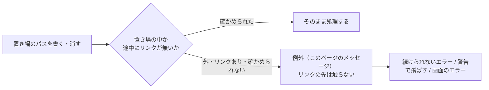

# 置き場の安全確認のエラー

扱うこと: インデックスの置き場（`work/store/`・`work/publish/`・`work/tmp/` など）を読み書き・削除するときに、リンクや置き場の外を指すパスを断る・フォルダを消せない・排他を待ちきれないときのエラーの文言と発生条件。扱わないこと: インデックス作成を止めるエラーとファイルごとの失敗（[エラーメッセージ一覧](errors.md)）、続けられる警告（[インデックス作成ログの警告・お知らせ一覧](log-warnings.md)）。先に読むページ: [エラーメッセージ一覧](errors.md)・[ファイルの読み書きの範囲](../../safety/file-access.md)。

置き場の中のファイル・フォルダを書く・消す前に、そのパスが置き場の中にあり、途中にリンク（ジャンクション・シンボリックリンク）が無いことを確かめる。確かめられない・外れていたときは、リンクの先を書き換えたり消したりしないよう、例外で止める。例外のメッセージは、起きた処理によって、[エラーメッセージ一覧](errors.md)の「続けられないエラー」（例外のメッセージそのまま）、[警告・お知らせ](log-warnings.md)（フォルダ単位で飛ばして続けるもの）、画面の操作のエラー（[インデックスの書き出し・読み込み・名前変更・ワークスペースのエラー](../gui/messages-index-ops.md)）のどれかに出る。

メッセージ中の `<…>` は実行時に埋め込む値。

## リンク・置き場の外を断るもの

| メッセージ | 発生条件 | 対処 |
|---|---|---|
| `インデックスの置き場の外か、途中にリンクがあるため、インデックスのファイルを置けません: <パス>` | 本文インデックスのファイルを置くパスが、置き場の外か途中にリンクがある（`convertFolderToContentIndex`） | 置き場（`work/store/`）の途中にあるリンクを外す |
| `置き場の外か、途中にリンクがあるため、インデックスを置けません: <パス>` | 作り終えたインデックスを公開用の置き場からインデックスの置き場へ移すとき、移し先か途中が、置き場の外か途中にリンクがある（`publishIndexFiles`） | 置き場（`work/publish/`・`work/store/`）の途中にあるリンクを外す |
| `gram 索引の置き場の外か、途中にリンクがあるため、作れません: <パス>` | gram 索引を置くパスが、置き場の外か途中にリンクがある（`updateGramIndexOf`） | 同上 |
| `置き場の外か、途中にリンクがあるため、消していません` | 古い形式のインデックスを消すとき、置き場の外か途中にリンクがある（`removeOldIndexOf`） | 同上 |
| `置き場の外か、途中にリンクがあるため、消せません: <パス>` | 画面から外されたフォルダのインデックスを消すとき、置き場の外か途中にリンクがある（`removeDroppedFolders`） | 同上 |
| `リンクかどうか確かめられないフォルダのため、消しませんでした: <パス>` | フォルダを消す前にリンクかどうかを調べられなかった（アクセス権が無い等。`removeTreeNoFollow`） | アクセス権を確かめてから、もう一度行う |
| `数えたあとでリンクに替わったフォルダのため、中のファイルを消しませんでした: <パス>` | 消す前に数えたときは通常のフォルダだったものが、消す直前にリンクに替わっていた（`removeTreeNoFollow`） | 置き場の中で、ほかのプログラムがフォルダを作り替えていないか確かめる |

## フォルダを消せないもの

| メッセージ | 発生条件 | 対処 |
|---|---|---|
| `フォルダがあるかどうか確かめられません: <パス>（<原因>）` | フォルダを消したあと、残っているかを調べられなかった（`removeDirectoryRetry`） | 原因（アクセス権・ネットワークの切断等）を取り除く |
| `フォルダがあるのに開けないため、消せません: <パス>` | フォルダを消そうとしたが、あるのに開けない（使用中・権限が無い等。何度か試したあと） | そのフォルダを開いているアプリ（ウイルス対策ソフトなど）を閉じる |
| `フォルダが消えていません: <パス>` | 消す処理を終えたのに、フォルダが残っている | 同上 |
| `インデックスの置き場があるかどうか確かめられません: <パス>（<原因>）` | 画面から外されたフォルダのインデックスを消すとき、置き場の有無を調べられなかった（`removeDroppedFolders`） | 原因を取り除いてから、もう一度更新する |

## 排他の待ち時間切れ

| メッセージ | 発生条件 | 対処 |
|---|---|---|
| `排他の待ちが時間切れになりました（<N> ミリ秒。<待っていた名前>）。ほかの処理が終わってからやり直してください。` | 同じワークスペースを使う別の処理（別のインデックス作成・書き出し・読み込み・ワークスペースの変更など）が長く動いていて、順番が回ってこなかった（`invokeWithNamedMutex`） | ほかの処理が終わるのを待って、もう一度行う |

## インデックスのファイルの読み書き

| メッセージ | 発生条件 | 対処 |
|---|---|---|
| `インデックスのファイルが大きすぎます` | 検索で読む本文インデックスのファイルが、読み込みの大きさの上限を超えている（`searchContentIndexFiles`）。この版は上限を超えるファイルを作らず、前の版が作ったものは次の更新で外して取り込み直す（[本文インデックスへの書き出し](../index-data/publish.md)） | 更新する（インデックスの作成） |
| `インデックスのファイルの形が崩れています（ファイル名の行に改行がありません）` | 本文インデックスのファイルの形が崩れている（`splitContentIndexTextByBook`） | ［すべて更新］でインデックスを作り直す |
| `区画のファイルが途中で終わっています` | gram 索引の区画のファイルが途中で終わっている（書き込みの途中で止まった等。`readGramBytes`） | gram 索引は次のインデックス作成で作り直す |
| `インデックスの目録を読めません: <パス>` | インデックスの目録（形式の記録）が読めない（`readIndexFormat`） | ［すべて更新］でインデックスを作り直す |
