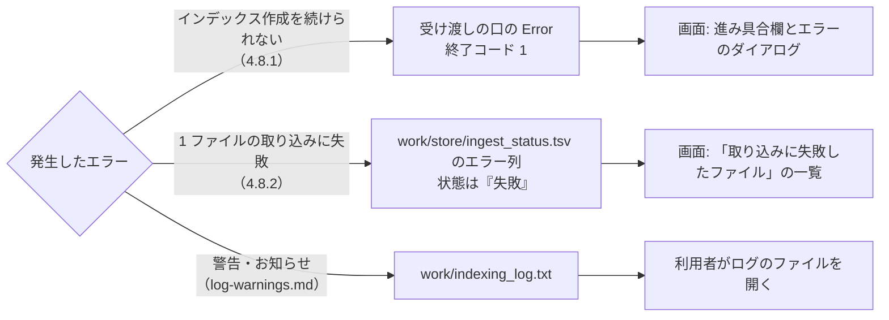

# エラーメッセージ一覧

扱うこと: インデクサが利用者に示すエラー・警告のメッセージ全文・発生条件・対処。扱わないこと: メッセージを起こす処理そのものの詳細（各処理のページ）。先に読むページ: [インデックス作成](index.md)。警告・お知らせは[インデックス作成ログの警告・お知らせ一覧](log-warnings.md)、置き場の安全確認のエラーは[置き場の安全確認のエラー](errors-store.md)にある。

インデクサ（`tebunko/indexer.ps1`・`indexer/indexer_run.ps1`）が利用者に示すエラー・警告の一覧。メッセージは種類によって記録先と画面での表示が異なる。

| 種類 | 記録先 | 画面での表示 | インデックス作成の続行 |
|---|---|---|---|
| 続けられないエラー（[続けられないエラー](#続けられないエラー)） | 受け渡しの口の `Error`（終了コード `1`）と `work/indexing_log.txt` | 進み具合欄に `インデックスを作成できませんでした` とメッセージ。エラーのダイアログ `インデックスを作成できませんでした。`＋メッセージ | 中止する |
| ファイルごとの失敗（[ファイルごとの失敗（取り込み一覧のエラー列）](errors-ingest.md#ファイルごとの失敗取り込み一覧のエラー列)） | `work/store/ingest_status.tsv` のエラー列（状態は `失敗`） | ［インデックス管理］タブの「取り込みに失敗したファイル」の一覧（[インデックス一覧の管理](../gui/index-tab.md)） | 次のファイルへ進む |
| 警告・お知らせ（[警告・お知らせ（インデックス作成ログ）](log-warnings.md)） | `work/indexing_log.txt` | ワークスペースの `indexing_log.txt` を開いて確認する | 続ける |

メッセージ中の `<…>` は実行時に埋め込む値。

利用者に出すエラー・警告の文言を足したら、この一覧・[ファイルごとの失敗](errors-ingest.md)・[インデックス作成ログの警告・お知らせ一覧](log-warnings.md)（[まとめ・置き場・後片付け](log-warnings-index.md)も）・[置き場の安全確認のエラー](errors-store.md)・[画面に出すメッセージの一覧](../gui/messages.md)のどれかに載せる（`tests/meta/error_messages.Tests.ps1` が確かめる）。

## 続けられないエラー

`invokeIndexer` が例外を受け、例外のメッセージをそのままログと受け渡しの口の `Error` に入れて終了コード `1` で終える（[インデックス作成のメインフロー](flow.md)）。`describeIngestError`（[失敗の原因](office-apps.md#失敗の原因describeingesterror)）は通さない。画面は終わったインデックス作成の `Error` を読んで表示する（`IndexingSession.GetError`）。
インデックス作成中にクロール対象フォルダが見つからなくなった場合だけは、`finally`（アプリの終了・取り込み一覧の書き直し）を確実に通すため、例外にせずに `Error` にメッセージを入れて終了コード `1` で終わる。

| メッセージ | 発生条件 | 対処 |
|---|---|---|
| `クロール対象フォルダがありません。画面でクロール対象フォルダを追加してください。` | 設定にクロール対象フォルダが 1 つも無い | 画面でクロール対象フォルダを追加する |
| `チェックの付いたクロール対象フォルダがありません。画面で取り込むフォルダにチェックを付けてください。` | クロール対象フォルダはあるが、すべてチェックなし | 取り込むフォルダにチェックを付ける |
| `setting.config を読み込めません。（<JSON の解析エラー>）` | 起動した後に `setting.config` が JSON として読めなくなった（手で編集して壊した等）。起動の時に壊れていたものは退避して既定の設定で起動する（[壊れた設定ファイルの退避](../structure/settings-file.md#壊れた設定ファイルの退避)） | `setting.config` を直す。直せなければ tebunko を閉じて `setting.config` を削除し（次の起動で既定の設定になる）、画面で設定し直す |
| `設定ファイルが壊れていたため、既定の設定で起動しました。ワークスペースの場所・登録したフォルダなども既定に戻っています。 元に戻すには、tebunko を閉じてから、退避したファイル（<パス>）を直して setting.config に置き換え、開き直してください。` | 画面なしで起動した `indexer.ps1` が、壊れた `setting.config` を退避した（ログの先頭に出る。続けて `クロール対象フォルダがありません。…` で終わる） | ログに出たパスの、退避したファイルを直して `setting.config` に置き換えるか、画面で設定し直す |
| `ほかのインデックス作成が実行中です。インデックス作成が終わってから実行してください。` | 同じ `work` のインデックス作成が既に動いている（`newAppMutex`。画面を使わずに起動したものと重なった場合） | 実行中のインデックス作成が終わるのを待つ。進み具合は画面で確認できる |
| `クロール対象フォルダが見つからなくなったため、インデックス作成を中止しました: <パス>（残り <N> 件は取り込まずに残しました。フォルダを使えるようにしてから、もう一度更新してください）` | インデックス作成中にクロール対象フォルダにアクセスできなくなった（ネットワークの切断・USB メモリの取り外し等）。残りのファイルをすべて失敗にしないよう中止する（[インデックス作成のメインフロー](flow.md)） | フォルダを使えるようにしてから、もう一度インデックス作成を始める（続きから取り込む） |
| `取り込みのスレッドが止まりました：<理由>` | 取り込みのスレッドが途中で止まった（部品を読み込めない等。[取り込みの並列化](parallel.md)）。理由が分からなければ `取り込みのスレッドが止まりました。` | メッセージと、`work/indexing_log.txt`（[警告・お知らせ](log-warnings.md)）の内容から原因を取り除き、もう一度インデックス作成を始める |
| `新しい版の tebunko で作られています` | ワークスペースのインデックスが、この版より新しい版の tebunko で作られている（目録の形式の版がこの版より新しい） | 新しい版の tebunko を使う |
| `古い形式です。作り直してください` | 古い形式（前の版）の本文インデックスを読もうとした | ［すべて更新］でインデックスを作り直す |
| `選んだインデックスに、更新できるものがありません。` | ［選んだインデックスだけ更新］で選んだインデックスが、どれも更新できない（元のフォルダが使えないなど。理由は[警告・お知らせ](log-warnings.md)の `更新できません`） | 元のフォルダを使えるようにしてから、もう一度選ぶ |
| `「<パス>」は空のフォルダではありません。ワークスペースには別の空のフォルダを選んでください（［設定］の［変更…］）。` | 既定のワークスペースの場所に、ほかのファイルが置いてある（インデックスのファイルと混ざるため、インデックス作成を始めない） | ［設定］の［変更…］で別の空のフォルダを選ぶ |
| （例外のメッセージそのまま） | 上記以外の予期しない例外。例: `work/store/ingest_status.tsv` をほかのアプリが開いていて書き込めない | メッセージと、`work/indexing_log.txt`（[警告・お知らせ](log-warnings.md)）の内容から原因を取り除き、もう一度インデックス作成を始める |

- `Error` が空の場合（インデクサが入れずにスレッドが止まった等）、画面はスレッドが止まった理由を表示し、それも無ければ `詳しくはログを確認してください。` と表示する。
- 受け渡しの口はインデックス作成 1 回ごとに作るため、前回のエラーは残らない。

## ファイルごとの失敗（取り込み一覧のエラー列）

1 ファイルの取り込みに失敗したときの文言は、[ファイルごとの失敗（取り込み一覧のエラー列）](errors-ingest.md)に載せている。
