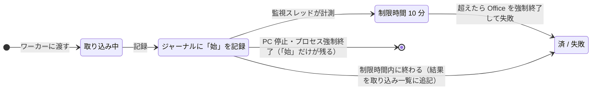
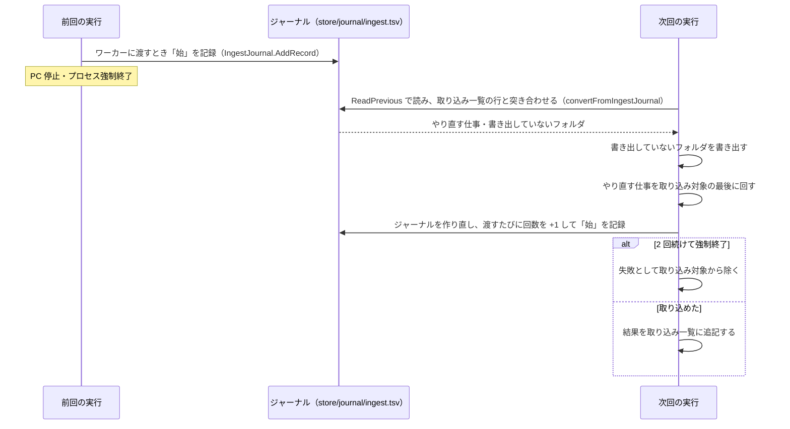

# 取り込み一覧

扱うこと: `work/store/ingest_status.tsv` の形式と書き込み方、強制終了・時間切れからの再開の仕組み。扱わないこと: インデックス作成全体の流れ（[インデックス作成のメインフロー](flow.md)）、取り込み対象をどう決めるか（[取り込み対象の決定](target-decision.md)）。先に読むページ: [インデックス作成](index.md)、[インデックス作成のメインフロー](flow.md)。

## 取り込み一覧 `work/store/ingest_status.tsv`

クロール対象フォルダ配下のファイルを 1 ファイル 1 行で記録する。UTF-8（BOM 付き）・タブ区切りで、Excel でそのまま開ける。

```
クロール対象フォルダ	C:\data\営業	営業
クロール対象フォルダ	D:\old\2019年度	2019年度
相対パス	更新日時	サイズ	状態	TSV数	取り込み日時	エラー	抽出版
営業\2024\見積\A社.xlsx	2025/01/10 12:34:56	10420	済	3	2026/09/19 10:00:35		2
営業\空ブック.xlsx	2025/01/10 12:34:56	8578	済	0	2026/09/19 10:00:35		2
営業\秘密.xlsx	2025/01/10 12:34:56	15360	失敗		2026/09/19 10:00:40	読み取りパスワードが設定されているため開けません（パスワード付きのファイルは取り込めません）	
2019年度\新規.docx	2026/09/18 09:00:00	20480	未取り込み				
```

| 列 | 内容 |
|---|---|
| 先頭の行 | `クロール対象フォルダ<TAB><パス><TAB><インデックス名>`。クロール対象フォルダ（チェックなしを含む）ごとに 1 行 |
| 相対パス | `<インデックス名>\<クロール対象フォルダからの相対パス>`（= `work/store/content` からの相対パス）。大文字・小文字は区別しない |
| 更新日時・サイズ | クロール時の元ファイルの更新日時（`yyyy/MM/dd HH:mm:ss`、`formatFileTime`）とバイト数。次回、これと比べて更新の有無を判定する |
| 状態 | `未取り込み`（取り込み待ち・中断。利用者の PowerPoint のために取り込めなかったファイルもここで、理由がエラーの列にある）/ `済` / `失敗` |
| TSV数 | 作成した TSV の数（= 場所の数。`済` のとき）。内容が空のファイルは `0`。本文インデックスに入れた後も値はそのまま（本文インデックスに入れる前の TSV が残っているときの確認に使う。[取り込み対象の決定](target-decision.md#取り込み対象の決定createtargetlist)） |
| 取り込み日時 | 取り込んだ（または失敗した）日時 |
| エラー | 失敗の原因（`describeIngestError` で例外から作る。[失敗の原因](office-apps.md#失敗の原因describeingesterror)。タブ・改行はスペースにする）。`未取り込み` の行には、利用者の PowerPoint のために取り込めなかった理由が入る（[エラーメッセージ](errors.md)）。エラーが空の `未取り込み` は、取り込み待ち・中断 |
| 抽出版 | 取り込んだ（`済`）ときの、その形式の読み取る内容の版（`getExtractVersion`。`indexer_decide.ps1` の `$extractVersions`）。今は `.xlsx` `.xlsm` が 4（グラフ・SmartArt・ヘッダー・フッターを読む・グラフの項目名を読まない）、`.docx` `.docm` `.doc` `.pptx` `.pptm` が 4（埋め込んだ Office のファイルの中の文字を読む・グラフの項目名を読まない）、`.ppt` が 2（図形・コメント等を読む）、`.xls` `.xlsb` は 1。今の版より小さければ、更新が無くても取り込み直す（[インデックス作成のメインフロー](flow.md)）。空は 1 とみなす |

書き込み方（`writeStatusFile` / `addStatusRow` / `readStatusFile`）:

- クロールの後に全ファイルを書き出す（一時ファイル `store\ingest_status.tsv.tmp` に書いてから置き換える）。
- インデックス作成中は 1 件ごとに結果の行を**末尾に追記**する。読み込み時は同じ相対パスの後の行を優先するため、途中で中断しても取り込み済みの結果は失われない。列数の合わない行（書き込み途中で強制終了した行）は無視する。
- 読み込み時、インデックス名（`クロール対象フォルダ` の行と、相対パスの先頭）が `testStoredIndexName`（`testIndexName` から予約名の拒みを外したもの。`aux.backup` のような既にある名前は通す）を通らない行、相対パスの残りに空・`.`・`..`・ファイル名に使えない文字の区切りがある行は読み飛ばし、数を `Rejected` で返す（ワークスペースは共有でき、ファイルは書き換えられうるため。読み飛ばした行は、次に書き直すときに消える）。インデックス作成は、読み飛ばした行があればその数を黄色のログに出す。`ingesting.txt` の行も同じ確かめを通す。
- `クロール対象フォルダ` の行の名前が `testStoredIndexName` を通らなくても、パスにして外へ出ない（`testPlainFolderName` を通る。前の版が作った最後が `.` や空白の名前など）ときは、行は読み飛ばし、名前を `LegacyFolders` で返す。`LegacyFolders` は、設定から外れたインデックスの確認と削除（`removeDroppedFolders`）にだけ使い、検索・取り込み・改名・削除の対象にはしない（確認で取りやめた回・確認の返事が無く打ち切った回・画面なしの実行では、フォルダの行は書き戻されて次の回もまた確認に出る。各ファイルの行は読み飛ばすため残らない）。
- 終了時（`finally`）に 1 ファイル 1 行に書き直す。インデクサが強制終了された場合は追記した行が重複して残るが、次回のクロール時に書き直される。

クラウドにだけあるファイル（[取り込み対象の決定](target-decision.md#クラウドにだけあるファイル)）で、ダウンロードせずに残したものの行は次のとおり。

| 前回の行 | 残したあとの行 |
|---|---|
| 無い（新規） | 行を作らない |
| 済・失敗 | 前回の行をそのまま残す |
| 未完了（`未取り込み`） | 行を作らない。取り込み途中のインデックスのフォルダも消す。確認で取りやめたときは、前回の行と取り込み済みの中身を残す（取り込み途中のフォルダは、実行の始めに本文インデックスのファイルへまとめるため、フォルダそのものは無くなる） |

済のファイルが、インデックスが無い・壊れているために取り込み直す対象になり、クラウドにだけあるため残したときは、前回の「済」の行がそのまま残る（インデックスは無いまま）。次のインデックス作成で、もう一度確かめる。

前の版が作った取り込み一覧をそのまま読めることの確かめ方は [前の版との互換](../index-data/format.md#前の版との互換)（列を足すと前の版の行を読めなくなる理由もそこに書く）。

## 強制終了・時間切れからの再開

大量のファイルを取り込むと、Office アプリが応答しなくなるファイル（壊れたファイル・非常に大きいファイル・表示されないダイアログで止まる等）で止まることがある。COM の呼び出しは応答が無いと戻らず、画面の［中止］（ファイルの切れ目で止まる）も効かないため、次の仕組みで同じファイルで止まり続けないようにする。



| 仕組み | 内容 |
|---|---|
| 1 ファイルの制限時間（`$fileTimeoutMinutes` = 10 分） | 取り込みのワーカーごとに、別のスレッド（監視。`OfficeWatchdog`）で制限時刻を監視する。制限時間を過ぎたら、そのスレッドが自分で起動した Office アプリ（`getApp` で PID を控えたもの。利用者のアプリ・ほかのワーカーのアプリは除く）を強制終了する。COM の呼び出しが例外で戻るため、そのファイルは `失敗`（エラー: `10 分以内に取り込みが終わらなかったため中止しました（Officeアプリを強制終了しました）`）とし、次のファイルへ進む。画面の［中止］のときも同じ見張りが、制限時間を待たずに自分のアプリを止める（そのファイルは失敗にせず「未取り込み」のまま残す）。強制終了したアプリはすべて終了扱いにし、次に必要になったときに起動し直す |
| 取り込みのジャーナル（`work/store/journal/ingest.tsv`） | 仕事（元のファイル 1 つの取り込み）の始まりと、フォルダの書き出しを、司令が 1 行ずつ追記して Flush する（`IngestJournal`）。ファイルを取り込みのワーカーに渡すときに「始」（相対パスと、続けて取り込みを始めた回数）を書く。結果は取り込み一覧に追記するだけで、ジャーナルには書かない（行があれば、その仕事は終わったと読める）。インデックス作成の終わりに「終」を書く。中止・続けられないエラーでも `finally` で書く（書き出せなかったフォルダがあるときを除く）。PC が停止した・プロセスが強制終了された等の場合は「終」が無いまま残り、次の始めに読む。行の形と読み方は [ジャーナルの形](#ジャーナルの形) |
| PowerPoint が要るファイルの後回し（Postponed） | PowerPoint は 1 つのセッションに 1 つのプロセスしか持てないため、利用者が PowerPoint を開いていると接続することになり、固まっても止められない（[Word・PowerPoint の共通処理と Office アプリの管理](office-apps.md#office-アプリexcelwordpowerpointの管理)「PowerPoint」）。そこで、そもそも接続せず、そのファイルを取り込まず、**失敗として数えて理由を見せる**（`indexer_run.ps1` の司令が `Postponed` の結果を受けたとき。`StatusLedger.AddFailure` に理由を入れ、進み具合の失敗の件数と、終わりの「更新に失敗したファイル」に出す。インデックスは変えない）。取り込み一覧の行は状態を「未取り込み」のまま、理由を「エラー」の列に書く（前回の行があれば、TSV 数・取り込み日時・抽出版は前回のまま残す。無ければ新しい行にする）。ワーカーに渡していた仕事は、この行を追記する（ジャーナルが、その仕事は終わったと読めるように。中止で止めた仕事も、今の行を追記する）。**状態を「失敗」にしない**のは、「失敗」の行は次の更新で飛ばされ、失敗分の再取り込みを選ばないと取り込まないため。「未取り込み」なら、利用者が PowerPoint を閉じてからの次のインデックス作成で、選ばなくても取り込む。「未取り込み」でエラーが空でない行は、`testStatusRowFailed`（`index_store.ps1`）で失敗に数える（`getIndexingState`・`getIndexStats`）。理由は 2 つある（`indexer_decide.ps1` の `postponedReasonRunning`・`postponedReasonInUse`。文は [エラーメッセージ](errors.md)）。利用者が PowerPoint を閉じれば、次のインデックス作成で取り込む（この扱いは PowerPoint だけ。Word は利用者のアプリを共有するため、Excel は新しいプロセスを起動して利用者が開いたファイルを渡すため、取り込めないことがない）（強制終了の回数には数えない。取り込み中に強制終了した場合とは別の扱い）。取り込み中に利用者が PowerPoint の窓を使い始め、制限時間を過ぎても、その PowerPoint は強制終了しない。そのワーカーを諦め、取り込み中のファイルと残りの PowerPoint のファイルを、同じく取り込まず、使っている方がいた理由で失敗として見せる（状態は「未取り込み」のまま。詳しくは [Office アプリの管理](office-apps.md#office-アプリexcelwordpowerpointの管理)「利用者が使っている PowerPoint」） |



### ジャーナルの形

`work/store/journal/ingest.tsv`（UTF-8 BOM 付き・CRLF）は、1 行に 1 記録で、先頭の列が記録の種類。書くのは司令だけで、1 行ずつ追記して Flush する。追記した行は、強制終了しても残る。

| 種類 | 列 | 書くとき |
|---|---|---|
| `版` | 格納形式の版（`2`） | ファイルの先頭の 1 行。版が違えば、読まずに捨てる |
| `回` | 日時・取り込み一覧のデータ行の数 | 1 回の始め。取り込み一覧を書き直したあとの行数 |
| `持` | 相対パス・回数 | 前回から持ち越した、まだ渡していない仕事 |
| `始` | 相対パス・回数 | 仕事をワーカーに渡すとき。回数は今回を含めた、続けて取り込みを始めた回数 |
| `出` | インデックスのフォルダからの相対パス | フォルダを本文インデックスのファイルへ書き出したとき |
| `書` | – | 取り込み一覧を書き直す前。行の位置の対応が崩れるため、前の回の「始」はすべてやり直す |
| `終` | – | インデックス作成の終わり。書き出せなかったフォルダが無いときだけ書く |

知らない種類の行と余分な列は読み飛ばす。最後の行が改行で終わっていなければ（書いている途中で止まった）、その行を捨てる。

次回の実行時（取り込み対象の決定の前、`convertFromIngestJournal`。判断層）:

- **書き出していないフォルダ**: 「始」があって「出」が無い仕事のフォルダ（`終` があっても）。TSV を置いたが本文インデックスのファイルに入れていないかもしれないため、始めに書き出す（`PendingPublish` の書き出しは、同じ仕事をもう一度やり直して書き出しても同じ結果になる）。中止を求められていれば飛ばし、書き出せなかったときは、ジャーナルを作り直さずに残す（次の始めにもう一度読む）。
- **やり直す仕事**: 「始」を書いたあと、この回（`回` の行数より後ろ）の取り込み一覧の行が無い仕事。後回し・中止の仕事も、渡した仕事は行を追記するため、止まったと見ない。「持」だけで「始」が無い仕事は、回数のまま持ち越す。「始」が同じ仕事に何度もあれば、最後の行を使う。`書` があるとき、`回` の行数が取り込み一覧より多いとき（外から書き換えられた）は、行を見ず、「始」の仕事をすべてやり直す。`終` があれば、やり直す仕事は無い。
- やり直す仕事が取り込み対象にあれば、取り込み対象の**最後に回す**（`前回、取り込み中に強制終了したファイルは最後に取り込みます: <相対パス>`）。他のファイルの取り込みが先に進む。
- 回数が `$interruptLimit`（2）以上の仕事は、応答しなくなるファイルとみなして `失敗`（エラー: `取り込み中に 2 回続けて強制終了されたため、取り込みを中止しました（…）`）とし、取り込み対象から除く。以降は他の失敗と同じく、画面で「失敗分も再取り込みする」を選ぶ（`-RetryFailed`）か元ファイルが更新されたときに取り込み直す。
- 取り込み対象に無い（取り込み済み・削除された等）仕事は、何もしない。
- 読み終えたら、ジャーナルを `版`・`回`・`持`（まだ渡していない仕事）だけの新しいものに入れ替え（一時ファイルに書いて入れ替える）、この回の記録を追記していく。

取り込み一覧は、取り込みの途中は行を追記するだけで、1 ファイル 1 行にまとめ直すのは終わりの直前（ジャーナルに `書` を書いてから）。そのため、作成中に取り込み一覧の行が 1 件ごとに増え、画面が読む取り込み済み・失敗の件数も途中で増える。前の版が作った `work/ingesting.txt` が残っていれば、始めに 1 度だけ読んで「やり直す仕事」に足し、ジャーナルを作り直したあとで消す（`readLegacyIngesting`・`removeLegacyIngesting`）。

**限りがあること**: 強制終了のあと、次の実行の前に取り込み一覧が外から書き換えられると、行の位置の対応が崩れることがある。その場合も、影響は回数が合わないことだけで、取り込みはやり直される（取り込み一覧の行数が `回` の行数より少なければ、「始」の仕事をすべてやり直す）。
