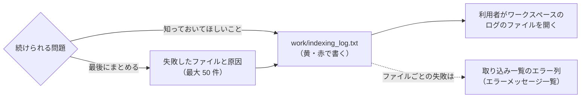

# インデックス作成ログの警告・お知らせ一覧

扱うこと: インデックス作成が続けながら `work/indexing_log.txt` に書く警告・お知らせの文言・発生条件。扱わないこと: インデックス作成を止めるエラー・ファイルごとの失敗（[エラーメッセージ一覧](errors.md)）、置き場の安全確認のエラー（[置き場の安全確認のエラー](errors-store.md)）。先に読むページ: [インデックス作成](index.md)・[エラーメッセージ一覧](errors.md)。

利用者に出す警告・お知らせの文言を足したら、この一覧に載せる（`tests/meta/error_messages.Tests.ps1` が、`writeIndexerLog` に Yellow・Red で渡す文言がこの一覧・[エラーメッセージ一覧](errors.md)・[画面に出すメッセージの一覧](../gui/messages.md)のどれかにあることを確かめる）。



インデックス作成は続けるが、利用者が知っておくべき内容。`work/indexing_log.txt` に記録する（ワークスペースのフォルダから開く）。

| メッセージ | 発生条件 |
|---|---|
| `  [<インデックス名>] <パス> … フォルダが見つからないため取り込みません` | チェックの付いたクロール対象フォルダが存在しない。そのフォルダのインデックスは残す |
| `    アクセスできないフォルダがあったため、元ファイルが無くなったかどうかの確認は行いませんでした。` | クロール対象フォルダの中にアクセスできないフォルダがあった。元ファイルが無くなったインデックスの削除を行わない（[取り込み一覧](ingest-list.md)） |
| `    インデックス（TSV）が無くなった・壊れている <N> 件は取り込み直します。（インデックスを直接削除した・0 バイトのTSVが残っている）` | 取り込み一覧が `済` なのに、インデックスの TSV が無い・足りない・0 バイトのものがある（`testIndexComplete`。[取り込み対象の決定](target-decision.md#取り込み対象の決定createtargetlist)） |
| `  インデックスのフォルダを調べられないため、インデックスが残っているかの確認は行いません。` | `work/store/content` を列挙できなかった（アクセス権が無い等）。取り込み一覧の `済` をそのまま信じる |
| `    元のファイルが無くなったため、取り込まずに一覧から除きます。（移動・削除・名前変更された）` | 取り込み対象を調べてから取り込むまでの間に、元のファイルが無くなった。失敗にはせず、TSV を削除して一覧から除く |
| `取り込みの直前に元のファイルが無くなった <N> 件は、取り込まずに一覧から除きました。` | 同上（インデックス作成の最後にまとめて表示する） |
| `前回取り込みに失敗し、その後更新されていないファイル <N> 件はスキップします。（パスワード付きなど）` | 前回失敗したファイルがあり、「失敗分も再取り込みする」を選ばなかった |
| `前回、取り込み中に強制終了したファイルは最後に取り込みます: <相対パス>` | 前回、このファイルの取り込み中にインデクサが強制終了した（[取り込み一覧](ingest-list.md)） |
| `取り込み中に <N> 回続けて強制終了したファイルは、失敗としてスキップします: <相対パス>` | 同じファイルで続けて強制終了した。[ファイルごとの失敗（取り込み一覧のエラー列）](errors-ingest.md#ファイルごとの失敗取り込み一覧のエラー列) のメッセージで失敗にする |
| `    <シート名> の使用範囲を縮められませんでした: <メッセージ>` | 使用範囲がデータよりずっと広いシートで、一時シートを作れなかった（ブックの構成が保護されている等。[Excel の抽出処理](excel.md#excel-の抽出処理extractworkbook)）。そのシートはそのまま書き出す（時間切れで失敗することがある） |
| `    図形・コメントを読み取れませんでした: <メッセージ>` | 新形式（ZIP）のブックの図形・コメントを読めなかった（ZIP・XML が壊れている等。[Excel の図形・コメントの読み取り](excel.md#excel-の図形コメントの読み取りreadxlsxobjectunits)）。セルの値は取り込む（図形・コメント・ヘッダー・フッターの文字は検索できない） |
| `    一部を読み取れませんでした: <部品名>` | 1 つの部品を読めなかった（XML が壊れている、「サイズの上限」を超える等）。部品は、図形の中の 1 つのグラフ・SmartArt（`xl/charts/chartN.xml`・`xl/diagrams/dataN.xml`。[グラフ・SmartArt の読み取り](excel.md#グラフsmartart-の読み取り)）か、シートのヘッダー・フッター（`xl/worksheets/sheetN.xml`。[ヘッダー・フッターの読み取り](excel.md#ヘッダーフッターの読み取り)）。その部品だけを空にし、ほかの文字・図形・コメント・セルの値は取り込む |
| `    予備の読み取りに失敗しました: <元のメッセージ>` | 「形式の分からないバイナリ」（[暗号化されたファイルの判定](office-apps.md#暗号化されたファイルの判定office_protectionps1office_protection_viewps1)）を予備でWord・PowerPointに開かせたが失敗した。取り込み一覧には `暗号化されているか壊れているため取り込めません。` に言い換えて記録する |
| `    暗号化の判定: <種類>` | 暗号化されたファイルの判定（[暗号化されたファイルの判定](office-apps.md#暗号化されたファイルの判定office_protectionps1office_protection_viewps1)）で、`Password`（パスワード付き。新形式）・`Rights`（IRM・秘密度ラベル）・`Unknown`（形式の分からないバイナリ）のいずれかと判定した（`logProtectionKind`）。旧形式・ふつうのテキストとして開くもの（`Legacy`・`Text`）は書かない |
| `    取り込みに失敗しました: <原因>` | 1 ファイルの取り込みに失敗した（原因は [ファイルごとの失敗（取り込み一覧のエラー列）](errors-ingest.md#ファイルごとの失敗取り込み一覧のエラー列) のメッセージ） |
| `中止の要求を受けたため、インデックス作成を中止します。（残り <N> 件は次回取り込みします）` | 画面の［中止］が押され、次のファイルを渡す前に止めた（終了コード `2`） |
| `中止の要求を受けたため、インデックス作成を中止します。（取り込み中だったファイルと残りは次回取り込みします）` | 画面の［中止］が押され、取り込みのスレッドから「止めた」と戻ってきた（終了コード `2`） |
| `中止のため、取り込みませんでした（次回取り込みします）: <相対パス>` | 中止で止めた、または始めていなかったファイル（失敗に数えず、一覧は「未取り込み」のまま） |
| `前回取り込んだときのサブフォルダの設定を保存できませんでした。画面の［要更新］の判定が実際と合わないことがあります。（<原因>）` | 取り込み終えたあと、設定の `ingestedSubfolders`（前回取り込んだときの `subfolders`）を書けなかった（黄。取り込みの結果は変えない。終了コードにも影響しない） |
| `中止の要求を受けたため、取り込み対象の一覧化を中止しました。（取り込み一覧は前回のままです）` | クロール中に［中止］が押された（終了コード `2`。確認は出さない） |
| `    <アプリ名> の終了に失敗しました: <メッセージ>` | Excel・Word・PowerPoint を終了できなかった。残ったものは、次に画面を起動したときの確認で終了する。**注**: 今の実装（`shared/office/office_app.ps1` の `Write-Host`）ではログに残らず、取り込みのスレッドからは表示もされない |
| `    終了したプロセスの作業フォルダを削除できませんでした: <パス>（<原因>）` | 前の（終了済みの）プロセスの作業フォルダを片付けるとき（`removeStaleProcessDirs`）に、使用中・リンクかどうか確かめられないフォルダがあるなどで削除できなかった。次回のインデックス作成時にもう一度試す |
| `    作業フォルダを削除できませんでした: <パス>（<原因>）` | 終了時に作業領域（`work/tmp/<PC の鍵>/<PID>`）または `work/publish/<PID>` を削除できなかった（使用中・リンクかどうか確かめられないフォルダが中にある、など。原因はメッセージに出る）。次回のインデックス作成時に削除する |
| `ワークスペースのパスに [ ]（角かっこ）が含まれるため、取り込みの作業フォルダを置けません。取り込みをすべてスキップします。` / `ワークスペースのパスが長すぎるため、取り込みの作業フォルダを置けません。取り込みをすべてスキップします。` / `ワークスペースの作業領域の途中にリンク（ジャンクション・シンボリックリンク）があるため、更新の作業フォルダを置けません。取り込みをすべてスキップします。` | インデックス作成の始め（`initTmpDir`）に、作業フォルダ（`work/tmp/<PC の鍵>/<PID>`）を置けないと分かった（`selectTmpDir`。リンクのときは、`tmp\<PC の鍵>` から下の途中にリンクがあるとき。[ファイルの読み書きの範囲](../../safety/file-access.md)。[データの置き場所とパスの決め方](../structure/data.md)）。どのファイルも中間 TSV などをこのフォルダに作るため、テキストファイルを含めこの回のファイルをすべてスキップし、ファイルごとに上の (1) のメッセージで失敗にする |
| `画面からの返事が 60 分ありませんでした。インデックス作成を取りやめます。` | 取り込み前の確認（受け渡しの口の `ConfirmTargets`）で取り込み対象を画面に出した後、60 分待っても返事が無かった。1 件も取り込まずに終了コード `2` で終わる |
| `画面で取りやめたため、取り込みません。（取り込み一覧は前回のままです）` | 確認で［キャンセル］が押された、または上の返事の待ち時間を過ぎた（終了コード `2`） |
| `    埋め込みを読み取れませんでした: <メッセージ>` | Word・PowerPoint・Excel に埋め込まれたファイルを読めなかった（壊れている・上限を超える等）。その埋め込みだけを飛ばし、ほかの文字は取り込む（`extractDocument`） |
| `    サイズの上限（<上限の種類>）を超えました: <部品名>（<大きさ>）` | `.docx` `.pptx` `.xlsx` の部品か合計が上限を超えた。取り込み一覧には短い失敗の文言だけを書き、原因を調べるための詳細をここに書く（`writeZipSizeLimitLog`。[ファイルごとの失敗](errors-ingest.md#ファイルごとの失敗取り込み一覧のエラー列)の `ファイルサイズが大きすぎるため更新できません。`） |
| `    サイズの上限（1ファイルの合計）を超えました: <部品名>（<大きさ>）` | 上の行のうち、1 つのファイルの部品を展開した大きさの合計が上限を超えた。大きさは `<N> バイト、約<M>MB` の形 |
| `    サイズの上限（埋め込みから出す文字の合計）を超えました: <部品名>（<大きさ>）` | 上の行のうち、埋め込みから出す文字の数が上限を超えた。大きさは `<N> 文字、約<M>M文字` の形 |
| `    サイズの上限（部品ごと）を超えました: <部品名>（<大きさ>）` | 上の行のうち、1 つの部品の大きさが上限を超えた。大きさは `<N> バイト、約<M>MB` の形 |
| `    リンク（ジャンクション・シンボリックリンク）のため取り込みませんでした: <パス>` | クロール中に、リンクのフォルダ・ファイルを見つけた。リンクの先は読まない（`createTargetList`。[ファイルの読み書きの範囲](../../safety/file-access.md)） |
| `    インデックスの置き場の外を指すパス（途中のリンクを含む）のため、削除しませんでした: <パス>` | 元のファイルが無くなったインデックスのフォルダを消すとき、そのパスが置き場の外を指す・途中にリンクがある（`removeBookDir`）。消さずに続ける |
| `    [<インデックス名>] 更新できません（<理由>）` | 選んだインデックスの更新（［更新］の対象の絞り込み）で、そのインデックスの元のフォルダが使えないなど、更新できない（`SelectOnly`）。ほかの選んだインデックスは続ける |
| `<アプリ名> のファイルの一覧を読めなかったため、終了させずに残しています（あとで読み直します）` | 利用者に渡す Office アプリが開いているファイルの一覧を読めなかった。終了させずに、あとでもう一度読む（[Office アプリの管理](office-apps.md#office-アプリexcelwordpowerpointの管理)） |
| `開かれたファイルがあるため <アプリ名> を利用者に渡しましたが、窓や設定を戻しきれませんでした（終了させずに残しています）` | 取り込み中に利用者がファイルを開いた Office アプリを利用者に渡したとき、窓や設定を元に戻しきれなかった。終了させずに残す |
| `段階ごとの時間（秒）: 起動 <秒>（うちまとめ <秒>） / クロール <秒> / 取り込み <秒>（うちまとめ <秒>） / 仕上げのまとめ <秒> / gram 索引 <秒> / その他 <秒> / 全体 <秒>`（画面の返事を待ったときは、続けて ` / 画面の確認待ち <秒>（全体に含めない）`） | インデックス作成の終わりに 1 回。完了・中止・続けられないエラーのどれでも、そこまでの分を出す。段階は重ならない（取り込みの中のまとめは「取り込み」に含め、「うちまとめ」に別に出す。合計には足さない）。「その他」は全体から段の合計を引いた残り（取り込みのスレッドの始まり・取り込み一覧の書き直し・Office の終了など）。画面の確認の返事を待った時間は全体から除く |
| `  <拡張子> <N> 件: 抽出 <秒> / コピー <秒> / 置き場への移し <秒> / 1 件 <ミリ秒> ms（失敗 <N>・回し直し <N>・後回し <N>）` | 上の行に続けて、取り込みの種類（拡張子。小文字）ごとに 1 行（抽出の時間の長い順）。件数は成功 + 失敗。抽出・コピー・置き場への移しは、取り込みのスレッドが測った時間の合計（スレッドが並ぶので、取り込みの経過より大きくなりうる）。1 件は成功した分の（抽出 + コピー + 置き場への移し）の平均（成功が 0 件なら `-`）。回し直しは Office のスレッドへ回した分、後回しは中止・利用者の PowerPoint・諦めたスレッド（回し直し先の持ち主が諦めていた分を含む）で次回に回した分 |

インデックスのまとめ・gram 索引・目録・前の版・作業フォルダの後片付けの警告は、[警告・お知らせ一覧（まとめ・置き場・後片付け）](log-warnings-index.md)に載せている。

インデックス作成の最後には、失敗したファイルと原因をまとめて記録する（最大 `$failureListLimit` = 50 件。残りは件数だけ）。

```
＜取り込みに失敗したファイルと原因＞
  営業\秘密\顧客リスト.xlsx
    → 読み取りパスワードが設定されているため開けません（パスワード付きのファイルは取り込めません）
  ほか 12 件（原因は一覧の「エラー」列）

失敗したファイルは、画面で「失敗分も再取り込みする」を選んで取り込むと再取り込みします。
```
