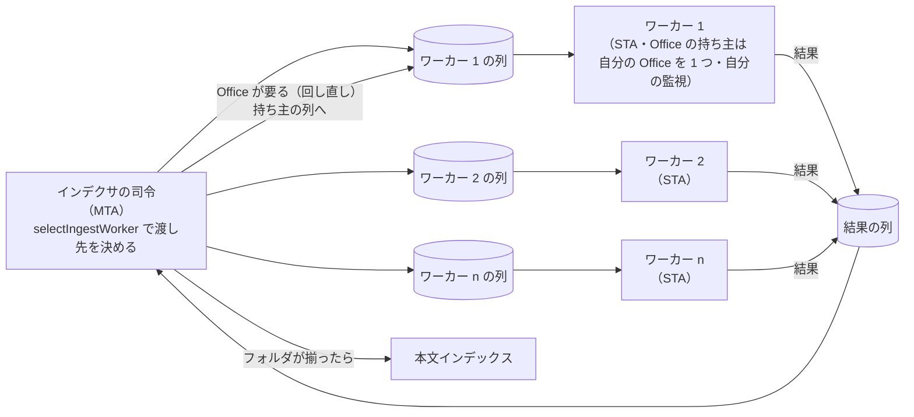
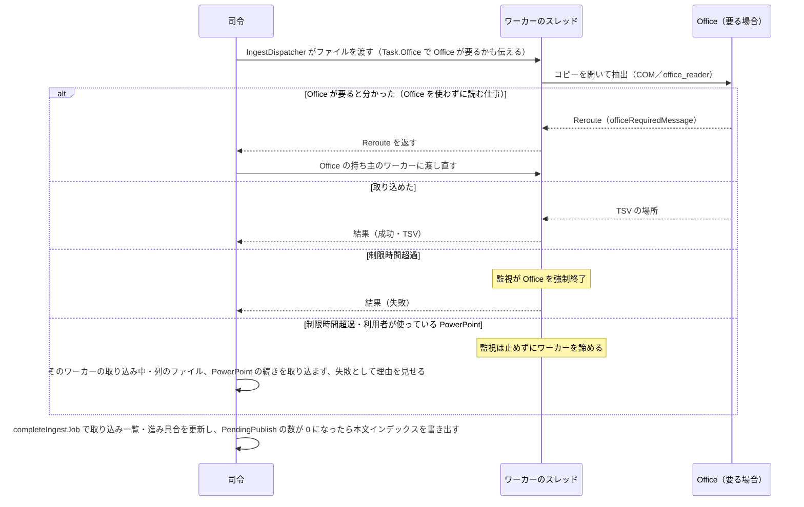

# 取り込みの並列化

扱うこと: 取り込みのワーカーと、司令・取り込みスレッド・監視の役割分担、Office の起動し直しと制限時間、中止のときの片づけ、実測。扱わないこと: メインフローそのもの（[インデックス作成のメインフロー](flow.md)）、スレッド・プロセス全般の一覧（[プロセスとスレッド](../structure/threads.md)）。先に読むページ: [インデックス作成のメインフロー](flow.md)。

インデクサの司令が取り込み対象を並べ、取り込みのワーカーに 1 ファイルずつ渡す。ワーカーは 1 種類で、どれも同じスクリプトを動かし、どの種類のファイルも受けられる（STA）。ワーカーごとに列と取り込みスレッドを持つ。取り込みスレッドは結果（成功・失敗・TSV の場所）を返し、書き出しは司令がまとめて行う。

Office のアプリ（Excel・Word・PowerPoint）は、そのアプリのファイルを最初に受けたワーカーが「持ち主」になる。Office の COM を呼ぶのは持ち主のスレッドだけで、アプリごとに起動する Office は最大 1 つになる。

| 仕事 | 対象（拡張子） | 渡し先のワーカー | Office |
|---|---|---|---|
| Excel | `.xls*`（すべての Excel のファイル。セルの表示値を読むため Excel が要る） | Excel の持ち主 | Excel を 1 つ |
| Word | `.doc` | Word の持ち主 | Word を 1 つ |
| PowerPoint | `.ppt` | PowerPoint の持ち主 | PowerPoint を 1 つ |
| Office を使わずに読む | `.docx`・`.docm`・`.pptx`・`.pptm`・テキスト・PDF など | 持ち主でない、いちばん空いているワーカー（無ければいちばん空いているワーカー） | 使わない |

ワーカーの数は、Office を使わずに読む仕事の数（設定 `ingestThreads`。1〜4。0 はコア数 − 1 で 1〜4。取り込むファイルの数より多くはしない）に、この回に要る Office のアプリの数（最大 3）を足した数である。0 のときは、取り込みのスレッドを使わず、司令のスレッドで取り込む。

- **渡し先は判断層が決める**（`selectIngestWorker`・`getIngestApp`・`getRerouteApp`。判断層の `indexer_decide.ps1`）。Excel のファイルはセルの表示値を読むため、すべて Excel の仕事にする。Word・PowerPoint は、旧形式（`.doc`・`.ppt`）だけ Office の仕事にし、新形式は Office を使わずに読む仕事にする。テキストの拡張子（`.txt` 等）や PDF は、どの分岐にも当たらないため Office を使わずに読む仕事になる（[テキストファイルの読み取り](text.md)）。
- **Office は種類ごとに 1 つだけ起動する。** あるアプリのファイルは、そのアプリの持ち主のワーカーにだけ渡す。持ち主がまだいなければ、持ち主のいないワーカーのうちいちばん空いているものを持ち主にする（持ち主のいないワーカーが 1 つも無ければ、いちばん空いているワーカーが 2 つ目以降のアプリも持つ）。インデックス作成が起動する Office は、Excel・Word・PowerPoint がそれぞれ最大 1 つになる。PowerPoint も、持ち主が一度起動したら使い回す（変換のたびに起動し直さない）。同じ種類の Office を複数のスレッドが同時に起動しないため、起動の前後のプロセスの一覧の差で PID を取り違えない。起動した Office の優先度は変えない（[スレッドの一覧](../structure/threads.md#スレッドの一覧)）。起動した Office の PID は受け渡しの口（`OfficePids`）に記録する。
- **ワーカーのスレッドは、そのワーカーにファイルを初めて渡すときに始める**（`IngestDispatcher` の `Submit`）。渡すファイルが無いワーカーは、スレッドも Office も作らない。列は `IngestDispatcher` の `Start` がワーカーごとに作る（`BlockingCollection`）。
- **ファイルごとに、Office を使うかを決める。** 渡すファイルの `Task.Office` が偽のとき、ワーカーは Office を使わずに `office_reader` で ZIP（XML）の形式を直接読む。真のときは Office の COM で読む。ワーカーを動かすスクリプトは 1 種類だけで、これで取り込み方を切り替える。スレッドを使わないとき（司令のスレッドで取り込むとき）は `Task.Office` を付けず、今までどおり動く。
- **Office が要ると分かったファイルは、Office の持ち主のワーカーに回し直す。** 新形式の拡張子でも、中身が ZIP でない（パスワード付き・中身が旧形式）ことがある。`extractDocument` が `${officeRequiredMessage}`（`このファイルの取り込みには Word・PowerPoint が要ります。`）の例外を投げ、`invokeIngestTask` が `Reroute` を返す。司令は同じファイルを Word または PowerPoint の持ち主（`getRerouteApp`）に渡し直す。回し直しは、渡してある数の上限を超えても渡す（持ち主が取り込み中でも列に足す）。回し直す間も取り込み中のまま扱う。ZIP でも旧形式でもない PowerPoint のファイル（壊れている）は、回し直さずに失敗にする。パスワード付き（新形式）・IRM・秘密度ラベルの暗号化（[暗号化されたファイルの判定](office-apps.md#暗号化されたファイルの判定office_protectionps1office_protection_viewps1)）も、回し直さずにその場で失敗にする（Officeが要らないため）。「形式の分からないバイナリ」は、アプリごとの予備が有効なときだけ今の旧形式と同じく回し直す。
- **判定でOfficeにまだ触れていない失敗は、`stopApp` を呼ばない。** パスワード付き・IRM・「形式の分からないバイナリ」（予備が無効）の失敗は、例外の `Data` に印（`throwProtectionFailure`）を付け、`invokeIngestTask` がそれを見て、そのワーカーのOfficeを終了し直さずに次のファイルへ進む。IRM・パスワード付きのファイルが並んでも、そのたびにOfficeを起動し直して遅くならないため。
- **並びの先を見て、空いているワーカーに渡す。** 司令は、まだ渡していない最初のファイルから `${ingestLookAhead}`（200 件）先までを見て、ワーカーに空きがあるファイルを渡す。ワーカー 1 つに渡しておける数は 2（取り込み中の 1 件と次の 1 件）である。Excel のファイルが続いても、Office を使わずに読むワーカーを遊ばせない。取り込む順は取り込み一覧の順と変わることがあるが、結果（取り込み一覧・本文インデックス）は同じになる。
- **監視はワーカーごとに持つ。** どのワーカーも、始めるときに自分の監視のスレッドを作る（`OfficeWatchdog` の `Start`）。監視は、そのスレッドの制限時間だけを見て、そのスレッドが起動した Office だけを PID で止める。制限時間と中止の見張りが働くのは、Office を使うファイル（`task.Office`）を取り込んでいる間だけで、Office を使わずに読むファイルの間は `Deadline` を入れず、見張りは何もしない（Office を持つワーカーが PDF などを読んでいても、遊んでいる Office を止めず、そのファイルは読み終わるまで待つ）。ただし、取り込み中に利用者が窓を開いた PowerPoint は、制限時間を過ぎても止めない（窓を一度でも見た印がある間。[Office アプリの管理](office-apps.md#office-アプリexcelwordpowerpointの管理)）。止めない代わりにそのワーカーを諦める。諦めたワーカーの取り込み中・列のファイルと、持ち主が諦めたワーカーのアプリのファイルは、取り込まず、失敗として理由を見せる（状態は未取り込みのまま）。ほかのワーカーは取り込みを続ける。
- **Office の起動し直しと制限時間は、ワーカーごとに数える。** ワーカーごとに 100 ファイルで起動し直す（Office を使ったファイルだけを数え、取り込んだあとに起動し直す）。1 ファイルの制限時間は 10 分。
- **一時フォルダはスレッドごとに分ける。** 作業領域の `<PID>\w<番号>`（`newWorkerTmpDir`）と、`publish` の `w<番号>` を使う。
- **本文インデックスはフォルダが揃ってから書く。** 司令は、はじめにフォルダごとのファイルの数を `PendingPublish.AddPending` で数えておき、ファイルを渡すたびに `Dispatch`、結果を受け取るたびに `Complete`（または渡さずに済ませるとき `Skip`）を呼ぶ。結果を受け取るたびに、取り込み中の数・まだ渡していない数がどちらも 0 になったフォルダの本文インデックスを書き出す（`indexer_run.ps1` の `flushPendingPublish` が `PendingPublish.TakeFlushable` を呼ぶ）。
- **取り込み一覧と進み具合は司令だけが書く。** 取り込みスレッドは結果を結果の列（`BlockingCollection`）に入れるだけで、取り込み一覧（`addStatusRow`）・進み具合は司令が書く。結果の受け方は `completeIngestJob`（`indexer_run.ps1`）にまとめてあり、成功・失敗・後回し・中止のどれも同じ関数が反映する。ログも、取り込みスレッドが 1 ファイル分を貯めて結果と一緒に返し、司令が書く。
- **ワーカーに渡した仕事は、すべてジャーナルに「始」で記録する**（`work/store/journal/ingest.tsv`。書くのは司令だけ）。強制終了の後は、結果の行が取り込み一覧に無い仕事すべてを「前回止まった仕事」として扱う（[ジャーナルの形](ingest-list.md#ジャーナルの形)）。
- **中止。** 司令は振り分けをやめ、Office を使っているファイル（回し直したものを含む）の取り込みは待たずに止める（Office を使わずに読んでいるファイルは、下の表のとおりそのファイルの読み取りが終わるまで待つ）。Office を持つワーカーは、見張りが `Channel.Stop` を見て自分が起動したアプリを止め（`Cancelled`。`TimedOut` ではない）、`invokeIngestTask` が `Stopped` を返す。列に残っていたファイルも `ingestFile` を呼ばずに `Stopped` で返る。`Stopped` のファイルは、一覧の行を作らず、一時の TSV も本文インデックスに入れない（「未取り込み」のまま次回取り込む）。そのあとに書き出しと Office の片づけを行う。

  中止が待つものは次のとおり。

  | 場面 | 中止が待つもの |
  |---|---|
  | クロール（一覧化） | フォルダごとと、100 ファイルごとの確認（それ以上は待たない） |
  | 列で始めていないファイル | 待たない（`ingestFile` を呼ばず `Stopped`） |
  | Office を使って取り込み中 | 見張りの周期（500 ミリ秒）と、アプリの終了 |
  | Office を使わずに読んで取り込み中 | そのファイルが終わるまで（打ち切りは範囲外） |

  各ワーカーのスレッドは、列が閉じられたら自分の Office を終了して終わる（`IngestDispatcher` の `Stop`）。
- **取り込みスレッドが止まったら。** 取り込みスレッドが途中で止まった（読み込めない等）ときは、インデックス作成を続けられないエラー `取り込みのスレッドが止まりました：<理由>` にする。

`setting.config` の `ingestThreads` で変えられるのは、Office を使わずに読む仕事の数だけである。Office のアプリ（Excel・Word・PowerPoint）の分のワーカーは、いつも 1 つずつ・Office 1 つにする。

取り込みのスレッドを使うときは、はじめにログに `N 件のファイルを取り込みます。（Office を使わずに読むファイルは R 個のスレッド、Excel・Word・PowerPoint のファイルはそれぞれ 1 つのスレッド（Office も 1 つ）で並べて取り込みます。…）` と出す。

テストでは受け渡しの口の `Workers` を 0 にし、すべてのファイルの取り込みを司令のスレッドで行う（途中に割り込むため）。テストデータ（300 ファイル）で、スレッド 1 つと 4 つの結果（本文インデックスと取り込み一覧）が同じになることを確かめた。

速さは、空いている CPU の量で決まる。1 ファイルの取り込みには、Excel と PowerShell で約 1 コアを使う。スレッドと Office の両方の優先度を下げると、ほかのアプリが約 2 コアを使っている PC で、両方 Normal より 1〜2 割遅くなる（性能データ 1,080 ファイル。取り込みのスレッド 1 つ 518 秒、3 つ 456 秒。両方 Normal では 398 秒）。PowerPoint を変換のたびに起動し直すと旧形式 1 件に約 7 秒かかり、使い回すと約 0.25 秒である。

時間は、インデックス作成ログの終わりに出す「段階ごとの時間」と、種類（拡張子）ごとの行で測る（[警告・お知らせ](errors.md#警告お知らせインデックス作成ログ)）。段階は起動・クロール・取り込み・仕上げのまとめ・gram 索引・その他に重ならないように切り、取り込みの中のまとめは「取り込み」に含めて内訳に別に出す。種類ごとの抽出・コピー・置き場への移しは、取り込みのスレッドが 1 件ずつ測った時間の合計で、スレッドが並ぶので取り込みの経過より大きくなりうる。速さの比べは、取り込みの経過と 1 件の平均の両方で見る。時刻は Stopwatch だけで測り、ファイルの内容や名前は使わない。
