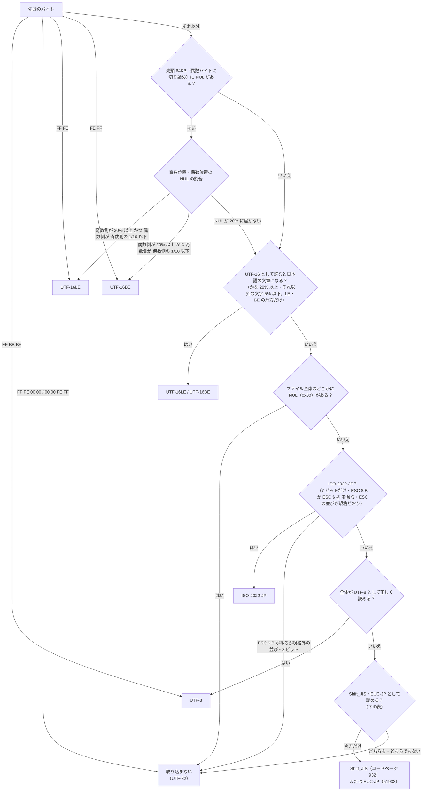

# テキストファイルの読み取り

扱うこと: テキストファイル（`.txt` `.py` `.java` など）の対象の拡張子、既定のアプリで開くかメモ帳で開くかの判定、文字コードの判定、行への分け方、大きさの上限、tebunko が作ったファイルの除外。扱わないこと: Office ファイルの取り込み（[クロール対象フォルダと取り込み対象](crawl.md)・[Excel](excel.md)・[Word・PowerPoint の共通処理と Office アプリの管理](office-apps.md)）、検索時の長い行の扱い（[検索結果の出力](../search/output.md#長い行を切る)）。先に読むページ: [クロール対象フォルダと取り込み対象](crawl.md)、[取り込み対象の決定](target-decision.md)。

## 対象の拡張子

`${textExtensions}`（`shared/core/text_file.ps1`）に固定する 75 個。大文字・小文字は区別しない。ソースコード・設定ファイルなど、文字コードを適切に選べれば読めるものを広く含む。`setting.config` で拡張子を足す仕組みは無い（設定で選べるのはこの 75 個の中だけで、取り込まないものを外す・メモ帳で開くものを増やす方向だけ。下の「設定で選ぶ」。`tests/meta/safety.Tests.ps1` が、Office の拡張子・PDF の拡張子（[PDF ファイルの読み取り](pdf.md)）と合わせて 86 個の固定の一覧ちょうどであることを確かめる）。RTF（表示用の解釈が要る形式）など読み方が別に要る形式、`.exe` `.com` `.scr` `.hta` `.wsf` `.wsh` `.jse` `.vbe` `.lnk` `.url` `.msi` `.cpl` `.inf`（実行・登録に使われるファイル）・`.ts` は対象外。`.html` `.htm` は対象（下の `${textOpenExtensions}`。表示用の解釈が要る形式だが、タグを含めたテキストとして検索できるほうが有用なため対象に含めた）。

`${textExtensions}` は次の 2 つを合わせたもの。

- **`${textOpenExtensions}`（60 個。既定のアプリで開く）**: `.txt` `.csv` `.tsv` `.md` `.log` `.json` `.xml` に加え、`.c` `.h` `.cpp` `.cc` `.cxx` `.hpp` `.cs` `.java` `.kt` `.kts` `.go` `.rs` `.swift` `.scala` `.dart` `.vb` `.bas` `.pas` `.asm` `.m` `.r` `.jl` `.hs` `.ex` `.exs` `.erl` `.clj` `.groovy` `.jsx` `.tsx` `.vue` `.sql` `.yaml` `.yml` `.toml` `.ini` `.cfg` `.conf` `.properties` `.gradle` `.cmake` `.proto` `.graphql` `.tf` `.html` `.htm` `.css` `.scss` `.less` `.rst` `.tex` `.diff` `.patch`。
- **`${textNotepadExtensions}`（15 個。メモ帳で開く）**: `.bat` `.cmd` `.ps1` `.vbs` `.js` `.reg` `.sh` `.py` `.rb` `.pl` `.php` `.lua` `.mjs` `.psm1` `.psd1`。既定のアプリで開くと実行・登録になるため、検索結果から［開く］で開くときは既定のアプリではなくメモ帳（固定のパス `%SystemRoot%\System32\notepad.exe`）で開く（[検索結果からファイルを開く](../gui/open-file.md)）。取り込み・検索の対象かどうかの判定（`testTextExtension`）はこの 15 個も含める。

拡張子だけが対象の判定基準で、拡張子の無いファイル・除外リストの仕組みは無い。

### 設定で選ぶ

利用者は、次の 2 つを別々に選べる。取り込み対象の拡張子は Office 10 個・PDF・このテキスト 75 個の 86 個の中だけ（足せない）、開き方はこの 75 個の中だけ。

- **取り込み対象の拡張子（インデックスごと）**: インデックスの名前ごとに、取り込まない拡張子を選ぶ。インデックスを取り込む前の確認ダイアログの［変更…］から開くダイアログ「取り込み対象の拡張子 - ＜インデックス名＞」（拡張子ごとの件数つきのチェック一覧）で選ぶ（[インデックス管理](../gui/index-tab.md)）。既定は 86 個（Office 10 個・PDF・テキスト 75 個）すべて取り込む。Office・PDF も対象外にできる（外したものは、テキストと同じく更新のあとにインデックスから外れ、戻すと新規として取り込む。抽出のしかたは変わらないので、抽出版は上げない）。設定は `setting.config` の `indexExtensionExcludes`（インデックス名 → 取り込まない拡張子）。検索の絞り込みの `fileKinds` は検索のときに見る種類で、これはインデックスに入れるかどうかで、別のもの。複数のフォルダを持つインデックスも 1 か所で決める。
- **開き方（拡張子ごと・全体）**: 検索結果の［開く］で、拡張子ごとに「既定のアプリで開く」か「エディタで開く」かを選ぶ。［設定］の「テキストファイル」の「テキストの開き方」の［変更…］で選ぶ（[設定タブ](../gui/settings-tab.md)）。`${textNotepadExtensions}` の 15 個は「既定のアプリで開く」を選べない（エディタ固定）。設定は `notepadTextExtensions`（エディタで開く拡張子。60 個の中から）。エディタの既定はメモ帳で、設定 `textEditorPath` で差し替えられる形になっている（この版では設定ファイルを手で書き換える。画面で選べるのは将来の対応）。

- 取り込む一覧は `getIndexTargetExtensions`（Office・PDF・テキストの 86 個から取り込まないものを除く）で作る。`IngestPlanner.Crawl` が始めに 1 回だけ設定を読み、フォルダのインデックス名で一覧を作って `createTargetList` に渡す（途中で変えても次の回から効く）。拡張子ごとの件数は、数える段階（`findTargetFiles`）が列挙したファイルから数える（Office・PDF・テキストの分を、取り込まない拡張子の分も。tebunko が作ったファイルは除く。`getTargetExtensionCounts`）。
- 開き方は `getTextOpenWay`（15 個は常に `notepad`＝エディタ、そのほかは設定の `notepadTextExtensions` に入っていればエディタ）で決め、エディタで開くときは `openWithEditor` を通る。開くたびに設定を読む。
- 検索側の「テキストかどうかの見分け」（`testTextExtension`）と、インデックスの中のフォルダの見分け（`${indexBookDirPattern}`）は 75 個のまま。取り込まないにした拡張子のインデックスも、外すまでは正しく読める。

## 文字コードの判定（`detectTextEncoding`）

バイト列だけを見て判定する（画面にもファイルにも触らない判断層の関数）。上から順に、最初に当たったものを使う。**判定できないもの（あいまいなものを含む）は取り込まない**（誤った文字コードで読んで化けたまま検索対象にしない）。

- **BOM**: `EF BB BF` → UTF-8、`FF FE` → UTF-16LE、`FE FF` → UTF-16BE。UTF-32 の BOM（`FF FE 00 00`・`00 00 FE FF`）は UTF-16 の BOM と見間違えないよう先に確かめ、取り込まない。
- **NUL の偏りによる BOM の無い UTF-16 の判定**: 先頭 64KB（偶数バイトに切り詰める）を 2 バイトの組として数え、組の数を N、偶数の位置（0, 2, …）の NUL の数を E、奇数の位置（1, 3, …）の NUL の数を O とする。ASCII の文字は UTF-16LE で奇数の位置が NUL になるため、O が多ければ LE、E が多ければ BE と判定する。
  - `O ≥ N × 20%` かつ `E ≤ O ÷ 10` → UTF-16LE
  - `E ≥ N × 20%` かつ `O ≤ E ÷ 10` → UTF-16BE
  - それ以外（NUL が 20% に届かない） → 次の「NUL の無い日本語の UTF-16」と同じ判定に回す（日本語の UTF-16 は、改行（CRLF）や全角スペース・「一」など下位バイトが 00 の文字だけが NUL になり、偶数・奇数の両側に NUL が出ることもあるため）
  - 閾値（20%・1/10）は `${textUtf16NulRatioThreshold}`・`${textUtf16NulSkewDivisor}` の定数
- **NUL の無い（または改行の分しか無い）日本語の UTF-16**（`detectJapaneseUtf16WithoutNul`）: ひらがな・カタカナ・漢字は NUL を含まないため、上の判定に掛からない。先頭 64KB（8 バイト以上）を LE・BE それぞれで読み、**ひらがな・カタカナが 20% 以上**で、日本語の文章に出る文字（ASCII・句読点・かな・漢字・全角）**以外が 5% 以下**のとき、その向きの UTF-16 とする。LE・BE の両方が当たるときは判定しない。7 ビットだけ（ASCII の範囲）のバイト列は、ひらがなの UTF-16 と ASCII の文字列（`0a0a…` など）の見分けが付きにくいため、かなの割合を 90% 以上にする。閾値は `${textJpUtf16KanaRatio}`・`${textJpUtf16AsciiKanaRatio}`・`${textJpUtf16OtherRatio}`・`${textJpUtf16MinBytes}`。
- **NUL（0x00）を含むか**: ここまでで BOM の無い UTF-16 とは判定できなかったもののうち、ファイル全体（先頭 64KB に限らない）のどこかに NUL が 1 つでもあれば、バイナリとして取り込まない（`[Array]::IndexOf`。1 バイトずつループしない）。UTF-8・Shift_JIS・EUC-JP・ISO-2022-JP はいずれも文字の表現に NUL を使わないため、先頭 64KB より後ろに NUL が現れるファイル（例: 先頭がテキストで途中からバイナリが続くもの）もここで取り込まない。
- **ISO-2022-JP**（`testIso2022JpBytes`）: 7 ビットだけのバイト列で、漢字への切り替え（`ESC $ B`・`ESC $ @`）を含み、ESC の並びがすべて規格のもの（`ESC $ B`・`ESC $ @`・`ESC ( B`・`ESC ( J`・`ESC ( I`（半角カナ。コードページ 50221 で読む））のとき。`ESC $ B` があるのに 8 ビットのバイトや規格外の ESC の並びがあるものは、JIS のつもりの壊れたものとして取り込まない（UTF-8 として読むと化ける）。ASCII だけで表せるため UTF-8 として読めてしまう（化ける）ので、UTF-8 より先に確かめる。`ESC [` などの端末の制御の並び（色つきのログ）や `ESC ( B` だけのものは対象にせず、UTF-8 になる。
- **UTF-8**: 不正なバイト列で例外にするデコーダー（`DecoderExceptionFallback`）で全体を読めれば UTF-8（ASCII だけのファイルもここに当たる）。
- **Shift_JIS・EUC-JP**（`detectLegacyJapaneseEncoding`）: 上のどれにも当たらなければ、次の条件で決める。決まらなければ取り込まない。

  | | Shift_JIS（コードページ 932） | EUC-JP（コードページ 51932） |
  |---|---|---|
  | 読み方 | 不正なバイト列があれば失敗にして読む | 同じ |
  | 自然さ | 制御文字（TAB・LF・FF・CR 以外）・私用領域・U+FFFD が出ない（外字 F040〜F9FC は私用領域に読まれるため取り込まない） | 同じ |
  | そのほか | 半角カナが「ASCII 以外の文字」の 30% 以下（`${textLegacyHalfKanaRatio}`）。超えるとき（半角カナの多い CSV など）は、濁点・半濁点が付けられるカナの直後にしか来ないなど、半角カナの並びとして自然なものだけ（`testHalfWidthKanaNatural`）。GBK・Big5 を Shift_JIS として読むと崩れる | ひらがな・カタカナを含む（かなの無い漢字だけの文章は、GBK・EUC-KR と構造が同じで見分けが付かない） |

  片方だけ当たればその文字コード。両方当たるときは、Shift_JIS として読むと半角カナばかりになる（EUC-JP のかなの見え方）なら EUC-JP、そうでなければ取り込まない。どちらも当たらなければ取り込まない。読んだ結果の数え（半角カナの割合）は最初の ASCII 以外の文字から `${textLegacySampleChars}` 文字だけで行い、大きなファイルで遅くならないようにしている。NUL の無いバイナリは制御文字が出るため、ここで取り込まない。

### 分かっている限界

- **対象の言語は日本語と英語**（主な文字コードは Shift_JIS と UTF-8）。GBK・Big5・EUC-KR は対象外で、誤って取り込まれるのは既知の限界。誤判定を減らすための判定は足さない。
- **末尾が NUL で埋まった大きい `.log` など**: アプリの強制終了などでファイルの途中から NUL（0x00）で埋まったまま残ったファイルは、その NUL が先頭 64KB より後ろにあっても取り込まない（上の「NUL（0x00）を含むか」）。NUL は全体を見て判定するため、そのようなファイルは「テキストファイルではないため更新できません。」の失敗になる（[分かっている限界（利用の手引き）](../../guide/limitations.md)）。
- **取り込まないもの**: UTF-32・GBK・Big5・EUC-KR・かなの無い EUC-JP・NUL の無いバイナリ・NUL が偏らない UTF-16 などは、文字コードを判定できないとして取り込まない（`テキストファイルではないため更新できません。`）。UTF-8・Shift_JIS・UTF-16 で保存し直せば取り込める。
- **短い Shift_JIS の並び**（半角カナの一部など。例: `ﾃｽ` = `C3 BD`）は、UTF-8 としても正しく読めることがあり、その場合は UTF-8 と判定されて化ける。
- **BOM の無い UTF-16 で、かなが 20% に届かないもの**（漢字だけの文章など）は、バイナリと見分けが付かないため取り込まない。
- **Shift_JIS の外字（F040〜F9FC）を含むファイル**は、外字が私用領域に読まれるため取り込まない。
- **半角カナの Shift_JIS と GBK・Big5**は、構造だけでは完全には見分けられない。半角カナの並びとして自然か（濁点・半濁点の位置）で見分けるため、濁点・半濁点を含まない短い GBK・Big5・EUC-KR が半角カナの Shift_JIS として誤って取り込まれ、半角カナの化けとして索引に入る（害は検索の雑音）。誤って取り込まれるのは、Big5・EUC-KR は 20 文字前後まで、GBK は 10 文字未満のとき（測定: Big5 8 文字で 71%・16 文字で 57%・32 文字で 7%、EUC-KR 8 文字で 66%・24 文字で 18%・32 文字で 0%、GBK 2 文字で 56%・8 文字で 5%・12 文字以上で 0%）。
- **半角カナだけの行で、･ や ､ を含み、半角カナの並びがすべて偶数の長さのもの**（例 `ﾔﾏﾀﾞ･ﾀﾛｳ`）は、EUC-JP としても正しく読めるため EUC-JP と判定され、化ける。
- **かなをほとんど含まない BOM 無し UTF-16（漢字だけ・ASCII だけの短い文）**は、UTF-16 とは判定しない（漢字だけの文は、ほかの文字コードとの区別が付かないため）。
- GBK・EUC-KR などがたまたま Shift_JIS・EUC-JP の条件を満たす偶然（ごく短い文や、かなに当たる並びを含む場合）は、判定の対象外で、誤って取り込まれうる。

## 行への分け方（`splitTextLines`）

行の分け方は `StreamReader.ReadLine` と同じ（CRLF・LF・CR のどれでも 1 行）。途中の空の行も捨てない（1 行目 = ファイルの 1 行目。本文インデックスの行番号がそのまま元のファイルの行番号になる）。行末の空白は取り除き（`TrimEnd`）、末尾の空の行は捨てる。

## 大きさの上限

元のファイルが `${textFileMaxBytes}`（10MB）を超えるものは、コピーも読みもせず（元の大きさをメタデータで見る。元は開かない） `ファイルサイズが大きすぎるため更新できません。` の失敗にする（Office のファイルのサイズの上限と同じ文言にそろえた）。バイナリと判定したものは `テキストファイルではないため更新できません。` の失敗にする。読み取り中の例外も、Office のファイルと同じく失敗にする（[ファイルごとの失敗](errors-ingest.md#ファイルごとの失敗取り込み一覧のエラー列)）。

空のファイル・空の行だけのファイルは、TSV 0 個の「済」とし、次のインデックス作成で「インデックスが無い」として取り込み直さない（中身が空の Office のファイルと同じ扱い）。

## テキストファイルの抽出処理（`extractTextFile`）

`tebunko/indexer/extract_text.ps1` の `extractTextFile` は、元のファイルに影響を出さないため、元を作業領域の `source.copy`（`.tsv` にならない固定の名前。消せずに残っても TSV として公開されない）に `copyFileShared`（読み取りだけ・`FileShare.ReadWrite | Delete`）でコピーし、コピーを `shared/core/text_file.ps1` の `readTextFile`（ファイルを開いて読む状態層の関数）で読み、TSV を書く前にコピーを消す（`finally`。消せなかったときは黙らず取り込みの失敗にする。作業領域の中身は本文インデックスに回るため、コピーを残さない）。強制終了で残ったコピーは、次のファイルの前と次のインデックス作成の始めに作業フォルダごと片付けられる。排他で開かれたファイルはコピーできず、取り込みの失敗になる。大きさの上限は、コピーの前に元の大きさで確かめる（コピーを読むときの確かめは、コピー中に大きくなった場合の保険）。書きかけのファイルをコピーしたときの中身は、直接読む場合と同じ。`readTextFile` が返す行の並びを、`tebunko/indexer/extract_text.ps1` の `extractTextFile` が場所「本文」の TSV 1 つに書き出す（`writeUnits` と違い、途中の空の行を捨てない）。取り込み（`ingestFile`。`tebunko/indexer/extract_office.ps1`）は、対象の拡張子ならここに回し、Office を使わずに読む仕事で取り込む（[取り込みの並列化](parallel.md)）。

本文インデックスへは、今の形式（版 1）のまま、種類 `テキスト`・場所 1 つ（部分 = 本文・対象 = 本文）で入る（[本文インデックスの形式](../index-data/format.md)）。

## tebunko が作ったファイルの除外

`.tsv` `.txt` などを取り込み対象にすると、tebunko 自身が作るファイル（本文インデックス・取り込み一覧・ログ・検索結果ファイル）まで取り込んでしまい、すべての語が二重にヒットする。`findTargetFiles`（`tebunko/indexer/indexer_plan.ps1`）は、クロール対象の拡張子で列挙した後、次のいずれかに当たるファイルを除く。

1. **今のワークスペース**: `$workspace.Entries()`（`store`・前の版の `content_index`・前の前の版の `index`・ログ等）の下・そのもの。拡張子にかかわらない。
2. **ほかの tebunko のワークスペース**: 目印は次の 3 つ。前の版の取り込み一覧（ワークスペース直下の `ingest_status.tsv`）、今の版の取り込み一覧（`store\ingest_status.tsv`）、今の版の目録（`store\format.tsv`）。目録はありふれた名前なので、親が `store` で、中身が目録として読める（`readIndexFormat` が `Missing`・`Broken` でない）ときだけ目印にする。利用者のフォルダの `format.tsv` と、ロックされるなどで読めない目録は目印にしない。列挙したファイルの中に目印があれば、そのフォルダ（親が `store` なら 1 つ上）をワークスペースとみなし、`Entries()` の下も同じく除く（以前の既定の場所・切り替える前のワークスペース・ほかの人のワークスペースに対応）。
3. **名前で分かる tebunko のファイル**: 本文インデックス（`content_index.*.tsv`）・前の版の集約ファイル（`content.*.tsv`）・前の版のシステムインデックス（`system_index*.txt`・`システムインデックス*.txt`）は、どこにあっても除く。
4. **`~$` で始まる一時ファイル**（既存の除外をそのまま続ける）。

既定でない場所のワークスペースに利用者が置いた `.xlsx`・`.txt` は、1〜3 のどれにも当たらないため今までどおり取り込む。判定はファイルごとに重くしないよう、除外するフォルダの `\\?\` 付きの前方一致の文字列を先に作ってから `StartsWith` で比べる（ファイルごとにドライブの割り当てをたどる処理は呼ばない）。
