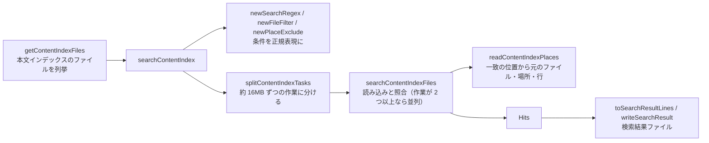

# 部品ごとの関数（検索・スレッド・元のファイル・画面）

扱うこと: 検索（`search_query.ps1`・`content_index_search.ps1`・`search_overflow.ps1`・`search_export.ps1`・`search_run.ps1`）、スレッドとプール（`worker_pool.ps1`・`search_service.ps1`・`indexing_session.ps1`）、元のファイルの特定（`source_map.ps1`）、画面が使う集計・設定・Office プロセスの関数一覧。扱わないこと: TSV・本文インデックスそのものの関数（[部品ごとの関数（TSV と本文インデックス）](tsv.md)）。先に読むページ: [部品から関数一覧を引く](index.md)。

## 検索（`tebunko/search/search_query.ps1`・`content_index_search.ps1`・`search_run.ps1`）

| 関数 | 入力 | 出力 | 概要 | 詳細 | 使用元 |
|---|---|---|---|---|---|
| `isValidRegex` | pattern | bool | 正規表現として正しいか | – | 検索・画面 |
| `newSearchRegex` | word, simpleMatch, caseSensitive | `@{Regex; SimpleMatch; TextRegex; ScanMode}` | 検索条件から照合用の正規表現を作る（文字どおりならエスケープ、大文字と小文字を区別しないなら IgnoreCase、正規表現として不正なら文字どおりにする）。1 行の照合は 5 秒で時間切れ。TextRegex は本文インデックスの全文にかける正規表現（Multiline）、ScanMode はそれを全文にかけてよいか（`getRegexScanMode`） | [検索](../search/index.md#検索条件サクラエディタの-grep-にならう) | 検索・画面（一致箇所の強調） |
| `getRegexScanMode` | pattern | string（`lines` / `filter` / `scan`） | 正規表現を全文にかけて、1 行ずつの照合と同じ結果になるかを判定する。`lines` は全文での一致の位置から行が分かる、`filter` は全文で一致しない本文インデックスのファイルを読み飛ばせる、`scan` は 1 行ずつ照合する。分からない書き方は安全側（`filter` か `scan`）に倒す | [検索を速くする仕組み](../search/speed.md) | newSearchRegex |
| `newFileKindFilter` | kinds | string | 選んだ種類（`readFileKinds` の値）から、対象ファイルの条件（`*.xlsx;*.xls` の形）を作る。すべて選んでいる・空なら空 | [検索](../search/index.md) | newSearchRequest |
| `newFileFilter` | filter | `@{Include; Exclude}` | 対象ファイルの指定（`*.xlsx;見積;!*old*`）を、元のファイル名に対する正規表現にする（無い側は `$null`） | [検索](../search/index.md#検索条件サクラエディタの-grep-にならう) | `searchContentIndex` |
| `newPlaceExclude` | includeShapes, includeComments | regex / `$null` | 検索から外す図形・コメントの場所（名前の末尾 `[図形]` `[コメント]`）の正規表現。どちらも検索するなら `$null` | 同上 | `searchContentIndex` |
| `truncateHitLine` | line, matchIndex（既定 -1） | string | 長い行（テキストのヒットの行・プレビューの前後の行）を、一致の位置（`matchIndex`。分からなければ -1 で先頭から）から前後 `hitLineMaxChars`（1,000 文字）に切る。切った側に `…` を付ける。`hitLineMaxChars` 以下ならそのまま | [長い行を切る](../search/output.md#長い行を切る) | searchContentIndexFiles, readContentIndexLines |
| `getContentIndexFiles` | folders（既定 `$workspace.IndexDir`。フォルダの文字列、または `@{Root; RelPath; Recurse}`（画面のツリーで選んだ範囲。`Recurse` が `$false` なら直下だけ）の配列）, onProgress（フォルダを 1 つ数えるたびに `{ param($count) }` を呼ぶ）, stopSignal（`Stop` を持つもの。フォルダ 1 つごとに見て、立っていれば残りを列挙しない） | `@{Folders; ContentIndexFiles}` | 検索対象の本文インデックスのファイルを列挙する（`findContentIndexFiles`）。結果の相対パスは `Root` から求める。Folders はフォルダごとの `@{Path; Root; Exists; Count}`、ContentIndexFiles は `findContentIndexFiles` の要素をつないだもの（フォルダの順・名前の順、重複なし） | [検索を速くする仕組み](../search/speed.md) | 検索・画面、getGramContentIndexFiles |
| `testIndexExists` | folders | bool | 本文インデックスのファイルが 1 件でもあるか（最初の 1 件で打ち切る） | – | 画面 |
| `getIndexSummary` | folders | `@{Count; LastWrite; Missing}` | 本文インデックスのファイルの件数・最新の更新日時・存在しないフォルダ | – | 画面 |
| `splitContentIndexTasks` | contentIndexFiles, taskBytes（既定 16MB）, headBytes（先頭の作業の大きさ。0 は使わない） | `@{Start; Count}` の並び | 本文インデックスのファイルの並びを、大きさの合計がおよそ taskBytes になるまでまとめて、1 つのスレッドに渡す作業に分ける。headBytes があれば、先頭の作業をその大きさにして、作業ごとに 2 倍にして taskBytes まで大きくする（上限があるとき、表に入る先頭の分を早く返すため。`searchContentIndex` は taskBytes の 1/64 を渡す） | 同上 | searchContentIndex |
| `searchContentIndexFiles` | contentIndexFiles, start, count, regex, max, textRegex, scanMode, cache, include, exclude, excludePlace, stopSignal（`Stop` を持つもの。ファイル 1 件ごとに見て、立っていればここまでのヒットを返す）, gate（照合の合図。`$null` は上限で打ち切る今までの動き）, slot（gate の自分の番号）, checkEvery（gate を見るヒットの間隔）, overflowDir（数えるだけの間のヒットを書き溜める置き場所。空は書かない） | `@{Hits; Skipped; Count; Timeout; OverflowFailed}` | contentIndexFiles の start から count 件を読み、regex に一致する行を `Hits` に返す（1 行に複数一致しても 1 件）。読めない・形が崩れている・`contentIndexSearchMaxBytes`（64MB）より大きい本文インデックスのファイルは、そのファイルだけ飛ばしてパスを `Skipped` に入れる（時間切れだけは飛ばさず、そのまま伝える）。`ScanMode` に応じて全文に 1 回照合し、一致しない本文インデックスのファイルは飛ばす。gate があると、表に入る上限を超えた時点（自分の `max` 件を超えたとき、または自分より前の作業の件数の和 + 自分の件数が上限を超えたとき）から、行を作らずに件数だけを数える（戻らない。`Count` に入れ、`overflowDir` があれば行を `<slot>.tsv` に書き溜める。[上限を超えた分](../search/index.md#上限を超えた分の数え上げと書き溜め)）。照合の時間切れは、gate があれば投げずに `Timeout` で返す。一致の位置から場所・行を求める（`readContentIndexPlaces`）。Excel の図形・コメントの行（`CellPrefixed`）は、区切りのタブより後から始まる一致だけをヒットにする（`testCellPrefixedHit`。セル番地だけの一致は件数・上限に数えない）。元のファイルがテキストの拡張子（`getContentIndexFileKind`）なら、ヒットの行を `truncateHitLine` で切る（Excel・Word・PowerPoint は切らない）。インデックス作成中の本文インデックスのファイルも読めるよう共有して開き、読めないものは飛ばす | 同上 | searchContentIndex（並列検索のスレッドでも動く） |
| `testCellPrefixedHit` | regex, line | bool | セル番地 + 区切りのタブ + 文字の行（Excel の図形・コメント）で、最初のタブより後から始まる一致があるか（開始位置つきの `IsMatch`。タブが無い行は `$false`） | 同上 | searchContentIndexFiles（並列検索のスレッドでも動く） |
| `searchContentIndex` | word, contentIndexFiles, simpleMatch, limit, stopSignal（検索の要求など `Stop` を持つもの。ファイル 1 件ごとに見て、作業スレッドにも渡す。`$null` は止めない）, caseSensitive, fileFilter, workerCount（並列のスレッド数。0 は自動で最大 4）, cache（`newTsvTextCache`）, includeShapes, includeComments（図形・コメントの場所も検索するか。`newPlaceExclude`）, taskBytes, onProgress（`{ param($done, $total, $newHits, $hitTotal) }`。done・total は本文インデックスのファイルの数、hitTotal は今までの件数）, pool（照合のプール `newContentIndexWorkerPool`。`$null` なら並列にするときだけ作って最後に閉じる）, checkEvery（作業が合図を見るヒットの間隔）, overflowDir（溢れの置き場所。空は書き溜めない） | `@{Hits; SimpleMatch; Total; Truncated; HitTotal; CountTimeout; OverflowFailed; Cancelled; Skipped}`（`Truncated` は上限を超えたこと、`HitTotal` は上限を超えた分も含む件数で、中止・総数の時間切れは -1。`Skipped` は飛ばした本文インデックスのファイルのパスの一覧） | 本文インデックスを検索する（照合は `searchContentIndexFiles`＝.NET の `StreamReader`＋`[regex]`）。Hits は PSCustomObject（Root・RelPath（本文インデックスのファイル）・RelDir・FileName・Book・Location・LineNumber・Line）。Total は本文インデックスのファイルの数。作業（約 16MB）ごとに進捗を知らせ、中止に対応する。件数の上限（`limit`）を超えても打ち切らず、表（Hits）には上限までを入れ、超えた分は数え続けて `HitTotal` にする（作業の返した行のうち表に入らない分は、`overflowDir` の `<作業の番号>.head.tsv` に書く）。作業が 2 つ以上なら複数スレッドで並行して検索する（結果の順は変わらない）。照合が時間切れになれば例外にする | [検索](../search/index.md) | 検索・画面 |
| `newTsvTextCache` | maxChars（既定 6,400 万文字） | `@{Texts; Chars; MaxChars; Generation}` | 検索で読んだ本文インデックスのファイルの内容と場所の一覧を次の検索・プレビューで使い回す入れ物（パス → 更新日時・サイズ・内容・場所の一覧・最後に使った世代）。更新日時・サイズが変わった本文インデックスのファイルは読み直す。追い出しは `trimTsvTextCache` | [検索を速くする仕組み](../search/speed.md) | 画面 |
| `newContentIndexWorkerPool` | workers（既定 `getWorkerCount`） | `WorkerPool` | 本文インデックスの照合のプールを作る（各スレッドには照合に要る関数と値だけを読み込む。`searchContentIndexFiles`・`testCellPrefixedHit`・`readContentIndexPlaces`・`testContentIndexCellPrefixed`・`testCellPrefixedPlace`・`convertContentIndexMetaToPlace`・`decodeContentIndexValue`・`getContentIndexFileKind`・`testTextExtension`・`testSourceBookName`・`truncateHitLine`・`newSearchOverflowWriter` と、`textExtensions`・`officeExtensions`・`displayControlChars`・`hitLineMaxChars`・`hitLineBeforeMatchChars` などの定数。優先度は Normal） | [プロセスとスレッド](../structure/threads.md#寿命) | 検索の司令（`SearchService`）、searchContentIndex |
| `trimTsvTextCache` | cache, keepRatio（既定 0.9） | 追い出した数 | 検索 1 回の後に呼ぶ。上限の keepRatio を超えていたら、今の世代で使わなかったものを古い世代から追い出し、世代を 1 つ進める | [閉じるときの順番と GC](../structure/closing.md#gc-とメモリ) | 検索の司令 |
| `newSearchRequest` | word, simpleMatch, folders, limit, option, workDir（既定 `$workspace.Dir`） | 検索の要求（`[hashtable]::Synchronized`） | 検索 1 回分の要求を作る。画面が条件と `Stop`（取り消し）を書き、検索の司令がヒット（`Queue`）・進み具合・`Finished` を書く | [プロセスとスレッド](../structure/threads.md#寿命) | 画面 |
| `invokeSearchRequest` | request, pool, cache | – | 検索の要求を実行し、ヒットと進み具合を要求に少しずつ入れる。例外は投げずに `Error` に入れる。始める前に取り消されていたら何もせずに `Cancelled` にする。gram 索引・列挙・照合には要求そのものを `-stopSignal` として渡し、gram 索引・列挙の後に `Stop` を見て、立っていれば先の段に進まず `Cancelled` にする | 同上 | 検索の司令 |
| `toResultLine` | book, location, lineNumber, line | string | `ファイル名<TAB>場所<TAB>種別<TAB>行番号<TAB>該当行` を返す（場所・種別は `describePlace` の表記）。Excel はセル内改行を LF に戻し、Word・PowerPoint は `"` で始まるセルを `"` で囲む。場所のタブ・改行（Excel のシート名に付けられる）はスペースにする | [検索結果ファイル](../search/output.md#1-行の組み立て) | 検索 |
| `toResultHeader` | columnCount | string | 見出し行 `ファイル名<TAB>場所<TAB>種別<TAB>行<TAB>A<TAB>B…` を返す | [検索結果ファイル](../search/output.md#出力フォーマットworksearch_resultstxt) | 検索 |
| `getSearchResultLine` | relDir, book, location, lineNumber, line | string | 結果の 1 行（相対フォルダ付き `toResultLine`）。コピーとファイル出力で共通 | 同上 | `toSearchResultLines`・`invokeSearchExport` |
| `getSearchResultColumnCount` | line | int | 1 行の見出しに要る列の数（ファイル名・場所・種別・行番号の 4 列を除いたセルの数） | 同上 | `toSearchResultLines`・`invokeSearchExport` |
| `getSearchResultCountLine` | word, count | string | `【検索文字列　X】 N 件` の行 | 同上 | `writeSearchResult`・`invokeSearchExport` |
| `toSearchResultLines` | hits | `@{Header; Lines}` | 検索結果ファイルの見出し行と各行（`getSearchResultLine`、最大セル数の `toResultHeader`） | 同上 | 画面（コピー） |
| `writeSearchResult` | writer, word, hits | – | 1 ワード分の `【検索文字列　X】 N 件`・見出し行・各行・空行を、メモリ上の全件から書き出す。画面の［結果をファイルに出力］は全件をメモリに持たないので `invokeSearchExport` を使い、同じ形になることをテストで確かめる | 同上 | テスト（書き出しの基準） |
| `newExportRequest` | source, outputPath, shownHits, filterText, word | hashtable（Synchronized） | 書き出しの要求（`Kind = "Export"`）。表の分（値だけ）・絞り込みの文字列・元の検索の要求を持つ。`Outcome`・`Written`・`Scope`・`HeadOnlyReason`・`Error`・`Finished` を司令が書く | [結果をファイルに出力](../gui/search-tab.md#結果をファイルに出力) | `startExport`（画面）・`SearchService.Export` |
| `getSearchOverflowRoot` | tmpRoot | string | 溢れを置く根（`tmpRoot\<PC の鍵>\search_overflow`）を組み立てる（ファイルには触らない） | [上限を超えた分の数え上げと書き溜め](../search/index.md#上限を超えた分の数え上げと書き溜め) | `getSearchOverflowPidDir`・`removeStaleSearchOverflow` |
| `getSearchOverflowPidDir` | tmpRoot | string | このプロセスの溢れのフォルダ（根`\<PID>`）。次の検索の始めと閉じるときに中ごと消す | [上限を超えた分の数え上げと書き溜め](../search/index.md#上限を超えた分の数え上げと書き溜め) | `invokeSearchRequest`・検索のスレッド |
| `getSearchOverflowDir` | tmpRoot, requestNumber | string | 検索の要求 1 つの溢れのフォルダ（根`\<PID>\<要求の番号>`） | [上限を超えた分の数え上げと書き溜め](../search/index.md#上限を超えた分の数え上げと書き溜め) | `invokeSearchRequest` |
| `testSearchOverflowRoot` | root, tmpRoot | bool | 溢れの根として使ってよいか（絶対パス・`..` を含まない・`tmpRoot\<PC の鍵>\search_overflow` と一致・途中がリンクでない）。作る・消すはこれが真のときだけ | [上限を超えた分の数え上げと書き溜め](../search/index.md#上限を超えた分の数え上げと書き溜め) | `removeSearchOverflow`・`removeStaleSearchOverflow` |
| `removeSearchOverflow` | path, tmpRoot | bool | 溢れの根の下のフォルダ（`<PID>`・`<要求の番号>`）を中ごと消す。根・途中の確かめが偽なら何も消さず `$false`。消せなくても例外は投げない（残りは次の検索・起動時に消える） | [上限を超えた分の数え上げと書き溜め](../search/index.md#上限を超えた分の数え上げと書き溜め) | `invokeSearchRequest`・検索のスレッド |
| `newSearchOverflowWriter` | dir, name | StreamWriter または `$null` | 溢れのファイルを BOM なしの UTF-8・LF で作って開く。作れない・開けないときは `$null`（照合のスレッドからも呼ぶため .NET だけで書く） | [上限を超えた分の数え上げと書き溜め](../search/index.md#上限を超えた分の数え上げと書き溜め) | `searchContentIndexFiles`・`searchContentIndex` |
| `writeSearchOverflowHits` | writer, hits | bool | 司令が、表に入らなかった行を溢れの head のファイルに書き足す。書けなければ `$false` | [上限を超えた分の数え上げと書き溜め](../search/index.md#上限を超えた分の数え上げと書き溜め) | `searchContentIndex` |
| `getSearchOverflowFiles` | dir | パスの並び | 溢れのファイルを、全件の順（作業の番号の順に、head → 作業のファイル）に並べる。フォルダが無ければ空 | [上限を超えた分の数え上げと書き溜め](../search/index.md#上限を超えた分の数え上げと書き溜め) | `readSearchOverflowLines`・書き出し |
| `invokeSearchExport` | request（`newExportRequest` の要求） | なし | ［結果をファイルに出力］の書き出し。表の分と溢れのファイルを本文の一時ファイルに書き、`.new` に見出し付きで組み、`search_results.txt` と置き換える。結果は要求の `Outcome`（Done / Cancelled / Locked / Denied / Failed）・`Written`・`Scope` に残す | [結果をファイルに出力](../gui/search-tab.md#結果をファイルに出力) | 検索の司令（`SearchService`） |
| `getSearchExportScope` | source（検索の要求） | `@{Scope; Reason}` | 何を書くかを決める（All / Overflow / HeadOnly と、HeadOnly の理由） | [結果をファイルに出力](../gui/search-tab.md#結果をファイルに出力) | `invokeSearchExport` |
| `testHitFilter` | book, filterText | bool | 元のファイル名が絞り込みに合うか（空は全部合う。大文字・小文字を区別しない部分一致） | [結果の絞り込み](../gui/search-tab.md#絞り込み) | `HitRow.MatchesFileName`・`invokeSearchExport` |
| `readSearchOverflowLines` | dir | string の並び | 溢れの全件を全件の順の行で返す（全部をメモリに読むので、テスト・小さい量向け） | [上限を超えた分の数え上げと書き溜め](../search/index.md#上限を超えた分の数え上げと書き溜め) | テスト |
| `removeStaleSearchOverflow` | tmpRoot, isAlive | int | 強制終了などで残った溢れを、起動時に消す。動いていないプロセスの `<PID>` だけ消し、消した数を返す | [上限を超えた分の数え上げと書き溜め](../search/index.md#上限を超えた分の数え上げと書き溜め) | 起動（`startup.ps1` のバックグラウンドの処理） |

## gram 索引で絞る（`tebunko/search/gram_search.ps1`・`search_gram.ps1`）

詳細は [2-gram の索引](../index-data/gram-index.md)。

| 関数 | 入力 | 出力 | 概要 | 使用元 |
|---|---|---|---|---|
| `getSearchGramValues` | word | 値の配列 | 検索語から、照合に使う 2-gram の値を作る（空白で区切った部分の隣り合う 2 文字。小文字にそろえ、多いときは 16 個に均等に間引く） | getGramContentIndexFiles |
| `getGramContentIndexFiles` | word, simpleMatch, folders, indexRoot, gramRoot, onProgress, stopSignal（`Stop` を持つもの。列挙とインデックス名ごとに見て、立っていれば `$null`） | `@{Folders; ContentIndexFiles; Gram（@{Total; Candidates}）}` / `$null` | 検索語の 2-gram をすべて含むと分かったファイルだけに、照合する本文インデックスのファイルを絞る。正規表現・2-gram が作れない・索引の置き場が無い・1 つも外せなかったときは `$null`（呼ぶ側が `getContentIndexFiles` ですべてを集める） | 検索（`search_run.ps1`） |

## スレッドとプール（`shared/core/worker_pool.ps1`・`tebunko/search/search_service.ps1`・`tebunko/indexer/indexing_session.ps1`）

設計は [プロセスとスレッド](../structure/threads.md)。クラスは作ったランスペースのスレッドだけから呼ぶ（`SearchService`・`BackgroundQueue`・`IndexingSession` は画面のスレッドで作る。`WorkerPool` はプールを持つ側のスレッドで作る。`Workspace` は各スレッドで作り直す）（[クラスと関数の使い分け](../structure/classes.md)）。

| 関数・クラス | 入力 | 出力 | 概要 | 使用元 |
|---|---|---|---|---|
| `newWorkerState` | functions, variables | `InitialSessionState` | プールの各スレッドに読み込む関数・値だけを入れた状態を作る（lib.ps1 全体を読み込むと、スレッドを用意するだけで時間がかかるため） | newContentIndexWorkerPool |
| `getWorkerCount` | max（既定 4）, processors | int | プールのスレッドの数の既定（コア数 − 1。1〜max） | 検索・インデックス作成 |
| `WorkerPool` | size, state, host, priority | – | ランスペースと PowerShell のインスタンスを使い回すプール。`Submit`（仕事を始める）・`Receive`（終わりを待って出力を返す）・`Cancel`・`Close`。`Priority` は仕事を始めるたびにスレッドに設定する。`Prelude` は各スレッドで最初の仕事の前に 1 回だけ実行する | 照合のプール・BackgroundQueue |
| `BackgroundQueue` | size, prelude, host | – | 画面から頼まれる短い仕事のスレッド（画面は 2 つで作る）。`Post`（仕事を始める）・`Poll`（終わった仕事の onDone を画面のスレッドで呼び、残りの数を返す）・`Close` | startJob（`shell.ps1`） |
| `newSearchService` / `SearchService` | libPath, cache, workers | `SearchService` | 検索の司令のスレッド（画面を開いている間 1 つ）。`Request`（前の要求を取り消して新しい要求を渡す。スレッドが止まっていれば作り直す）・`Export`（書き出しの要求を渡す。実行中の検索は取り消さない。作り直したときは溢れが消えているので表の分だけになる）・`Cancel`・`IsRunning`・`GetFailure`・`Close`（5 秒待って止まらなければスレッドを止める） | 画面 |
| `newIndexingSession` / `IndexingSession` | indexerPath, channel | `IndexingSession` | インデックス作成 1 回分のスレッド（MTA・BelowNormal）を作り、`indexer.ps1 -Channel <channel>` を実行する。`IsRunning`・`Stop`・`Wait`・`GetExitCode`（終了コードが無ければ 1）・`GetError`・`GetCloudSkipped`（クラウドにだけあるため残した件数。無ければ 0）・`KillOffice`（`OfficePids` に記録した Office だけを、プロセス名と起動時刻を確かめて止める）・`Close` | 画面 |

### 元のファイルの特定・画面

## 元のファイルの特定（`tebunko/search/source_map.ps1`）

| 関数 | 入力 | 出力 | 概要 | 詳細 | 使用元 |
|---|---|---|---|---|---|
| `writeSourceFolderFile` | folders（`@{Path; Name}` の配列）, dir（既定 `$workspace.IndexDir`） | – | 各インデックスのフォルダ（`dir\<インデックス名>`）に元のフォルダの記録（`インデックス名<TAB>クロール対象フォルダ`）を書き出す | [取り込み一覧](../indexing/ingest-list.md) | インデックス作成 |
| `readSourceFolderFile` | dir | Dictionary（インデックス名 → フォルダパス） | `dir` 直下の元のフォルダの記録を読む。無ければ空（`dir` の下は探さない。インデックスのフォルダの下は元のファイル 1 つにつき 1 フォルダになるため） | 同上 | getSourceFolderMap |
| `getSourceFolderMap` | dir, statusPath（既定 `$workspace.StatusFile`）, settingsPath（既定 `$settingsFile`） | Dictionary（インデックス名 → 元のフォルダ） | インデックス名に対する元のフォルダ。`dir` 直下の元のフォルダの記録 → （既定のインデックスなら）取り込み一覧 → **設定（`targetFolders` / `indexSources`）** の順に上書きするため、設定の「今の置き場所」が最も優先される | [元のファイルを開く](../gui/open-file.md#元のフォルダの特定インデックスを別の-pc場所で使う場合) | getSourceLocation |
| `getSourceLocation` | hit, maps（フォルダ → 対応 のキャッシュ） | `@{Name; Folder; Rest; Known}` | 検索結果のインデックス名・元のフォルダ・その下の相対フォルダ。検索対象フォルダの対応 → その下の `<インデックス名>` のフォルダのもの → 検索対象フォルダ自身・その親のもの（インデックス名のフォルダを直接指定した場合）の順に使う。分からなければ Known = `$false`・Folder = 空（Name は返すため、フォルダを選んでもらえば設定に記録できる） | 同上 | resolveSourcePath, 画面 |
| `getConfirmedSourceNames` | settingsPath（既定 `$settingsFile`） | `@{Confirmed; Crawled}`（名前の配列） | 設定を読み直し、`Crawled`（`targetFolders` の名前）と `Confirmed`（`Crawled` に `indexSources` の名前を足したもの）を返す。`Confirmed` に無い名前は、もらったインデックスとして元のフォルダを確かめる | [もらったインデックスの元のフォルダを確かめる](../gui/open-file.md#もらったインデックスの元のフォルダを確かめる) | 画面（元のファイルを開く） |
| `readSourceLocation` | hit, maps, statusPath, settingsPath, indexDir | `@{Location; Maps}` | `getSourceLocation` の、裏のスレッドから呼ぶ版。場所を引数で受け、maps を書き換えず複製に足して返す | [ワークスペースがネットワークにあるとき](../gui/network.md#ワークスペースがネットワークにあるとき) | 画面（元のファイルを開く） |
| `findMovedSource` | picked, rest, book | `@{Path; Root}` / `$null` | 選んだフォルダの中から元のファイルを探す。選んだフォルダを元のフォルダ、その下のフォルダ…の順に当てはめて試し、見つかったファイルと、元のフォルダに当たるフォルダ（Root）を返す | [元のファイルを開く](../gui/open-file.md#元のファイルが見つからないとき元のフォルダを設定する) | 画面 |
| `resolveSourcePath` | hit, maps | string / `$null` | 検索結果の元のファイルのパス（ファイルがあるかは確かめない）。元のフォルダが分からなければ `$null` | [元のファイルを開く](../gui/open-file.md#元のフォルダの特定インデックスを別の-pc場所で使う場合) | 画面 |

## 画面が使う集計・設定・Office プロセス

| 関数 | 入力 | 出力 | 概要 | 詳細 | 使用元 |
|---|---|---|---|---|---|
| `readSearchOption` / `writeSearchOption` | path（既定 `$settingsFile`） / option（`@{UseRegex; CaseSensitive; IncludeShapes; IncludeComments}` のうち変える項目）, path | `@{UseRegex; CaseSensitive; IncludeShapes; IncludeComments}` / – | 画面の検索条件（`setting.config` の `useRegex` / `caseSensitive` / `fileFilter` / `includeShapes` / `includeComments`。無ければオフ・空、図形とコメントはオン）。保存は option にある項目だけを変える | [設定ファイル（setting.config）](../structure/settings-file.md) | 画面 |
| `getIndexingState` | since, path | `@{Exists; Folders; Total; Pending; Failed; Done; IngestedSince; Updated; FailedRows; IndexStats}` | 取り込み一覧の状態ごとの件数、since 以降に取り込んだ件数、失敗したファイルの行（FailedRows。取り込み日時の新しい順。`未取り込み` でエラーの列に理由がある行も入る。`testStatusRowFailed`）、インデックス名ごとの集計（IndexStats。`getIndexStats`。取り込み一覧を読み直さずに済むよう同じ読み込みから作る） | [状態と操作の流れ](../gui/state-flow.md) | 画面 |
| `getOfficeProcesses` | recordDir, selfId, selfStartTicks | `@{Id; ProcessName; AppName; StartTime; HasWindow; Owned; Owner}` の配列 | 実行中の Excel・Word・PowerPoint。記録（`office_pids`）と照らして `Owned`（記録と同じプロセスか）・`Owner`（Self／Other／Gone）を付ける。`HasWindow` は `MainWindowHandle` が 0 でないこと | [前回残った Office の確認](../gui/leftover-office.md) | 画面 |
| `stopOfficeProcesses` | targets, recordDir | `@{Id; Stopped; Status; Reason}` の配列 | 止める直前に PID が記録と同じプロセスか照らし直し、同じものだけ `Stop-Process -Force` で終了する。`Status` は Stopped／Changed／Gone／Failed | 同上 | 画面 |
| `compareOfficeProcess` | process, processName, startTicks | `Same`／`Different`／`Unknown` | 控えた名前・起動時刻との比べ方。ハンドルを先に開く。開けない・控えが無い・起動時刻が読めないときは `Unknown`、名前か起動時刻が違えば `Different` | 同上 | `isSameOfficeProcess`・`quitApp` |
| `isSameOfficeProcess` | process, processName, startTicks | bool | 止める前の照合。ハンドルを先に開き、名前と起動時刻（UTC の Ticks）が控えたものと同じときだけ `$true`。開けない・読めない・控えが無いときは `$false` | 同上 | `OfficeWatchdog`・`KillOffice`・`stopOfficeProcesses` |
| `testOfficeProcessHasWindow` | process | bool | プロセスが窓を持っているか。`Refresh` したあと `MainWindowHandle` が 0 でないときだけ `$true`。読めないときは `$false`（COM・P/Invoke は使わない） | [Office アプリの管理](../indexing/office-apps.md#office-アプリexcelwordpowerpointの管理) | `getOfficeProcesses`・`OfficeWatchdog`・`KillOffice` |
| `getWatchdogVerdict` | entry, hasWindow, users, due | string | 見張りが、控えたプロセスを止めるか決める。`Skip`（何もしない）・`Spare`（期限を過ぎたが、利用者が使った印があるので止めない）・`Kill`（期限を過ぎたので止める）。窓を見張るプロセスで窓が見えたら印を入れる。印は起動時刻が同じものだけを有効とする | [Office アプリの管理](../indexing/office-apps.md#office-アプリexcelwordpowerpointの管理) | `OfficeWatchdog` |
| `testWorkerAbandoned` / `IngestDispatcher.TakeAbandonedWorker` | – / – | bool / `@{ Worker; Entries }` または `$null` | 取り込みのスレッドが自分のワーカーが諦められたか見る / 司令がまだ後回しにしていない、諦められたワーカーと、そのワーカーで取り込み中だったファイルを、取り込み中から外して返す。諦められたワーカーのファイルは取り込まず、理由付きの失敗にする（状態は「未取り込み」のまま） | [取り込み一覧](../indexing/ingest-list.md) | `invokeIngestTask`・`IngestDispatcher`・`invokeIndexerBody` |
| `getSearchCountingText` | limit, counted | string | 上限を超えたあと、総数を数えている間の要約欄の文（`検索中…　該当 10,000 件以上（総数を数えています：K 件）`） | [画面のメッセージ](../gui/messages.md) | 検索タブ（画面層） |
| `getSearchFinishSummaryText` | hits, files, seconds, truncated, hitTotal | string | 検索が終わったときの要約欄の文。上限を超えたときは、数え終えていれば総数を添え（`全 N 件中 M 件を表示`）、数えている間に止まった（`hitTotal` が -1）ときは総数を数えていないと伝える。上限以下は `getSearchSummaryText` | [画面のメッセージ](../gui/messages.md) | 検索タブ（画面層） |
| `getSearchFinishStatusText` | word, hits, optionText, truncated, hitTotal, countTimeout, cancelled | string | 検索が終わった（中止・上限を超えたを含む）ときのステータスバーの文。上限以下は `getSearchStatusText`。数えている間の中止・時間切れ・数え終えたの別に文を変える | [画面のメッセージ](../gui/messages.md) | 検索タブ（画面層） |
