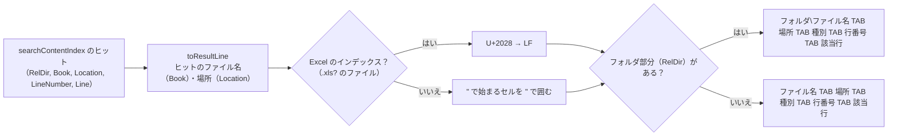
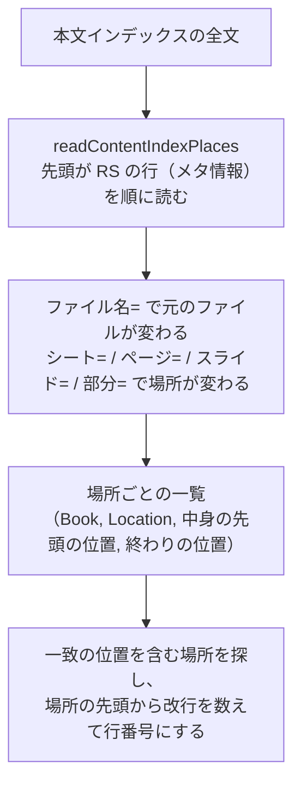

# 検索結果ファイル

扱うこと: 検索結果のファイル（Excel ブック・CSV・TSV）の出力フォーマット、ヒット 1 行の組み立て、ヒットから元のファイル名・場所・行番号を求める方法。扱わないこと: 検索の仕様そのもの（[検索](index.md)）。先に読むページ: [検索](index.md)、[インデックスのファイルの形](../index-data/format.md)。

## 出力フォーマット（Excel ブック・CSV・TSV）

画面の［出力 ▾］で、表示中の結果（絞り込み後）を、作業フォルダの一時の置き場に書き出し、書けたら開く（Excel ブックは既定のアプリ、CSV・TSV はメモ帳）。種類は `.xlsx`（Excel ブック）・`.csv`・`.tsv`。件数の上限を超えて表に入らなかった分（[上限を超えた分](index.md#上限を超えた分の数え上げと書き溜め)）も、検索が最後まで進んでいれば続けて書く。

- **Excel ブック（.xlsx）**: 1 シート。1 行目が見出し `ファイル名`・`場所`・`種別`・`行`・`該当行` の 5 列で、ヒット 1 件が 1 行。該当行は、元の列のセルを ` │ ` でつないで 1 セルに入れる（画面の表と同じ）。セルは文字列として書く（数式として解釈しない）。1 シートの行の上限は 1,048,576 行（見出しを含む）で、超えた分は書かず、ステータスに件数を添える。
- **CSV・TSV**: 1 行目が見出し `ファイル名`・`場所`・`種別`・`行`・`A`・`B`…（該当行の最大セル数分の列名）。ヒット 1 件が 1 行で、該当行は元の列ごとに 1 列に分ける。UTF-8（BOM 付き）、改行は CRLF。CSV はコンマ区切りで、RFC 4180 のとおりコンマ・改行・`"` を含むセルを `"` で囲む。TSV はタブ区切りで、同じく囲む。
- **Excel ブックだけ**、1 つのセルは 32,767 文字までで、超えた分は切る（Excel のセルの上限。切ったセルの数をステータスに添える）。CSV・TSV のセルの長さには上限を設けない。
- 旧版の `work/search_results.txt`（検索文字列と件数の行から始まるタブ区切り）は書かなくなった。前の版が残したファイルは消さない。
- 画面の［コピー］（選択行をクリップボードに入れる）は、これまでと同じタブ区切りの形式（`toSearchResultLines`）のまま。

ファイル名・場所・種別・行・該当行の決め方は次のとおり。

- **場所・種別** は、ヒットの `Location`（場所の名前。本文インデックスのメタ情報から組み立てる。[ファイル名・場所の求め方](#ファイル名場所の求め方readcontentindexplaces)）を場所ごとの表記にしたもの（`describePlace`。画面の見出しの要約と同じ）。結果の表の「場所」列は、Excel ではこれにセル番地を足した行ごとの表記（`describeHitPlace`。`[シート]売上!B12`）を出すが、この出力にはセル番地を付けない。

  | 場所の名前（`Location`） | 場所 | 種別 |
  |---|---|---|
  | `売上`（Excel のシート） | `[シート]売上` | セル |
  | `売上[図形]` | `[シート]売上` | 図形 |
  | `売上[コメント]` | `[シート]売上` | コメント |
  | `売上[ヘッダー・フッター]` | `[シート]売上` | ヘッダー・フッター |
  | `ページ003`（Word） | `3 ページ（目安）` | 本文 |
  | `ページ003[図形]` `ページ003[コメント]` | `3 ページ（目安）` | 図形 / コメント |
  | `文書[コメント]`（本文に参照の無い Word のコメント） | `文書` | コメント |
  | `スライド002[図形]` `スライド002[コメント]` | `スライド 2` | 図形 / コメント |
  | `ヘッダー・フッター` `脚注` | `ヘッダー・フッター` `脚注` | 本文 |
  | `スライド002（非表示）`（PowerPoint） | `スライド 2（非表示）` | 本文 |
  | `スライド002_ノート` | `スライド 2` | ノート |
  | `本文`（テキストファイル。場所は 1 つだけ） | （空） | 本文 |

  - Word のページは、Word が保存したときのページ区切りから数えた目安のため「（目安）」を付ける（[Word](../indexing/word.md)・[既知の問題](../indexing/known-issues.md#word-の注意点既知の問題)）。
  - Excel の図形・コメントは、該当行の 1 列目が図形の左上・コメントのセル番地、2 列目が文字（[Excel の図形・コメントの読み取り](../indexing/excel.md#excel-の図形コメントの読み取りreadxlsxobjectunits)）。Excel のヘッダー・フッターは、該当行が文字だけ（セル番地の列は無い。行番号はその場所の中の何行目か）。
  - シート名にタブ・改行が入っている場合（Excel は付けられる）は、列・行が分かれないようスペースにする。
- **行番号** は場所の中の行番号（`searchContentIndex` の `LineNumber`。元の TSV の行番号と同じ）。Excel ではシートの行番号、Word・PowerPoint では場所（ページ・スライド等）の中で何行目か。
- **該当行** は、CSV・TSV では 5 列目以降に元の列の順（5 列目 = A 列）でセルが並ぶように出力する（Excel ブックでは 1 セルにつなぐ）。見出しの列名（A, B, C…）と行番号で、元のセル位置が分かる。
  - Excel: TSV の行をそのまま出力し、セル内改行（U+2028）だけを LF に戻す。改行を含むセルは Excel の出力時点で `"` で囲まれているため、貼り付けても 1 セル内の改行となり、右隣のセル・後続の行はずれない。このため結果ファイルをテキストエディタで開くと、改行を含むセルは複数行に見える。
  - Word・PowerPoint: 行（段落、または表の 1 行をタブ区切りにしたもの）は `"` で囲まれていない。Excel は `"` で始まるセルを囲みの `"` と解釈して後続がずれるため、`"` で始まるセルだけを `"` で囲み、中の `"` を `""` にする。途中に `"` を含むセルはそのままで、貼り付けても文字どおりになる。
- CSV・TSV の見出しの列名の数は、ヒット行の最大セル数（`countTsvFields`。`"` で始まるセルは閉じる `"` までを 1 セルとする）。ヒットが 0 件のときは、見出しの `ファイル名`・`場所`・`種別`・`行` の 4 列だけの 1 行（CSV はコンマ区切り、TSV はタブ区切り）になる。件数の行は書かない。

出力例（CSV。`⏎` はセル内改行の LF）:

```
ファイル名,場所,種別,行,A,B,C,D
sub dir\old.xls,[シート]Sheet1,セル,3,古い形式 りんご
見積[確定].xlsx,[シート]一覧,セル,12,,りんご,100,"青森産⏎ふじ"
報告書.docx,2 ページ（目安）,本文,5,"""りんご""の出荷"
```

## 1 行の組み立て



## ファイル名・場所の求め方（`readContentIndexPlaces`）

ヒット 1 件の元のファイル名（Book）・場所（Location: シート名・ページ・スライド）・元のファイルのあるフォルダ（RelDir）は、次のように求める。

| 値 | 求め方 |
|---|---|
| RelDir | 本文インデックスのファイルのあるフォルダの、インデックスのフォルダ（`Root`）からの相対パス（`findContentIndexFiles`） |
| Book | 一致した位置より前の、いちばん近い `ファイル名=` の値 |
| Location | 一致した位置を含む場所のメタ情報（`シート` / `ページ` / `スライド` / `部分`・`対象`・`非表示`）から組み立てた場所の名前（`convertContentIndexMetaToPlace`。`見積[図形]`・`ページ001`・`スライド002（非表示）`・`スライド001_ノート` など。[インデックスのファイルの形](../index-data/format.md#配置命名規則)「本文インデックスの形式」） |
| LineNumber | 場所の中身の先頭から数えた行番号（場所のメタ情報の後の最初の行が 1） |



- 書き換えたインデックスで偽の名前を開かせないため、`ファイル名=` の値が `testSourceBookName`（取り込み対象の拡張子であり、区切り・制御文字などを含まない名前）を通らない場所は、一覧に入れない（その場所の一致は結果に出ない）。
- 場所の一覧は、全文で一致したとき（と、読んだ内容を使い回すために残すとき）だけ作る。一致しない本文インデックスのファイルでは作らない（[検索を速くする仕組み](speed.md)）。
- 場所の番号（`ページ`・`スライド`）が数でないときは、その値の文字列をそのまま場所の名前にする（例外にしない）。
- 本文インデックスのファイルの読み取り（読む・場所の一覧を作る・照合する）で例外になったファイル（版が違う・版が無い・形が崩れている・読めない）と、大きさが `contentIndexSearchMaxBytes`（64MB）を超えるファイル（読まずに飛ばす）は、そのファイルだけ飛ばし、ほかのファイルの検索を続ける。飛ばしたファイルは検索の結果の `Skipped`（パスの一覧）に入り、検索が終わったステータスバーの文の後ろに `読めなかったインデックスのファイル：N 件`（`getSkippedContentIndexText`）と出る。検索の全体を「検索できませんでした」にはしない。件数の上限で打ち切ったときは、そこまでに読んだファイルの分だけが入る。照合の時間切れは検索語の問題のため、飛ばさずに検索の全体を中止する。読んだ内容を使い回さないとき（画面は使い回す）は、語に一致しないファイルは場所の一覧を作らないので、そのファイルが壊れていても飛ばした数には入らない。
- 画面の選択行のプレビュー（`readContentIndexLines`）も同じ一覧で、Book・Location が一致する場所の中から前後の行を取り出す（[検索タブ](../gui/search-tab.md) [選択行のプレビュー](../gui/preview.md)）。
- 検索では TSV の相対パスを分解しない。TSV の名前（フォルダ名 = 元のファイル名、ファイル名 = 場所）は、本文インデックスに入れるとき（`getIndexFolderBooks`）だけに使う。

場所の付け方は [インデックス作成](../indexing/index.md) の [インデックスのファイルの形](../index-data/format.md#配置命名規則)・[場所の符号化](../index-data/format.md#場所の符号化encodeindexplace--decodeindexplace) を参照。

## 長い行を切る

テキストファイル（`.txt` 等）は、1 行に数 MB の内容が入ることがある（`.json` `.xml` `.log` など）。取り込み・検索の一致そのものは行を切らずに行う（行番号と検索の一致がずれないため）が、結果の表・プレビュー・この検索結果ファイル・画面の［コピー］に出す行は、`search_query.ps1` の `truncateHitLine` で `${hitLineMaxChars}`（1,000 文字）に切る。

- 一致した行（結果の表・検索結果ファイル）は、一致の位置の `${hitLineBeforeMatchChars}`（200）文字前から 1,000 文字を取る（一致の位置が分からない図形・コメント等では先頭から）。
- 選択行のプレビューの前後の行（`readContentIndexLines`）は、一致していないため常に先頭から 1,000 文字を取る。
- 切った側に `…` を付ける（先頭・末尾のどちらか、または両方）。
- Excel・Word・PowerPoint の行は切らない（Excel は列の位置がずれるため。詳細は [テキストファイルの読み取り](../indexing/text.md)）。`content_index_search.ps1` の `searchContentIndexFiles` は、元のファイル名の拡張子（`getContentIndexFileKind`）がテキストのときだけ切る。
