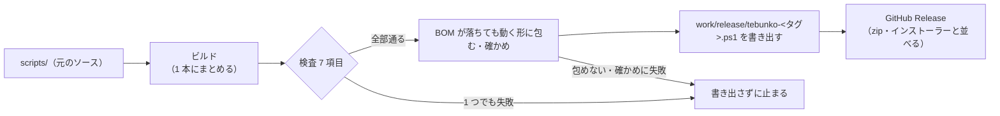
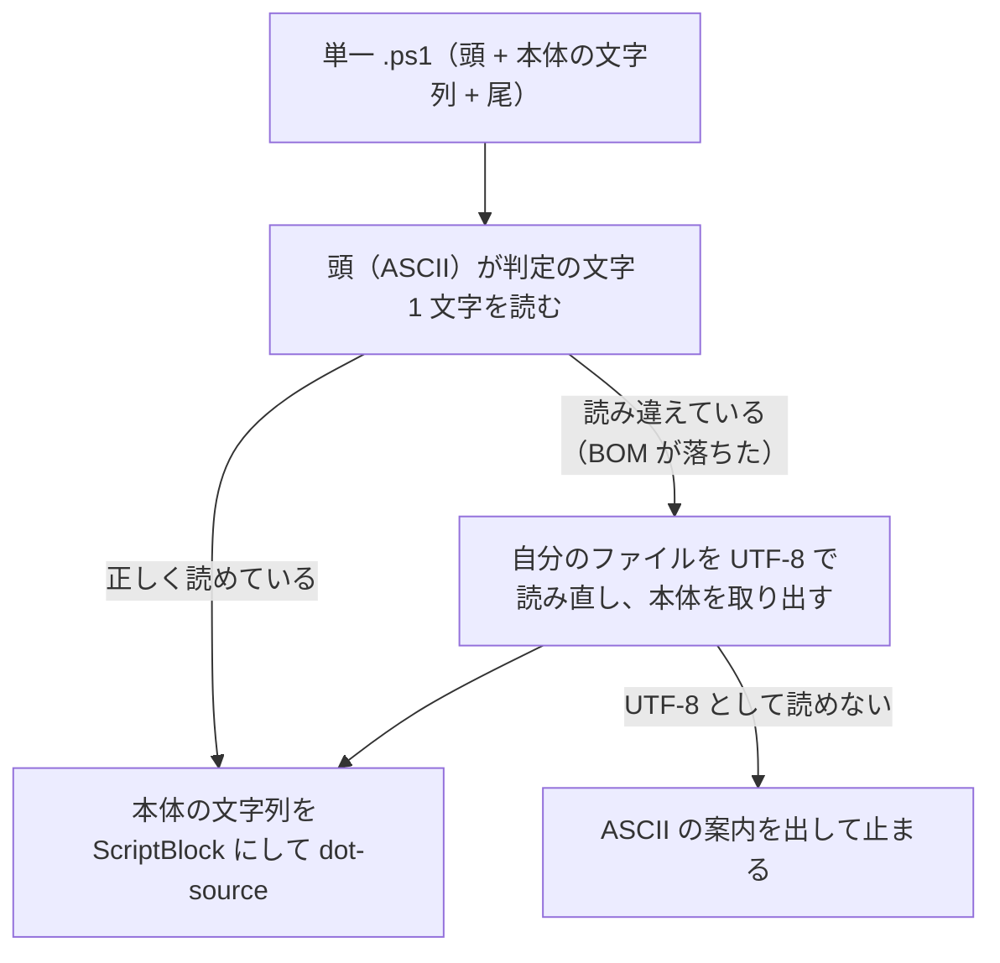

# 単一 PowerShell のビルド

扱うこと: `scripts/` のソースから、展開せずに動く 1 本の `.ps1` を作る仕組み。ビルド（まとめる）と検査（まとめた結果を確かめる）の 2 段に分けて説明する。扱わないこと: zip・インストーラーの作り方（[配布物と開発用のフォルダ構成](folders.md)）、利用者向けの使い方（[README](../../../README.md)）。先に読むページ: [配布物と開発用のフォルダ構成](folders.md)・[ソースの分け方](source.md)。

## 目的

zip は展開が要り、インストーラーは実行ファイル（.exe）を入れる。展開もインストールもせず、1 本のファイルだけを持ち運んで動かしたい利用者のために、同じ `scripts/` から機械的に 1 本の `.ps1`（`tebunko-<タグ>.ps1`）を作る。

- ソースは増やさない。`scripts/` が唯一の元で、1 本の `.ps1` はビルドのたびに作り直す。
- zip・インストーラーの中身と動きは変えない。
- 試験版として zip・インストーラーと並べて配る。利用者の確かめが済むまで、その位置づけは変えない。

## 仕組み（全体）

単一 .ps1 の作成は、ビルドと検査の 2 段である。ビルドは `scripts/` を 1 本にまとめる。検査は、まとめた結果を確かめる。どちらも `tools/new_single_script.ps1` が行う。検査に通ったものだけを書き出し、1 つでも失敗したら何も書き出さずに止まる。



- `release.yml` が、zip の検査のあとに `-Version <タグ>` を付けて呼ぶ。止まったら、リリースの工程もそこで止まる。
- 出力は `work/release/` に書く（日本語のまま・BOM 付き UTF-8・CRLF）。作ったファイルはリポジトリにコミットしない（`tests/meta/structure.Tests.ps1` の M5 が確かめる）。
- ファイルのたどり方と禁止の語の一覧は `tools/script_rules.ps1` に集め、`tests/meta/layers.Tests.ps1`・`tests/meta/safety.Tests.ps1`・`tools/check_release_package.ps1` と共有する。

## ビルドのロジック

### 読み込み行の差し替え

`scripts/` のファイルは、ほかのファイルを `. ([WildcardPattern]::Escape("$PSScriptRoot\...".Replace('`', '``')))` や `. ([WildcardPattern]::Escape("$TebunkoDir\...".Replace('`', '``')))` の行で読み込む。ビルドは、この行を、読み込まれるファイルの中身に置き換える。置き換えた中身の中にも読み込み行があれば、同じ規則でさらに置き換える。

例: `lib.ps1` の次の行は、`settings.ps1` の中身に置き換わる。

```powershell
. ([WildcardPattern]::Escape("$PSScriptRoot\core\settings.ps1".Replace('`', '``')))
```

- 同じファイルが 2 回以上読み込まれていたら、中身を入れるのは 1 回目だけにする。2 回目以降の行は空にする（入れ終えたファイルを集合で覚えておく）。
- 関数の中にある読み込み行も、行の置き換えなので、そのまま働く。

### 起動口の `param`

起動口（`gui.ps1`・`indexer.ps1`）は、`param` ブロックを持つことがある。そのまま入れると `param` が二重になるため、構文木で `param` を除いた本体だけを取り出して入れる。結合したファイルの頭に、`param ($Part, $RetryFailed, $Channel)` を 1 つだけ置く。

### 単一 .ps1 の 2 段の形

結合した `.ps1` は、先頭と本体の 2 段でできている。

- **先頭**: 別スレッドが読む「部品」の文字列を持つ。部品は `lib`（検索や設定など、画面を使わない処理）と `indexerLib`（取り込みの処理）の 2 つ。
- **本体**: 起動したスレッドが実行するコード。画面のファイルも `lib` も入る。

別スレッドは、本体を読み直さず、先頭の部品の文字列だけを読む。部品には画面のファイルを入れない。画面のクラスを別のランスペースでもう一度コンパイルすると、画面のスレッドの型と別物になるためである（[クラスと関数の使い分け](classes.md)）。画面のファイルは本体にだけ入る。`lib` の中身は、本体にも部品にも入る。本体は画面のスレッドで使い、部品は別スレッドで使うためである。

例: `lib.ps1` に `ui/` のファイルを読み込む行を足すと、`lib` の部品に画面のファイルが入るので、検査 7 で止まる。

### 先頭に入れる変数

| 変数 | 中身 | 使う所 |
|---|---|---|
| `${bundledScriptPath}` | 実行中の `.ps1` 自身のパス（頭の `${tebunkoPath}`。`$PSCommandPath` の値） | `shared/core/paths.ps1`（根フォルダ）、`tebunko/gui.ps1`（単一 .ps1 かどうかの見分け） |
| `${bundledVersion}` | `@{ Tag; Sha }`。`-Version` と `git rev-parse HEAD` から、`VERSION.txt` と同じ決め方で作る | `shared/core/version.ps1` の `readVersionFile` |
| `${bundledXaml}` | 画面定義（XAML）の文字列。キーは `scripts` 内の元のパス | `shared/ui/app_host.ps1`、`tebunko/ui/splash.ps1` |
| `${bundledParts}` | 別スレッドが読む部品（`lib`・`indexerLib`）の文字列 | `tebunko/core/parts.ps1` の `getPartLoad` |

XAML と部品は、単一引用符のヒアストリングとして埋め込む。中に行頭が `'@` の行があると途中で閉じるため、ビルドが見つけたら止める。

### 本体の読み込みの順と `-Part` の分かれ方

先頭と本体の境には、目印の行（`# ---- BODY-START (above: parts embedded for other threads) ----`）を置く。テストは、包んだ本体からこの行までを切り出して部品を取り出し、`getPartLoad` を通して読む。本体は次の順に並べる。

1. `ui/startup_error_view.ps1`（起動の失敗の文言）、`ui/startup_error.ps1`（知らせ方）、`lib.ps1` の順に読む（`gui.ps1` の先頭と同じ順）。
2. `indexer/indexer_lib.ps1` と `indexer/indexer_main.ps1` を読む。
3. `-Part indexer` のときは、`indexer.ps1` の本体を実行する。画面を出さずに取り込みだけ行って終わる。
4. それ以外（既定は `gui`）のときは、`gui.ps1` の本体を実行する。画面を起動する。

部品だけを読んで戻る `-Part lib` のような指定は、本体に無い。

## 検査のロジック

ビルドの結果を、次の 7 つで確かめる。1 つでも失敗したら止まる。

| # | 確かめること | 防ぐもの |
|---|---|---|
| 1 | 構文エラーが 0 件である | まとめ方を誤って、起動しないファイルを配ること |
| 2 | 読み込み口からたどれるファイルが、すべて入っている。読み込み口からたどれない余計なファイルは入っていない | ファイルの入れ忘れと、関係ないファイルの混入 |
| 3 | 読み込み行（`$PSScriptRoot`・`$TebunkoDir` の dot-source）が残っていない | 差し替え漏れ。実行時に無いファイルを探して落ちる |
| 4 | 起動口の `param` の名前が、頭の `param` にすべてある | 起動の引数を渡せなくなること |
| 5 | 禁止の語（`tools/script_rules.ps1` の一覧。`Invoke-Expression`・`[ScriptBlock]::Create`・`FromBase64String`・`EncodedCommand`・`ExecutionPolicy Bypass` など）が無い | ウイルス対策ソフトが疑う書き方が混ざること |
| 6 | 版の文字列が、指定した `-Version` と、コミットの SHA に一致する | 版の表示が違うファイルを配ること |
| 7 | 別スレッド用の部品が、入り口からたどれるファイルと過不足なく一致する。部品が読んだファイルのパスに `\ui\` を含むものが無い | 部品の入れ忘れ・余計なファイルと、画面のコードが別スレッドに混ざること |

- 同じファイルが二重に入ることは、検査ではなくビルドの規則（上の「読み込み行の差し替え」）が防ぐ。
- 検査 7 が見るのはパスだけで、ファイルの中身は見ない。パスに `\ui\` を含む（`ui\` フォルダの下にある）ファイルは、`*_view.ps1` でも部品に入れると止まる。

## 文字コード（BOM が落ちても動く形）

Windows PowerShell 5.1 は、BOM の無い UTF-8 のファイルを既定のコードページ（日本語環境では CP932）で読む。別の道具で保存し直す・中身を貼り付けて保存するなどで BOM は落ちうる。CP932 は 2 バイトで 1 文字のため、日本語の文字の最後のバイトが、次の ASCII の文字（バッククォート・`{`・`}`・英字・引用符）を飲み込む。5.1 は実行の前にファイル全体を構文として読むので、構文エラーになり、先頭のコードも動かない。実測では、日本語のまま BOM を落とした単一 .ps1 は、5.1 の構文の読み取りで 685 件のエラーになった。

そこで、検査に通ったあと、書き出す前に、日本語を含む本体全体を、単一引用符のヒアストリング（データ）に入れて包む（`tools/single_script_guard.ps1`）。ヒアストリングの中は、どう読み違えても構文にならない（改行・`'`・`#`・`@` は飲み込まれない）。日本語はそのまま残るので、ASCII に書き換えない。



- **頭と尾は ASCII だけ**で書く（頭の判定用の 1 文字だけが例外）。頭は、`param`（本体と同じ）、言語モードの確認、`${tebunkoRoot}`・`${tebunkoPath}`、判定用の文字、本体の文字列の始まり。尾は、判定・読み直し・dot-source。
- **判定**: 頭のヒアストリングに、`ア`（U+30A2）だけを入れておく。読み違えていれば、この 1 文字が別の文字列になる。そのときだけ、頭が `$PSCommandPath` のファイルを UTF-8 で読み直し、本体の文字列を取り出す。BOM があってもなくても、本体は同じ経路（文字列を `[scriptblock]::Create` して dot-source）で動くので、確かめる経路は 1 つになる。
- **退避**: 本体の中に、行頭が `'@` の行（本体の中の XAML・部品のヒアストリングの終わり）があるので、外側のヒアストリングを閉じてしまう。包むときに `@@'@` に置き換え、動かす前に戻す。本体にもともと `@@'@` の行があれば、包む道具が止まる。
- **`$PSScriptRoot`・`$PSCommandPath`**: ScriptBlock の中では空になる（その中で定義した関数の中も）。本体の中の使い方（文字列の中のものも含む）は、構文木で `${tebunkoRoot}`・`${tebunkoPath}`（頭が決める）に書き換える。書き換えたあとに元の名前が残っていないことを確かめる。別のランスペースで読む部品は、もともと動的に決めるので同じ。
- **行番号**: 本体の前に、頭の行数と同じ数の空行を足して作るので、エラーの `At line:N` の `N` は、単一 .ps1 のファイルの行番号と同じになる。ただし、ファイル名は出ない。
- **子プロセス**: `-Part indexer` で起こす子も、同じ頭を通るので、BOM が落ちていても動く。
- **言語モード**: `FullLanguage` でなければ、頭が英語の 1 行を出して終了コード 1 で止まる（ScriptBlock を作れないため）。
- **禁止の語**: 検査 5 は、包む前の本体に対して行う（上の表）。頭の `[scriptblock]::Create` は、この包みのために足した、禁止の語の唯一の例外である（理由・範囲は [安全性の確認](../../safety/checks.md#文字列を式として実行1の例外)）。包んだあとの全体を、構文木で、尾の最後の 1 行のほかに Create・`Invoke-Expression`・`iex` が無いこと（最後の文の全文が決めた 1 行と同じこと）と、その文を除いた全体に禁止の語（一覧の全分類）が無いことを確かめる（下の「包んだあとの確かめ」）。構文木が見るのは頭と尾で、本体は文字列（データ）なので、包む前の検査（5）と、包んだあとの行の検査が見る。別スレッドの部品の読み込み（`importTebunkoPart`）も、文字列から関数を登録して実行する形だが、EDR の見え方は実機でしか確かめられない。

範囲の外: Shift_JIS で保存し直した単一 .ps1。機械の ANSI コードページが 932（日本語の機械）のときは 5.1 で動く（日本語以外の文字は `?` になる）。それ以外の機械と 7 では、UTF-8 として読み直せず、ASCII の案内を出して止まる（テストは、932 の側を日本語の機械で、それ以外の側を CI で確かめる）。貼り付けて実行する形（ファイルのパスが無い）も対象にしない（`${bundledScriptPath}` が要るため、もともと動かない）。展開した版（zip）は変えない。

包んだあとの確かめ（1 つでも失敗したら何も書き出さずに止まる）:

- 構文エラーが 0 件である。
- UTF-8 のバイトを CP932 で読み違えた文字列でも、構文エラーが 0 件である。
- 頭と尾が ASCII だけで、行頭が `'@` の行が 2 本（判定と本体の終わり）だけである。
- ScriptBlock の Create・`Invoke-Expression`・`iex` の呼び出しが、末尾の最後の 1 行（文の全文が一字一句同じ）だけで、その文を除いた全体（本体の文字列を含む）に禁止の語（`tools/script_rules.ps1` の全分類）が無い。
- 版の文字列が残っている。

テストは次のとおり。

- `tests/tools/single_script_guard.Tests.ps1` … 包む規則（変数の書き換え・退避と復元・止める場合・行番号・Create の例外が 1 行だけであること）と、包んだ `.ps1` を別プロセスで起動した結果（BOM 付き・BOM なし・Windows PowerShell 5.1・PowerShell 7）と、言語モードが ConstrainedLanguage のときの止まり方と、読み直せないときの止まり方（ファイルのパスが無い・頭の判定用の文字が無い）。日本語の文字列・`$PSScriptRoot`・`$PSCommandPath`・引数・終了コード・エラーの行番号を見る。
- `tests/tools/new_single_script.Tests.ps1` … ビルドと検査そのもの（まとめる順・部品・新しい別スレッドでの読み込み・`-Part indexer`）と、出力が BOM 付き UTF-8 であること、頭と尾が ASCII だけであること、本体の行番号がファイルの行番号と同じであること、BOM の有無にかかわらず別プロセスで起動して日本語の記録が正しく出ること（Windows PowerShell 5.1・PowerShell 7）。
- `tests/meta/structure.Tests.ps1` … ソースを 1 本にしても壊れない決まり（別スレッドがパスで部品を読まない・`${bundledScriptPath}` を dot-source や呼び出しに使わない・トップレベルの `trap`／`exit` の形・作った 1 本をコミットしない）。
- `tests/meta/layers.Tests.ps1`・`tests/meta/safety.Tests.ps1` … 層の決まりと禁止の語を、まとめる元のソースに対して確かめる。
- 画面の自動テスト（`Gui` タグ）… 環境変数 `TEBUNKO_GUI_SINGLE=1` で、zip 版の代わりに単一 .ps1 版を組み立てて同じ場面を流す。CI の `gui-smoke` は、S8 で単一 .ps1 版の起動・検索・閉じるを流す。

## 実行時の違い

| 項目 | zip 版 | 単一 .ps1 版 |
|---|---|---|
| 根フォルダ | `scripts/shared/core/paths.ps1` から 3 階層上 | `.ps1` 自身がある場所 |
| 設定（`setting.config`） | 根フォルダ。書き込めなければ既定のワークスペースの直下（`getSettingsFilePath`） | 同じ決め方。根フォルダが `.ps1` のある場所になる |
| 版の表示 | `VERSION.txt` | `${bundledVersion}` |
| 画面定義 | `scripts` 内の XAML ファイル | `${bundledXaml}`。テーマ（`theme.xaml`）も同じ所から引く |
| 別スレッドの部品 | 実在するファイルを dot-source する | 部品の文字列を関数（`importTebunkoPart`）として登録して呼ぶ |
| アイコン | `xaml/app_icon.xaml`（ベクターの絵） | `${bundledXaml}`。窓・スプラッシュ・バージョン情報に出る |
| 起動口 | `tebunko.bat`（印の解除・実行ポリシーの指定・窓を隠す） | 無い。ファイルを直接実行する |
| 起動の失敗の知らせ | `reportStartupFailure` | 同じ。外側の受け皿が無いため、画面が開く前の失敗は PowerShell の窓にも出る |

- 設定は、起動した版のフォルダごとに別になる。zip 版と単一 .ps1 版を別のフォルダに置くと、設定は共有されない。
- 作業フォルダ（既定は `%USERPROFILE%\Documents\tebunko_ws`）は、設定の `workspaceFolder` が空なら、別のフォルダに置いた zip 版と単一 .ps1 版で同じ場所を使う。インデックスも共有される。取り込みは作業フォルダごとに 1 つずつしか動かない。
- 窓の多重起動の判定の鍵（`getFolderKey`）は、`.ps1` のあるフォルダから作る。同じフォルダに zip 版を並べて置くと、後から起動した方は画面を作らずに終わる（起動画面は一瞬出る。どちらを先に起動しても同じ）。別のフォルダなら、両方が起動できる。
- 単一 .ps1 版は、自分自身の印（Zone.Identifier）を消さない。動き始めたあとに消しても起動には効かず、EDR からは防御の回避に見えるため。
- 実行ポリシーも指定しない。右クリック［PowerShell で実行］、または呼び出した側の指定のまま動く。
- zip 版・インストーラー版との間で、設定とインデックスを自動で引き継ぐことはしない。移すには、［エクスポート…］と［インポート…］を使う。

## 配布

`release.yml` が、タグの push（または手動の試運転）で次を行う。

1. zip・インストーラーを作って検査する。
2. 結合の道具で `tebunko-<タグ>.ps1` を作る。
3. `SHA256SUMS.txt` に、単一 .ps1 版の SHA256 を 1 行追記する。`tebunko.cat` は `.ps1` を対象にしないため、改ざんの確認は `SHA256SUMS.txt` と来歴の署名で行う。
4. 来歴（Sigstore）に署名し、bundle（`tebunko-<タグ>.ps1.sigstore.json`）を作る（タグの push のときだけ）。
5. GitHub Release に、zip・インストーラーと並べて載せ、説明に SHA256 と試験版であることを書く。

zip・インストーラーの中身は変えない。検査の詳細は[第三者のツールによる検査結果](../../safety/scans.md)、開示する内容は[開示事項](../../safety/disclosure.md)にある。

## 制約

単一 .ps1 版で新しく生じるものだけを書く。

- `tebunko.ico` は埋め込まない。画面のアイコンは XAML（`app_icon.xaml`）なので、ほかの画面定義と同じく埋め込まれる。`.ico` が要るのはインストーラー・ショートカットだけで、単一 .ps1 版は使わない。
- `tebunko.bat` が持つ、起動の失敗のフォールバック（言語モードなどの記録）は持たない。
- `lib.ps1` の読み込みの失敗は、起動の失敗の知らせ（`reportStartupFailure`）に届かず、PowerShell の窓に出る。
- 出力は日本語のまま・BOM 付き UTF-8・CRLF である。BOM が落ちても動くよう、本体を文字列として持つ形に包む（[文字コード](#文字コードbom-が落ちても動く形)）。そのかわり、本体の中では `$PSScriptRoot`・`$PSCommandPath` が使えず（書き換える）、エラーの表示にファイル名が出ず、`FullLanguage` でない環境では動かない。出力を読んで直すことはしない（元は `scripts/`）。
- 同梱する第三者の部品（アイコンの形 Lucide）のライセンス文（`scripts/shared/licenses/LICENSE-Lucide.txt`）は埋め込まない。埋め込むのは `.xaml` と `.ps1` だけで、`theme.xaml` の注記（名前・ISC ライセンス・一部 MIT・文面の置き場所）がそのまま入る。文面は zip・インストーラーにある。
- `tebunko.cat`（カタログ）の対象にならない。