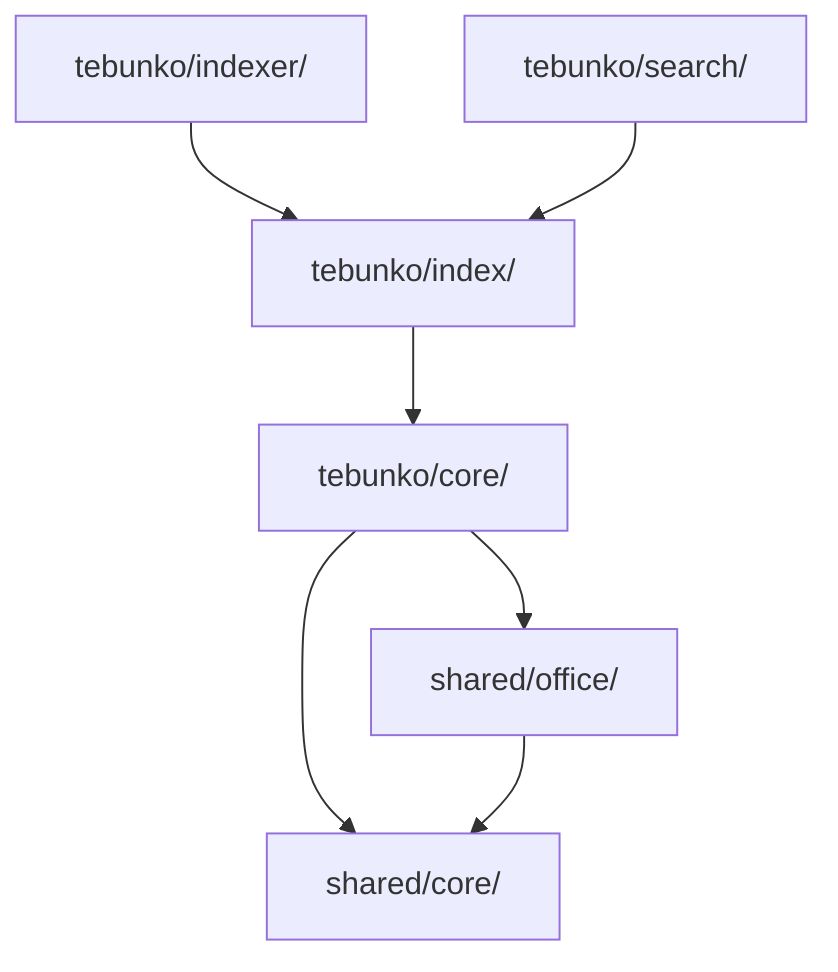
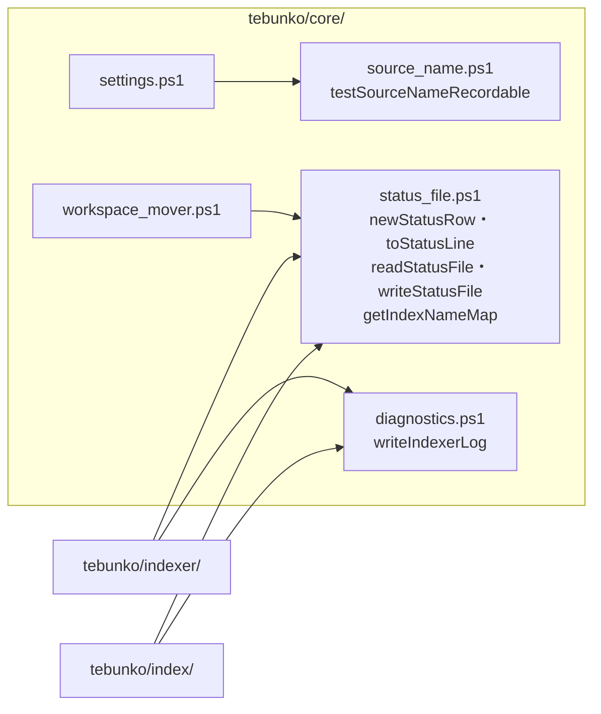
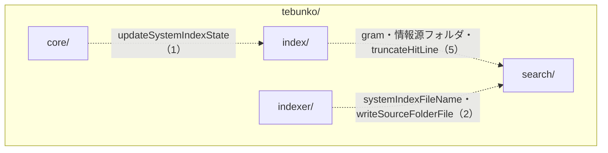
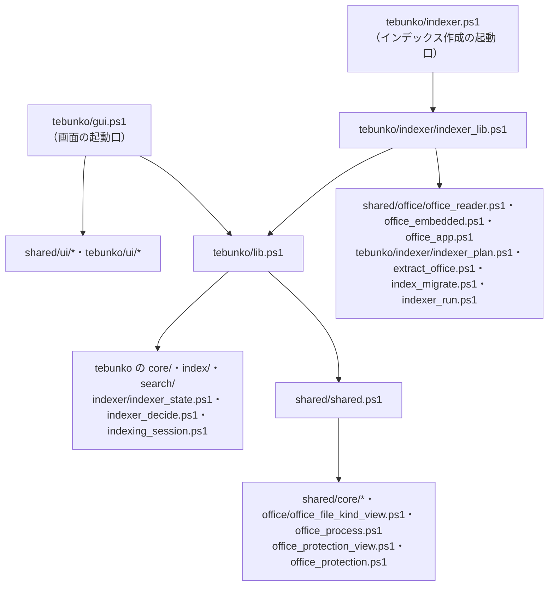

# ソースの分け方

扱うこと: `scripts/` を文脈と層で分ける考え方、フォルダごとの中身、読み込み口とその依存の向き。扱わないこと: 配布物・開発用フォルダの全体（[配布物と開発用のフォルダ構成](folders.md)）、クラス設計（[クラスと関数の使い分け](classes.md)）。先に読むページ: [設計の概要](../index.md)。

ソースは**文脈**（どの機能か）と**層**（何をするか）で分ける。どのツールにも依らない共通部分（`shared/`）と、このツール固有の部分（`tebunko/`）を分け、依存を一方向にするため。処理は**文脈**（どの機能のものか）と**層**（何をするものか）で分けて置く。

| 分け方 | 内容 |
|---|---|
| 文脈（上位） | `scripts/shared/`（どのツールからも使う）と `scripts/tebunko/`（このツール固有）。その下はドメイン（`core`・`office`・`index`・`indexer`・`search`・`ui`） |
| 層（下位） | 判断層（入力は素の値、出力は素の値）・状態層（ファイル・COM を読み書き）・画面層（`$ui` を触る） |

決まりごとは 3 つ。いずれも `tests/meta/` で機械的に確かめる（[テストの実行](../testing/run.md)）。

1. `shared/` はツールを知らない（依存は一方向）。ツール同士も互いを読み込まない。
2. 判断層は画面に触らない。触らないからテストが書ける。
3. 足したファイルは、必ずどこかの読み込み口から読み込む。

## フォルダの分け方

| フォルダ | 置くもの |
|---|---|
| `scripts/shared/core/` | パス定義（`paths.ps1`）・ファイルの読み書き（`fs.ps1`）・データの置き場所（`data_dir.ps1`）・TSV とセルの文字列（`text.ps1`）・テキストファイルの対象の拡張子・文字コードの判定・読み込み（`text_file.ps1`。取り込みのファイルが大きすぎるときの文言もここ）・TSV のファイルの読み書き（`tsv_file.ps1`）・フォルダのパスと一覧（`folder.ps1`）・スレッドのプール（`worker_pool.ps1`。`WorkerPool`・`BackgroundQueue`）・配布物の版の記録（`version.ps1`。`VERSION.txt` の読み取り）・診断情報とログの世代（`diagnostics_view.ps1`（判断層）・`diagnostics.ps1`（状態層）。ログの先頭に書く版と環境の見出しと、ログの入れ替え） |
| `scripts/shared/office/` | Office ファイルの拡張子と種類の表・種類の判定（判断層 `office_file_kind_view.ps1`）・プロセスの一覧と強制終了（`office_process.ps1`）・Office ファイルを ZIP として読む処理（`office_reader.ps1`）とその中の埋め込みファイルを読む処理（`office_embedded.ps1`）・Office アプリ（COM）の起動と終了（`office_app.ps1`）・暗号化されたファイルの種類の判定（判断層 `office_protection_view.ps1`）とその読み取り（`office_protection.ps1`） |
| `scripts/shared/ui/` | 画面の土台と共通部品（`types.ps1`・`app_host.ps1`・`shell.ps1`・`folder_dialog.ps1`） |
| `scripts/tebunko/core/` | tebunko のパス定義（`paths.ps1`）・取り込み一覧の読み書き（`status_file.ps1`）・元のフォルダを記録できる名前の判断（判断層 `source_name.ps1`）・診断の見出しとインデックス作成のログ（`diagnostics.ps1`）・設定ファイル（`settings.ps1`）・検索対象でチェックを外したフォルダの読み書きとフォルダの比べ方（`search_excludes.ps1`）・ワークスペース（`workspace.ps1`）・ワークスペースの切り替え（`workspace_mover.ps1`。`WorkspaceMover`）・［新規で開く］のコピーの作成と片付け（`open_copy.ps1`） |
| `scripts/tebunko/index/` | インデックス名と TSV の名前の決め方（`index_name.ps1`）・インデックスの作成と集計（`index_store.ps1`）・インデックスの追加・改名・削除と名前の保存（`index_catalog.ps1`。`IndexCatalog`）・検索用の本文インデックスの形式（`content_index_format.ps1`）と読み書き（`content_index_store.ps1`）・高速検索用の システムインデックスと状態（`system_index.ps1`） |
| `scripts/tebunko/indexer/` | 取り込み中のファイル・画面との受け渡しの口（`indexer_state.ps1`）・取り込み直すかの判断（`indexer_decide.ps1`）・取り込み対象の決定（`indexer_plan.ps1`）・1 ファイルの取り込みと抽出（`extract_office.ps1`）・作業フォルダ・外したフォルダのインデックスの後始末（`index_migrate.ps1`）・インデックス作成の本体と取り込みのスレッド（`indexer_run.ps1`）・画面のインデックス作成 1 回分のスレッド（`indexing_session.ps1`。`IndexingSession`）・インデックス作成の部品の読み込み口（`indexer_lib.ps1`） |
| `scripts/tebunko/search/` | 検索条件（`search_query.ps1`）・本文インデックスの検索（`content_index_search.ps1`）・検索結果の組み立てとインデックスの件数（`search_run.ps1`）・元のファイルの場所（`source_map.ps1`）・高速検索の決まり（`search_gram.ps1`）・Windows Search への問い合わせ（`windows_search.ps1`）・高速検索で照合する本文インデックスの収集（`fast_search.ps1`）・検索の司令のスレッド（`search_service.ps1`。`SearchService`） |
| `scripts/tebunko/ui/` | タブごとの画面（`*_tab.ps1` ほか）と、その判断層（`*_view.ps1`）。画面の枠（`ui/shell/`。左の欄と画面の切り替えの `nav.ps1`・判断層の `nav_view.ps1`。`startGui`（`gui_main.ps1`）の中身は `settings_recovery`・`regions`・`services`・`screens`・`window_events`・`closing`・`startup`・`activate_watch` の各 `.ps1` に分け、`startGui` の中でこの順に dot-source する。`$ui`・`$window` と `startGui` のローカル変数を共有するため、順を入れ替えない。型は `search/result_types.ps1`・`search/target_types.ps1`・`index/index_types.ps1`、インデックスの画面の判断層は `index/index_{list,edit,detail,archive}_view.ps1` に置く）と、タブに属さないもの（左の欄の［バージョン情報］と「バージョン情報」ダイアログ：`about_dialog.ps1`・判断層の `about_view.ps1` の `getAboutView`）も置く |

層は次の 3 つに分ける。**判断層は画面に触らないため、そのままテストできる**（[テスト](../testing/index.md)）。

| 層 | 例 | テスト |
|---|---|---|
| 判断層（入力は素の値、出力は素の値） | `text.ps1`・`index_name.ps1`・`source_name.ps1`・`content_index_format.ps1`・`search_query.ps1`・`search_gram.ps1`・`indexer_decide.ps1`・`*_view.ps1`（一覧は `tests/helpers/layer_paths.ps1`。`tebunko/ui/` の画面の判断層のほか、`shared/office/office_protection_view.ps1`・`shared/office/office_file_kind_view.ps1` のように `ui/` の外にも置く。テスト（`layers.Tests.ps1`）とカバレッジは名前で拾うため、置き場所によらず判断層として扱われる） | する（主にタグ `Unit`） |
| 状態層（ファイル・COM を読み書きする） | `status_file.ps1`・`indexer_state.ps1`・`index_store.ps1`・`index_catalog.ps1`・`workspace_mover.ps1`・`search_excludes.ps1`・`content_index_store.ps1`・`content_index_search.ps1`・`search_run.ps1`・`system_index.ps1`・`fast_search.ps1`・`windows_search.ps1`・`version.ps1` | する（主にタグ `Io`。`$TestDrive` を使う） |
| 画面層（`$ui` を触る） | `gui.ps1`・`*_tab.ps1`・`shell.ps1`・`app_host.ps1`・`folder_dialog.ps1`、`result_list.ps1`・`open_source.ps1`・`preview.ps1`・`index_tree.ps1` | `gui.ps1`・`*_tab.ps1`・`shell.ps1`・`app_host.ps1`・`*_dialog.ps1` は手で確かめる（カバレッジの対象外）。ほかは `$ui` を偽物にしてテストする |

依存の向きは一方向にする。**`shared/` はツール（`tebunko/`）を知らない。** ツール同士も互いを読み込まない。判断層と状態層（`core/`・`index/`・`indexer/`・`search/`・`shared/` の `core/`・`office/`）は `$ui`・`$window`・WPF の型に触らず、画面以外の読み込み口（`shared.ps1`・`lib.ps1`・`indexer.ps1`）は `ui/` のファイルを読み込まない。これらの決まりは `tests/meta/layers.Tests.ps1` で機械的に確かめる。

状態層の中のフォルダも、依存の向きを決める。上のものは下のものに依存してよく、逆は依存しない。

| 上 | 下 |
|---|---|
| `tebunko/indexer/`・`tebunko/search/`（互いに依存しない） | `tebunko/index/` |
| `tebunko/index/` | `tebunko/core/` |
| `tebunko/core/` | `shared/office/`・`shared/core/` |
| `shared/office/` | `shared/core/` |

共有の状態層（`shared/core/`・`shared/office/`）は、共有の画面層（`shared/ui/`）にも依存しない。

今の呼び出しの多い向きに合わせた（`indexer` → `index` と `search` → `index` と `index` → `core` が順向きで多く、読み込み口の順 `core` → `index` → `search`・`indexer` とも合う）。

状態層のフォルダの向きは、次の図のとおり（矢印は「依存してよい向き」）。

`tebunko/core/` には、上のフォルダ（`index/`・`indexer/`）か `core/` 自身が呼ぶ関数を置く。取り込み一覧（`store\ingest_status.tsv`）の読み書き、インデックス作成のログ、情報源の名前の判定、インデックス名の一覧がそれに当たる。ここに置いた関数は `index/`・`indexer/` の関数を呼ばず、上のフォルダは `core/` を下向きに呼ぶ。

向きの検査は、文字列ではなく構文木（AST）で行う（`tools/script_arch.ps1`。部品自身のテストは `tests/tools/script_arch.Tests.ps1`）。全部のファイルが同じスコープに読み込まれ、下の層が上の層の関数・変数を名前で使っても動いてしまうため、ファイルごとに構文木を作り、関数の呼び出し・最上位で代入した変数の読み・決めた変数（`$ui`・`$window`）と型（`System.Windows.*`）に触っていることを見る。数える書き方の詳細は、下の「依存として数える書き方」にある。

`tests/meta/layers.Tests.ps1` の「依存の向き（ファイル単位）」が、「このパスのファイルは、あのパスのファイルに依存しない」の表で決まりを書く。失敗の文には、ファイルの組と、関数・変数の名前が出る。

向きの検査は、依存があるかどうかだけを見る。境界での受け渡し（向こう側へ何を渡し、向こう側の答えをどう使うか）は、`tests/tebunko/ui/layer_boundary.Tests.ps1` が、向こう側をスタブに替えて確かめる。判断層の関数が呼ぶ状態層の関数をスタブにする組と、画面層の関数が呼ぶ判断層の関数をスタブにする組がある。境界を足したら、同じファイルに足す。

今ある逆向きの依存は、同じファイルの例外の一覧（「from のファイル・to のファイル・名前」の組と、許している理由）に載せ、増やさない。直したら一覧から消す（どの行でも見つからなくなった例外は、テストが失敗にする）。例外は、次の種類に分かれる。

- 状態層の中で、下のフォルダが上のフォルダの関数・変数を使う依存。`tebunko/core/workspace.ps1` から `tebunko/index/system_index.ps1`、`tebunko/index/` から `tebunko/search/`（gram の関数・情報源フォルダのファイルの読み書き・ヒット行の切り詰め）、`tebunko/indexer/` から `tebunko/search/` への依存が残る。どれも、下のフォルダへ関数を移すと消える。
- 判断層のファイルが、判断層でない状態層（ファイル・COM を読み書きする層）の関数・変数・クラスを使う依存。例外の行に種類を付ける。
  - `境界`: 判断層が状態層の関数に判定を任せる形。`tests/tebunko/ui/layer_boundary.Tests.ps1` の `Mock` の対象に出る関数だけが、この種類にできる（出ていなければテストが失敗にする）。
  - `移すと消える`: ファイル・COM に触らない値や関数（拡張子の一覧・状態の名前・フォルダ名の組み立てなど）が状態層のファイルにある。判断層のファイルへ移すと消える。
- 画面の判断層（`result_list_view.ps1`）が、画面層のクラス（`FileGroup`・`HitRow`）を型として使う依存と、`tebunko/index/` が `tebunko/indexer/` のクラス（`StatusLedger`）を型として使う依存。

例外の一覧に残っている依存のうち、状態層のフォルダどうしの逆向きの依存を、フォルダ単位で並べると次のとおり（点線の矢印が、決めた向きに反する今の依存。括弧は、ファイルの組ごとに 1 つと数えた一覧の行の数で、1 行に名前を複数書く行がある）。判断層から判断層でない状態層への依存（上の箇条書きの `境界`・`移すと消える`）と、クラスの型の依存は、フォルダ単位にまとまらないので、図には描かず箇条書きで示す。

共通の値を作る場所は、読む側より下の層に置く。`$workspace` は状態層の `tebunko/core/paths.ps1`（`initWorkspace`・`setCallerWorkspace`）だけが作り、画面層（`switchWorkspace`）は `initWorkspace` を呼んで作り直す。`shared/` が使うツール側の値は、ツール側が登録する（エラーの記録先と見出しは `setGuiErrorLogSource`、仕事の列は `setBackgroundQueue`・`setNetworkQueueFactory`、画面の標題は `setShellTitle`、ステータスの文の出し先は `setStatusSink`、ミューテックスの名前の先頭は `newAppMutex` の引数）。

依存として数える書き方（見つかるもの）:

- 関数の呼び出し（`${function:名前}`・`Get-Command <定数の名前>`（ワイルドカードの無いもの）も含む）。
- `=` の代入と、`Set-Variable -Name <定数>`・`New-Variable -Name <定数>`・`$variable:名前 = …`（最上位・`$script:`・`$global:` の代入と同じ条件で数える）。
- 変数を名前で読む形で、名前が定数のもの: `Get-Variable`（`gv`）、`${variable:名前}`・`$variable:名前`、`Get-Item`・`Get-Content`・`Get-ItemProperty`・`Get-ItemPropertyValue`・`Resolve-Path`・`Test-Path` などの `variable:名前`。パスが定数だけのかっこ（`Test-Path ("variable:x")`）なら、その値を読む。
- 名前を文字列の並びで受け取る関数（`newWorkerState`。`tests/meta/layers.Tests.ps1` が、1 つ目の引数を関数、2 つ目を変数の名前として渡す）の引数。`tools/script_arch.ps1` は関数の名前を知らず、一覧は呼び出す側から渡す。
- 別のファイルで定義したクラスを、`[型名]`（`[型]::new()`・引数・戻り値・変数の型）か `New-Object <型>`・`New-Object -TypeName <型>`（型が定数のもの。`'System.Collections.Generic.List[Workspace]'`・`'Workspace[]'` は `[` `]` `,` で区切った名前のそれぞれ）で使う形。`findFileDependencyItems` が `[型名]` の名で返し、例外の一覧にも同じ名で書く。
- `Set-Variable` は、`-Scope` が無いとき、名前の前の `script:`・`global:` などをスコープとして読む（`Set-Variable -Name "script:x"` は、関数の中でも `x` の最上位の変数を作る）。`-Scope` があるときは、名前の前の印は名前の一部。`New-Variable`・`Get-Variable` は、名前の前の `script:` などを名前の一部として数える（`New-Variable -Name "script:x"` は、`x` ではなく名前 `script:x` の変数）。`variable:`・`function:` ドライブは、名前の前の `script:`・`global:`・`local:`・`private:` の印を外して比べる（`Test-Path variable:script:x`・`${function:script:f}` は `x`・`f`）。`$variable:名前 = …` の代入は、`$script:` の代入と同じ条件で数える（`script:`・`global:` の印があれば関数の中でも最上位の変数）。
- コマンドの名前は、モジュール名の修飾（`Microsoft.PowerShell.Utility\Get-Command` など）を外して比べる。

呼ぶ先や読む変数が構文木から決まらない書き方は、向きの表では数えない。代わりに、`tests/meta/layers.Tests.ps1` の「名前を文字列で渡す呼び出し」が、今ある所を理由つきの閉じた一覧にし、増えたら失敗にする。ファイルと形ごとの数も一覧の行に持たせ、載っているファイルに同じ形を足しても失敗にする。形は次のとおり。

- 名前が定数でない `Get-Command`・`Invoke-Expression`（`iex`）・`Set-Alias`・`New-Alias`・`[scriptblock]::Create`・`$ExecutionContext.InvokeCommand`・`.AddCommand`・`.AddScript`
- `& (式)`・`& "展開文字列"`（呼ぶ名前が式で決まる形）
- `function:` ドライブを引く `Get-Item`・`Get-Content`・`Test-Path`・`Get-ChildItem`・`Set-Item`・`New-Item` など（読む・書くのどちらも。かっこの中の定数でない式 `Get-Item ('function:' + $n)` も）
- 名前が定数でない `Set-Variable`・`New-Variable`・`Get-Variable`
- 名前が定数でない `variable:` ドライブの読み
- `variable:` ドライブへの書き込み（`Set-Item`・`New-Item`・`Remove-Item`・`Copy-Item`・`Set-Content`・`Add-Content`・`Clear-Content`・`Clear-Item`・`Rename-Item`・`Move-Item`）
- 型が定数でない `New-Object`（`New-Object $型`）

見つからないもの（限界）:

- `& $name` の呼び出し、コールバックで渡したスクリプトブロックの中から呼ぶ形、`$ui` を別の名前の引数で受け取る形、クラスのメソッドの呼び出し。
- `using namespace` で短く書いた型。
- `Join-Path` などで組み立てたパスを、変数に入れてから渡す形（`$path = Join-Path ...; Test-Path $path`）。

同じ名前の関数・変数・クラスが、見る側のパスにもあるときは、そちらを使っているとみなす。

## 読み込み口

読み込み口は次の 2 つ。ファイルを足したら、読み込み口か起動口のどれかから読み込む（読み込み漏れは `tests/meta/layers.Tests.ps1` が起動口からたどって検出する）。読み込みは、起動口と読み込み口（`lib.ps1` など）では `. ([WildcardPattern]::Escape("$PSScriptRoot\...".Replace('`', '``')))` の形、画面の部品（`tebunko/ui/` の `gui_main.ps1` など）では `. ([WildcardPattern]::Escape("$TebunkoDir\...".Replace('`', '``')))` の形で書く（検査はこの 2 つの形の行をたどる）。フォルダ名に `[` `]` が入っていても読めるよう、相手のパスは必ず `Escape` を通す（`Escape` は 5.1 ではバッククォートをエスケープしないので、先に二重にする。対象は PowerShell 5.1 だけで、7 以降では二重になる）（通さない `. "$PSScriptRoot\..."` は、`tests/meta/structure.Tests.ps1` が落とす）。

| 読み込み口 | 読み込むもの | 使う側 |
|---|---|---|
| `scripts/shared/shared.ps1` | 共通基盤（`core/` のすべてと、`office/` のうち `office_file_kind_view.ps1`・`office_process.ps1`・`office_protection_view.ps1`・`office_protection.ps1`） | `tebunko/lib.ps1` |
| `scripts/tebunko/lib.ps1` | 上記＋ tebunko の `core/`・`index/`・`search/` と、`indexer/` のうち `indexer_state.ps1`・`indexer_decide.ps1`・`indexing_session.ps1` | 画面・インデクサ・テスト・画面が起こす別スレッド |
| `scripts/tebunko/indexer/indexer_lib.ps1` | `lib.ps1` ＋ インデックス作成だけで使う `office_reader.ps1`・`office_embedded.ps1`・`office_app.ps1`・`indexer_plan.ps1`・`extract_office.ps1`・`index_migrate.ps1`・`indexer_run.ps1` | `indexer.ps1`・取り込みのスレッド（画面は読み込まない） |

画面の部品（`shared/ui/`・`tebunko/ui/`）は `gui.ps1` が、インデックス作成だけで使うもの（`office_reader.ps1`・`office_embedded.ps1`・`office_app.ps1`・`indexer_plan.ps1`・`extract_office.ps1`・`index_migrate.ps1`・`indexer_run.ps1`）は `indexer/indexer_lib.ps1` が読み込む。`indexer_lib.ps1` は `indexer.ps1` と取り込みのスレッドが読み込む（画面は読み込まない）。

各スクリプト・テストからは dot-source（`. "$PSScriptRoot\lib.ps1"`）して使う。`ui/` の部品は `$PSScriptRoot` ではなく、`gui.ps1` から渡された `$TebunkoDir`（`tebunko/` 直下のパス）を基準に読み込む。

別スレッド（検索・背景の仕事・取り込み）の中では `$PSScriptRoot` が使えない。そのため、スレッドへ読み込ませる部品（`lib`・`indexerLib`）の読み込みは、`scripts/tebunko/core/parts.ps1` の `getPartLoad` が、呼び出し側で絶対パスに解決した `. '<パス>'` の文字列にして渡す。この文字列は、検索（`search_service.ps1`）・インデックス作成（`indexer_run.ps1`・`indexing_session.ps1`）が、別スレッドへ渡す前に `joinWorkerScript`（`shared/core/worker_pool.ps1`）でスレッドの本体の前につなぐ（背景の仕事の `WorkerPool` も、`worker_pool.ps1` の中で同じようにつなぐ）。スレッドの中には読み込みの行を書かないので、検査がたどる対象にならない（部品は `lib.ps1`・`indexer_lib.ps1` を通して読み込み漏れが見つかる）。

## 起動口となるスクリプト（`scripts/`）

| パス | 種別 | 説明 |
|---|---|---|
| `scripts/shared/` | スクリプト | どのツールからも使う部品（`core/`・`office/`・`ui/`・`xaml/`） |
| `scripts/shared/shared.ps1` | スクリプト | 共通基盤の読み込み口 |
| `scripts/shared/office/office_embedded.ps1` | スクリプト | Word・PowerPoint に埋め込んだ Office のファイル（.xlsx・.docx・.pptx）を、メモリの上で ZIP として読み、中の文字を取り出す。`office_reader.ps1` の後に読み込む（読み方は [Word の埋め込みの読み取り](../indexing/word.md#埋め込みの読み取りreadembeddedobjectlines)） |
| `scripts/shared/office/office_reader.ps1` | スクリプト | Office ファイルを ZIP として直接読み、Word・PowerPoint の本文・図形・コメント・SmartArt・グラフと、Excel の図形・コメント・SmartArt・グラフ（表示のグラフシートを含む）の文字を取り出す（[インデックスのファイルの形](../index-data/format.md)、[Word・PowerPoint の共通処理と Office アプリの管理](../indexing/office-apps.md)、Word は [Word](../indexing/word.md)、PowerPoint は [PowerPoint](../indexing/powerpoint.md)、Excel は [Excel](../indexing/excel.md)） |
| `scripts/shared/xaml/` | 画面定義 | 共通の画面定義（`theme.xaml`・確認ダイアログ） |
| `scripts/tebunko/` | スクリプト | tebunko 固有の処理と画面（`core/`・`index/`・`indexer/`・`search/`・`ui/`・`xaml/`） |
| `scripts/tebunko/gui.ps1` | スクリプト | 画面の起動口（[画面](../gui/index.md)）。検索・残った Office の終了は画面の中で行う |
| `scripts/tebunko/indexer.ps1` | スクリプト | インデックス作成の起動口（[インデックス作成](../indexing/index.md)）。画面は自分のプロセスのスレッドでこれを実行する（`-Channel`）。画面を使わずにコンソールから実行することもできる |
| `scripts/tebunko/lib.ps1` | スクリプト | 画面以外の部品の読み込み口 |
| `scripts/tebunko/xaml/` | 画面定義 | tebunko の画面定義（`tebunko.xaml`・タブ・ダイアログ） |
| `scripts/tebunko/startup/*.txt` | 文言 | `tebunko.bat` が起動に失敗したときに読む、場面ごとの文言（BOM 付き UTF-8・CRLF）。`tebunko.bat` は ASCII で書く決まりのため、日本語の文言はここに分ける。読み込み口からは読まない（スクリプトではない）（[起動に失敗したときの知らせ](../../safety/disclosure.md#起動に失敗したときの知らせtebunkobat)） |
| `scripts/tebunko/xaml/app_icon.xaml` | 画面定義 | 画面のアイコン（ベクターの絵。[画面の共通の決まり](../gui/common.md)）。元データは `docs/images/logo.svg`（リポジトリの管理者が作成）で、`tools/new_icon.ps1` で作る。手で編集しない |
| `scripts/tebunko/tebunko.ico` | 画像 | インストーラー・ショートカットなど、Windows が `.ico` しか受け付けない所のアイコン。`app_icon.xaml` と同じ `docs/images/logo.svg` から `tools/new_icon.ps1` で作る。画面は読まない。手で編集しない |

リリースでは、上の `scripts/` をそのまま使う zip・インストーラーに加えて、`tools/new_single_script.ps1` が読み込み口をたどって 1 本の `.ps1`（`tebunko-<タグ>.ps1`）に機械的に結合した試験版も作る。結合の元は変えないため、ここで決めたフォルダ・層・読み込み口の決まりはそのまま効く（[単一 PowerShell のビルド](single-script.md)）。
