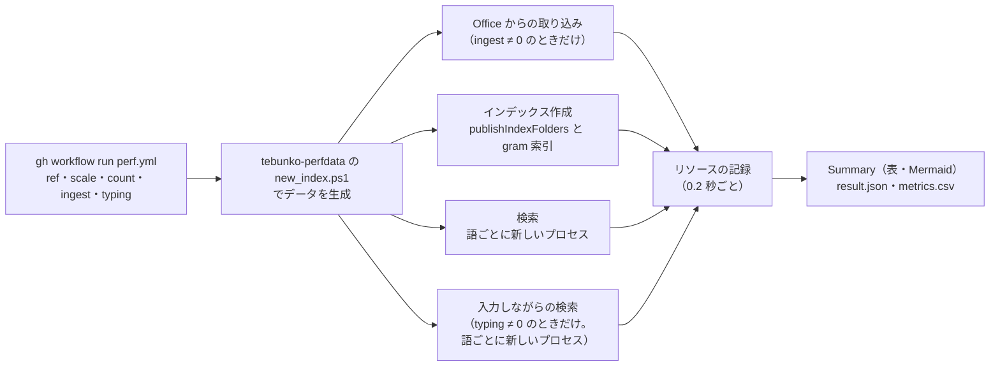

# 性能とリソースの計測のしかた

扱うこと: perf.yml による手動計測（取り込み・インデックス作成・検索・入力しながらの検索の速さとリソース）、手元の Windows での取り込み・入力しながらの検索の計測、取り込みの計測が頼る「計測の口」。扱わないこと: 速さの回帰テスト（[速さの回帰テストと上限の決め方](perf-check.md)）。先に読むページ: [CI](ci.md)。

## perf.yml（性能とリソースの計測）



手動で起動し、決まった量のデータで、Office からの取り込み、インデックス作成、検索の速さ、およびその間のリソース（メモリ・CPU・スレッド・ハンドル・GC）を測る。大きな変更の前後で数字を比べるときなどに使う。必須のチェックではない。

```
gh workflow run perf.yml -f ref=<測る ref> -f scale=0.1 -f ingest=200
```

- 入力: `ref`（測る ref。作業中のブランチも測れる）、`scale`（データの量。`0.04` はブック約 2,100・TSV 約 6,400（入力しながらの検索の 7,000 件規模）、`1` でブック 5.4 万・TSV 16 万・約 1GB）、`count`（語ごとに続けて検索する回数。既定 20）、`ingest`（取り込みを測る .docx・.pptx のそれぞれの数。`0` `200` `1000`。既定 `0` は取り込みを測らない。検索だけを測る起動が長くならないようにする）、`xlsx`（Excel のブックを ZIP から読む部分を測る、普通のブックを読む回数。`0` `5`。既定 `0` は測らない）、`typing`（入力しながらの検索を測る、語ごとの入力の繰り返し回数。`0` `10` `20`。既定 `0` は測らない）、`typing_min_length`（入力しながらの検索で最初に送る語の長さ。`3`（既定。画面と同じで合否を決める）・`1`（短い語の取り消しを多く含む厳しめの参考値））
- 計測スクリプト（`tools/measure_perf.ps1` と `tools/perf/`）はワークフローの ref から、計測対象のコードは入力の ref からチェックアウトする。計測スクリプトが呼ぶ関数（`publishIndexFolders`・`getContentIndexFiles`・`searchContentIndex`。名前を改める前の版の `getIndexPackFiles`・`searchPackIndex` でもよい）が無い ref（本文インデックスの形式より前の版）では、エラーメッセージを出して止まる
- データは [tebunko-perfdata](https://github.com/hsgwa/tebunko-perfdata) の `new_index.ps1` で毎回生成する（取り込みの一時置き場と同じ形の TSV）。置き場は `<作業フォルダ>\store\content\perfdata`（ワークスペースの本文インデックスの置き場と同じ形。`<作業フォルダ>` がワークスペースになり、gram 索引は `<作業フォルダ>\store\gram` に作る）。使う版は `perf.yml` の `PERFDATA_SHA` でコミットに固定する。検索する語は同じリポジトリの `words.tsv`（0 件・まれ（3 件）・大量・正規表現）
- ジョブの制限時間（`timeout-minutes`）は 360 分（GitHub のホストのランナーの上限）。`scale` が大きいと、データの生成・pack の作成・gram 索引の作成・検索（大量の語・正規表現は gram 索引で絞れず、1 回が長い）の合計が 120 分を超える。段ごとの時間は Summary の「インデックス作成」と「検索」の表と、`data_seconds` で分かる
- 測るもの（それぞれ別のプロセスで動かし、リソースが混ざらないようにする）
  - Office からの取り込み … `ingest` が `0` でないときだけ。`tools/perf/new_ingest_data.ps1` でテストデータ（`tests/testdata/office`）の複製を作り（.docx・.pptx を `ingest` 個ずつ。50 ファイルごとにフォルダを分ける）、`measure_perf.ps1 -Office` で測る。ランナーには Office が無いので、Office を使わずに読むファイル（.docx・.pptx。読み取りのスレッド）だけを測り、Excel・Word・PowerPoint を使う取り込み（.xlsx・.doc・.ppt）は手元の Windows で測る（下の「取り込みの計測」）
  - Excel の流れ読み … `xlsx` が `0` でないときだけ。`tools/perf/measure_xlsx.ps1` を起動し、ブックをその場で ZIP から組み立てて（`tools/perf/xlsx_data.ps1`。Office は使わず、テストデータにも置かない）、`readXlsxObjectUnits`（図形・コメント・ヘッダー／フッターを読む。シートの流れ読みを含む）の時間を測る。シート 1 枚の普通のブックを `xlsx` 回読んだ時間（最小・中央値・平均・最大）と、同じシートの部品を指す `<sheet>` を 200 個並べたブックを 1 回読んだ時間を出す。直す前と後の ref を、それぞれ同じ形で測って比べる（`metrics.csv` の `xlsx_normal_ms`・`xlsx_many_ms`）
  - 検索結果の書き出し … `export` が `0` でないときだけ。`tools/perf/measure_export.ps1` を起動し、合成のヒット 1 万件（Excel・Word・複数行・タブを含むセルを混ぜる）を `invokeSearchExport`（検索の司令のスレッドが使う書き手）で Excel ブック・CSV・TSV に書き出す時間を、形式ごとに `export` 回測る（最小・中央値・平均・最大）。書いた件数・書けなかった回数・ファイルの大きさ・ワーキングセットも出す。直す前と後の ref を、それぞれ同じ形で測って比べる（`metrics.csv` の `export_<形式>_ms`）
  - インデックス作成 … インデクサと同じ `publishIndexFolders`（本文インデックスを書く・TSV を消す）。Office からの取り込みは、下の取り込みの計測で別に測る。画面ではインデックス作成のスレッドの優先度を下げている（BelowNormal）が、計測ではほかに動くものが無いので、優先度は下げずに測る。pack の作成のあとに、検索が使う gram 索引を `updateGramIndexes` で作り、秒・ファイル数・大きさ（`Index.Gram`。`metrics.csv` の `gram_seconds`・`gram_files`・`gram_mb`）を出す。置き場が `<W>\store\content\<名前>` の形でないときと、測る版に `updateGramIndexes` が無いとき（#235 より前）は作らず、`Index.Gram.Skipped` に理由を書く（失敗にしない）。この PR より前の結果は gram 索引なしの数字なので、比べるときは区別する
  - 検索 … 語ごとに新しいプロセスを起動し、同じプロセスで `count` 回続けて検索する（上限 1 万件）。画面と同じく、検索の司令のスレッド（`newSearchService`）を 1 つ作り、要求（`newSearchRequest`）を順に送る。`lib.ps1` の読み込みと照合のスレッドの用意は司令のスレッドが始めに 1 回だけ行うので、1 回目の時間に含まれる。検索のキャッシュも画面と同じくプロセスで 1 つを持ち続ける。語ごとに、検索時間の最小・中央値・平均・最大と、その内訳（列挙・照合）を出す。1 回目は画面を開き直した直後の検索に当たり、たいてい最大の値になる。置き場が `<W>\store\content\<名前>` の形で、要求に `workDir` を渡せる版では、検索先を画面と同じ形（`Root` = `<W>\store\content`・`RelPath` = `<名前>`）で渡し、`workDir` も渡すので、検索は gram 索引で pack を絞る（そうでない版・置き場は今までどおり文字列で渡し、絞らない）。表の「照合した pack（gram で絞った数／全部）」は、絞った後に照合した pack の数（`Packs`）と、絞る前の全部の pack の数（`AllPacks`。ループの前に 1 回数える）。gram 索引を使わなかった語は「–／全部」と出る。「gram を使った回数／回数」は `GramUsed`（`searches.csv` にも出る）、「1 回目」は 1 回目の `ShownMs`、「数え終わるまで」は `TotalMs`。列挙の時間は、gram 索引で絞る時間を含む
    - 司令のスレッドが無い版（#102 より前）は、その版の画面と同じく、検索のたびに新しい Runspace で `lib.ps1` を読み込んで測る（内訳に読み込みの時間も出す）。どちらで測ったかは結果の `SearchMode`（`service` / `runspace`）に出るので、#102 の前後を同じワークフローで比べられる
  - 入力しながらの検索 … `typing` が `0` でないときだけ。語ごとに新しいプロセス（`tools/perf/measure_typing.ps1`）を起動し、語を `typing_min_length` 文字目から 1 文字ずつ伸ばした語（画面のインクリメンタルサーチと同じ）を、150 ms おきに検索の司令のスレッド（`newSearchService`）へ送る（新しい要求は前の要求を取り消す）。これを 1 回の入力として `typing` 回繰り返す。測るのは、最後の要求を渡した時点（渡す時間を含む）から、前の要求がすべて終わるまで・最初のヒットまで・検索が終わるまでの時間。1 回目は画面を開き直した直後の入力に当たるため、統計（最小・中央値・平均・最大）は 2 回目以降から作る。時刻は Windows のタイマーの細かさの分、大きく出る側に最大で約 16 ms の誤差がある。画面はヒットを 100 ms ごとに取り込むため、画面に出るまでは最大で約 100 ms 長くなる。検索の司令のスレッドが無い版（#102 より前）は測らない（結果の `Typing.Mode` が `none` になる。失敗にはしない）
  - 選択行のプレビュー … `perf.yml` では測らない。`measure_perf.ps1 -Preview <件数>` で、検索で見つかったヒットの先頭から件数分を、結果の表を↓キーで移るのと同じ順に、検索のキャッシュ無し・ありの両方でプレビューする（語ごとに新しいプロセス `tools/perf/measure_preview.ps1`。ヒットの無い語は飛ばす）。1 回ごとの読み込み（画面の最初の読みと同じ呼び方の `readContentIndexLines`。前に読んだファイルの控えを次の読みに渡す）と表づくり（`HitRow.BuildPreview`）の時間・作ったセルの数・メモリを `preview.csv` に、語ごとの統計と、GC のあとに残るメモリ・検索のキャッシュを捨てた分を `result.json` の `Preview`・`metrics.csv`・`summary.md` の「プレビュー」に出す。`-Render`（`-Preview` と一緒に指定。STA で動く）は、いちばん大きな表を画面の部品に入れて Measure・Arrange する時間も 5 回測り（描画は、残るメモリを取ったあとに行うので、残るメモリには入らない）、1 回目（部品の初期化が入る）と 2 回目以降の中央値・最大、行・列・セルの数を `Preview.Words[].Render`（`FirstMs`・`RestMs`。形式の版 4 で追加）に出す。表を作る時間も、最初の 1 回と 2 回目以降に分けて `BuildFirstMs`・`BuildRestMs`（版 4）に出す。見えている範囲のセルだけを作る今の表のために、表の行がそのとき持っているセルの数（`CreatedCells`。見える範囲を作ったあとの数）と、描画の部品の数・右と下へスクロールして範囲を作り直す時間・横に 30 px 刻みで 1 画面ぶん動かす時間（`HScrollMs`）と範囲を決め直した回数（`HScrollChanges`。2 以下を確かめる）・描画のあとに残るメモリ（`Render` の `Elements`・`ScrollMs`・`RenderRetainedMB`）も出す（版 5）。`RenderRetainedMB` は、表を持ったまま描画を繰り返し、GC をしたあとのマネージドヒープの、描画の前からの増え（表と部品を保持している間の値。手放したあとの値ではない）。`-ReadMore`（`-Preview` と一緒に指定）は、セルの数が最大だった行の表へ下に 200 行ずつ最大 5 回読み足す時間（読む・行を作る・見える範囲のセルを作る）を `Preview.Words[].ReadMore`（版 5）に出す。`-PreviewFullRead`（`-Preview` と一緒に指定）は、控えを捨てて毎回ファイルの全体を読む（初めて開くファイルの最初の読みに当たる）読み方でも、別のプロセスで同じ選択を測り、`Preview.Words[].FullRead`（形式の版 3 で追加）に今の読み方と同じ形で並べる。切り替えが効いたかは、`readContentIndexText` が呼ばれた回数（`ReadTextCallsUncached`）で確かめ、呼ばれていなければ失敗にする。`perf-check.yml` の `search` ジョブが上限と比べる（[速さの回帰テストと上限の決め方](perf-check.md)）
  - リソース … 別のスレッドで 0.2 秒ごと（および段階の切り替わり）に、プロセスのワーキングセット・プライベート・マネージドヒープ、CPU 時間、スレッド・ハンドルの数、GC の回数と、PC 全体の CPU・空きメモリを記録する。検索では、検索 1 回ごとのメモリも記録し、10 回あたりの増え方（最小二乗の傾き）を出す（検索を続けたときにメモリが増え続けないかを見るため）
- OS のファイルキャッシュは空にしない。本文インデックスは作成の直後なので OS のキャッシュに載っており、PC を起動した直後の検索（ディスクから読む）とは違う
- 結果は、ジョブの Summary（表と Mermaid のグラフ）と、artifact `perf-<実行の番号>`（保存期間は 90 日）に出力する。パスやファイル名は出力しない
  - `summary.md` … Summary と同じ内容（「Excel の流れ読み」「Office からの取り込み」「入力しながらの検索」の節を含む）
  - `result.json` … すべての数字。形式の版（`Schema`。gram 索引の項目を足した版が 6）と実行の情報（実行の番号・ref・コミット・scale・日時・ランナーの CPU）を含む
  - `metrics.csv` … 1 行 1 指標の縦長の形（`run_id, date, ref, sha, scale, metric, word, stat, value, unit`）。実行をまたいで数字を貯め、Grafana などで見るときに使う（貯める仕組みはまだ無い）
  - `searches.csv`（検索 1 回ごと）・`typing.csv`（入力しながらの検索、1 回の入力ごと）・`resource-xlsx.csv`・`resource-ingest.csv`・`resource-index.csv`・`resource-search.csv`・`resource-typing.csv`（リソースの記録）
- ランナー（4 コア）は手元の PC と条件が違う。Defender のリアルタイム保護の状態は、結果の「環境」に出力する。比べるときは、同じワークフローで測った数字どうしで比べる。同じ条件でも、本文インデックスの作成の時間は 5 割ほどぶれることがある
- 手元でも同じ計測スクリプトで測れる（`.\tools\measure_perf.ps1 -Index <TSV のフォルダ> -Work <作業フォルダ> -Words <words.tsv> -Typing <入力の回数>`）。渡した TSV は本文インデックスに変換され、元の TSV は削除される

## 取り込みの計測（手元の Windows。Excel・Word・PowerPoint が入った機械で）

```
.\tools\perf\new_ingest_data.ps1 -Dest C:\perf\office -Docx 50 -Pptx 50
.\tools\measure_perf.ps1 -Office C:\perf\office -Work C:\perf\work -Repeat 1
```

- データ（`new_ingest_data.ps1`）… .docx・.pptx（`-Docx`・`-Pptx`。既定 200）、.doc・.ppt（`-Doc`・`-Ppt`。既定 0）はテストデータの複製、.xlsx（`-Xlsx`。既定 0）は tebunko-perfdata の `new_books.ps1` で作ったブック（`-Books`）の先頭の数冊。50 ファイルごとにフォルダを分ける（フォルダごとの本文インデックスの書き出しも一緒に測るため）。同じ引数からは同じ構成・同じ中身になる。Excel は .xlsx、Word は .doc、PowerPoint は .ppt を読むので、使う Office はデータにある種類で決まる
- 測り方（`tools/perf/measure_ingest.ps1`）… `-Repeat` 回（既定 3）、1 回ごとに新しいプロセス・空のワークスペースで流す（Office の起動を含む、初めての取り込みの時間）。測る tebunko の `scripts` を作業フォルダに写して `setting.config` を書くので、利用者の設定・既定のワークスペース・リポジトリの `setting.config` には触らない。取り込みは起動口 `indexer.ps1 -Channel` で動かし、記録のスレッドが受け渡しの口の `Progress.Phase` を読んで、段階（クロール・確認・取り込み・仕上げ）ごとの時間とリソースを出す。1 ファイルあたりの ms は、取り込みの段階の秒 ÷ ファイル数
- 成功・失敗は、ワークスペースの `store\ingest_status.tsv` を計測の側で読んで数える（同じ相対パスは最後の行の状態）。成功 + 失敗がファイル数と合わなければ、終了コードが 0 でなければ、取り込みの段階が読めなかったとき・知らない段階の名前が来たときは、計測を失敗にする。失敗したファイルがあれば `summary.md` に書く
- 段階ごと・種類ごとの時間は、取り込みの終わりに受け渡しの口の `StageTimings` に入り、`measure_ingest.ps1` の JSON の `Stages`（秒。起動・クロール・取り込み・仕上げのまとめ・gram 索引・その他・全体と、内訳のうちまとめ）と `Kinds`（種類ごとの件数・抽出・コピー・置き場への移しの秒・1 件の平均 ms）になる。同じ内容がインデックス作成ログにも出る（[警告・お知らせ](../indexing/log-warnings.md)）。`Progress.Phase` から出す段階の秒とは別の測り方で、全体との差が小さいかを見る確かめに使える。`StageTimings` が無い版では `null`
- リソースの表が測るのは、計測の PowerShell のプロセスだけ。EXCEL・WINWORD・POWERPNT のプロセスは含まない（「PC の CPU」には含む）
- Office を使う取り込み（.xlsx・.doc・.ppt）の時間に固定の上限を付けた合否のテストは無い。Office の時間は機械・Defender・Office の版で大きく揺れるので、比べるのは同じ機械・同じ日・同じ引数で続けて測った数字どうしにする（Office の版は結果の実行の情報に出す）。比べ方は下の「Office を使う形式の比べ方」。Office を使わずに読む .docx・.pptx は、`perf-check.yml` が固定の上限と比べる

## 計測の口（取り込みの計測が頼るもの）

取り込みのコードを書き直すときは、この口を変えない。変えるときは、先に計測（`measure_ingest.ps1`）を直し、変える前の版を測り直してから比べる。

| 口 | 中身 |
|---|---|
| 起動口 | `scripts\tebunko\indexer.ps1 -Channel <口>`。終了コード 0 = 完了 |
| 読み込み口 | `scripts\tebunko\lib.ps1`（`resolveTebunkoLib` が頼っている）の `newIndexerChannel`（引数 `retryFailed`・`confirmTargets`・`workers`） |
| Excel の流れ読み | `scripts\tebunko\indexer\indexer_lib.ps1`（`lib.ps1` も読み込む）が読み込む `readXlsxObjectUnits`（引数 `path`・`failures`・`sizeFailures`）。無い版は `xlsx` を渡すと失敗する |
| 受け渡しの口 | `Progress.Phase` と、その値 `クロール`・`確認`・`取り込み`・`仕上げ`。`StageTimings`（`@{ Stages; Kinds }`。段階ごと・種類ごとの時間。無い版は `$null` として扱う） |
| 設定 | `setting.config` がツールのフォルダにあること。キー `targetFolders`（`@{ name; path; enabled }` の配列）・`workspaceFolder`・`ingestThreads` |
| 取り込み一覧 | ワークスペースの `store\ingest_status.tsv`。見出しの `相対パス`・`状態`。状態の値 `済`・`失敗` |
| 取り込んだ結果 | 最後の回のワークスペース（`<作業フォルダ>\ingest\ws`。`measure_ingest.ps1` は次の回の始めまで消さない）の下に、本文インデックスのファイル `content_index.*.tsv`（[インデックスのファイルの形](../index-data/format.md#配置命名規則)の形。サブフォルダの下にもできる）があること。取り込みの回帰テスト（`perf_ingest.Tests.ps1`）が、数と合計の大きさを数える |


## 処理の記録（trace）と、起動から最初の検索までの計測

処理のどこにどれぐらい時間がかかったかを、区分ごとに入り切りできる形で記録する口。普段は何もしない（環境変数 `TEBUNKO_TRACE` が無ければ、控えもファイルも作らない）。速さの直しの前に、まず「どこに時間がかかっているか」を実測で見るために使う。

| 項目 | 中身 |
|---|---|
| 口 | `scripts/shared/core/trace.ps1`（`initTrace`・`testTrace`・`markTrace`・`writeTrace`）。ツールを知らない。書けなくても例外を出さない |
| 入り切り | 環境変数 `TEBUNKO_TRACE` に区分名をカンマで並べる（例 `startup,search`。`*` で全部。空・未設定なら全部切り）。読むのは `gui.ps1` の先頭の 1 か所だけ。検索の司令のスレッドには、`SearchService` が同じ指定と同じ起点を渡す |
| 経過の起点 | 画面のプロセスの起動時刻。スレッドの間で同じ起点を使うので、画面と司令のスレッドの記録を並べて読める |
| 出力先 | ワークスペースの `trace\<プロセスの起動日時>_<PID>_<スレッドの番号>.tsv`。列は 時刻・経過ミリ秒・区分・名前・スレッド。ネットワークのワークスペースには書かない。スレッドごとに別のファイルなので、混ざらない。ワークスペースを移すときには移さない（診断用） |
| 書く時 | 区分ごとに、1 回の区間が終わった時にまとめて 1 回（下の表）。`startup` は最初の検索の 1 回だけ（`-Once`） |
| 区切りを入れるときの注意 | `GetNewClosure()` したスクリプトブロック（`startWorkspaceMove` の終わりの処理など）の中からは、関数を名前で呼べない（`markTrace` も同じ）。区切りは、そのコールバックが呼ぶ関数（`finishWorkspaceMove` など）の中に置く |
| 入れない所 | インデクサ（別プロセス）。インデクサの中の段階ごとの時間は、取り込みの段階のログ（`IngestTiming`）にある |

### 区分と入れ所

| 区分 | 区間（始まり → 区切り → 終わり） | 書く時 |
|---|---|---|
| `startup` | 下の区切り 1〜11 | `finishSearch`（最初の 1 回） |
| `search` | 画面: 送り（`startSearch`）→ 最初の行（`pumpSearch`）→ 総数（`finishSearch`）。司令のスレッド: 受け取り → gram 索引で絞り終え → ファイルの列挙の終わり → `searchContentIndex` の終わり → 終わり（`narrow`・`cancelled`・`error`・`done` を名前に付ける） | 画面は `finishSearch`、司令は `invokeSearchRequest` の終わり |
| `preview` | 行を選ぶ（`showDetail`）→ 本文が入る（`applyDetail`）。続きを読む: `startReadMore` → `applyReadMore` | `applyDetail`・`applyReadMore` の終わり |
| `archive` | 始め（`startIndexArchiveJob`。名前に エクスポート／インポート が付く。ダイアログの前の準備の仕事〈大きさを数える・目録を読む〉と本番の仕事の 2 回通るので、記録も 2 組出る）→ 最初の進み具合（`updateImportProgress`。進み具合が 0 でなくなった最初の 1 回）→ 裏の仕事の終わり → 一覧・ツリーの読み直しの終わり | 読み直しの終わり（失敗のときは裏の仕事の終わり） |
| `workspace` | 移動の始め（`startWorkspaceMove`）→ 裏の移動の終わり（`finishWorkspaceMove` の始め）→ 画面の読み直しの終わり（`finishWorkspaceMove`） | `finishWorkspaceMove` の終わり |
| `index` | 開始の押下（`startIndexing`）→ 確認の画面を閉じる（`confirmIndexingTargets`）→ インデクサのプロセスを起動（`continueStartIndexing`）→ 最初の進み具合（`updateIndexingProgress`）→ 終わりを受ける（`finishIndexing` の始め）→ 一覧・ツリーの読み直しの終わり | `finishIndexing` の終わり |

入れ所は `tests/meta/trace_points.Tests.ps1` が確かめる（関数を移す・名前を変えるときは、その表も直す）。

### 起動から最初の検索までの区切り（`startup`）

| 区切り | 区間の終点 | 取る所 |
|---|---|---|
| 1 | PowerShell の起動（プロセスの開始 → `gui.ps1` の先頭） | `gui.ps1` |
| 2 | WPF の読み込みと起動中の表示（`stepSplash 5`） | `stepSplash` |
| 3 | `shared.ps1`・`settings.ps1`・`lib.ps1` ほかの読み込み（`stepSplash 50`） | `stepSplash` |
| 4 | 多重起動の判定・ワークスペース・XAML と部品の読み込み（→ `Loaded`） | `window_events.ps1` |
| 5 | 窓が出る（`Loaded` → `ContentRendered`） | `window_events.ps1` |
| 6 | 起動時の読み込みの画面のスレッドの分（`loadStartupData` の終わり） | `startup.ps1` |
| 7 | 裏の列に出したインデックスのツリーが画面に入る | `applyIndexTreeData` |
| 8 | 検索の司令のスレッドの用意が済む（画面と並んで進むので、他の区間とは重ねて読む） | `markSearchSentTrace` |
| 9 | 検索の送り | `markSearchSentTrace` |
| 10 | 表に最初の行が出る | `pumpSearch` |
| 11 | 総数が決まる | `finishSearch` |
| 12 | 送りまでに、窓が入力を受け付けなかった最長の時間（外から測る） | `measure_startup.ps1` |

### 測り方（手元の Windows）

```
.\tools\perf\measure_startup.ps1 -Workspace <インデックス入りのワークスペース> -Words "語1","語2" -Count 5 -Out <結果のファイル>
.\tools\perf\read_trace.ps1 -Dir <ワークスペース>\trace -Category preview
```

- `measure_startup.ps1` は、ツール（`scripts\`）を一時フォルダに写し、`-Workspace` を指す設定ファイルを置いて、`TEBUNKO_TRACE=startup,search` で画面を起動する（語ごとに、1 回目は温めとして別に出し、あと `-Count` 回）。窓が出たら UI オートメーションで語を入れて検索を押し、記録に `startup` の行が書かれたら閉じる。起こしたプロセスの PID だけを閉じる・止める（名前で探して止めない）。記録は `-Workspace` の `trace\` に書かれ、読んだあとにその回の分を消す。
- 起動は `tebunko.bat` と同じ呼び出しの形（`powershell.exe -Command "& gui.ps1"`）。`tebunko.bat` は子のプロセスを `start` で切り離すため、PID を控えられない。
- 表は区間の長さ（終点 - 始まり）と経過（起点から）の、中央値と最大。区間の始まりは表の中の前の区切り（8 は `stepSplash 50`）。外から測った「起動 → 記録が書かれる」と区切り 11 の経過の差も添える。
- `read_trace.ps1` はどの区分の記録にも使える（`-Category`）。区切りの定義を渡さないときは、記録に出てきた名前を経過の中央値の順に並べる。
- 検索の中の内訳（読み込みと照合）は、`measure_search.ps1` の `LoadMs`・`ListMs`・`MatchMs` で補う。
- 速さの計測は、手元でなく CI（`perf.yml`）で行うのが基本。この計測は、直す所を決めるための一度きりの切り分けで、`perf.yml` には入れていない。
