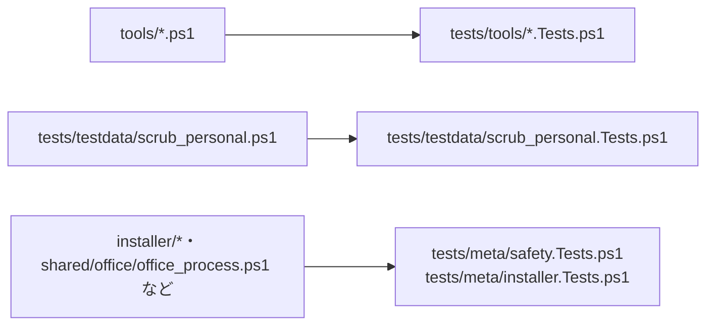

# 単体テスト（検査と道具）

扱うこと: 開発用の道具（`tests/tools/`）・テストデータの個人情報の除去・安全性の検査・インストーラーの検査の単体テストが何を確かめるか。扱わないこと: インデックス・検索・Office のテスト（[単体テスト（インデックスと検索）](unit-index.md)・[単体テスト（Office）](unit-office.md)）。先に読むページ: [テスト](index.md)。

**開発用の道具（`tests/tools/`）**

| 対象 | 主な確認内容 |
|---|---|
| `check_commit_message.ps1` | 形が合うタイトルを通し、違うものを止める、git が自動で作るメッセージは調べない、コメント行と空行を飛ばして最初の行を調べる、CRLF のファイル、空のメッセージは通す |
| `check_signoff.ps1` | 作者の `Signed-off-by` があり、ほかの `Signed-off-by:` の行（山かっこ無し・後ろに文字が続く・山かっこが 2 つ・名前だけの行を含む）が無ければ通す、無い・作者の形でない行が 1 つでもあれば止める（出力に違う行のメールアドレスは出さず、`-Range` は SHA だけ）、コメント行と `git commit -v` の差分の中は数えない、マージコミット・bot は調べない |
| `check_release_tag.ps1` | 形が合うタグを通し、形が違うもの（`v1.0`・`V1.0.0`・`v01.0.0`・全角の数字・接尾辞・末尾の改行など）を止める。指すコミットが main にあれば通し、無いときと、参照を解決できないときは、別の理由の文言で止める |
| `check_markdown_links.ps1` | あるファイル・フォルダ・見出しへのリンクを通し、切れたリンクを止める、コードの中のリンクは調べない、1 行に複数あるリンクをそれぞれ調べる |
| `pr_checks_comment.ps1` | 結果（`success`・`failure`・`cancelled`・`skipped` など）から表示文字への読み替え、複数のジョブの結果（カンマ区切り）から悪いほうを選ぶ（`combineJobResults`）、実行へのリンクが自分のリポジトリの形のときだけ通る、書き換える対象のコメントを作者（`github-actions[bot]`）と 1 行目のワークフローごとの目印（`<!-- pr-check:<id> -->`）で選ぶ（ほかのワークフローの目印のコメントは選ばない）。書き込みで例外が出ても投げずに警告として返すこと（`tryInvokePrCheckComment`）、コメントに head のコミットを添えること。各ワークフローの `pr-comment` ジョブが複合アクション（`.github/actions/pr-comment`）を `workflow-key` 付きで呼び、`pull-requests: write` をそのジョブだけに付け、呼ぶ前に既定のブランチを checkout していること、`release.yml` の許可、perf-check の、両方スキップのときに書かない条件は `Meta` で確かめる |
| `measure_perf.ps1` | 統計値（最小・中央値・平均・最大）と最小二乗の傾きの計算、点の間引き、グラフの行の書き方。小さなインデックスで最後まで動かし、フォルダ・ブック・TSV・本文インデックスのファイルの数、語ごとのヒット件数と検索時間の統計値、検索の流れ（`SearchMode`）、`result.json` の形式の版と実行の情報、`metrics.csv` の列と行、`summary.md` の表とグラフ（パスを含まないこと）を確かめる。本文インデックスしか無いインデックスでは、作成を測らずに検索だけを測る。`-Office` の取り込みは、`new_ingest_data.ps1`（種類ごとの数・50 ファイルごとのフォルダ分け・同じ引数から同じ構成になること）、取り込み一覧の数え方（同じ相対パスは最後の行・成功 + 失敗がファイル数と合わなければ失敗）、段階が読めないときと知らない段階のときの失敗、記録のスレッドが受け渡しの口の段階を読むこと、小さな .docx・.pptx のデータで最後まで動かして `result.json` の `Ingest`・`metrics.csv` の `ingest_` の行・`summary.md` の「Office からの取り込み」の表（パスを含まないこと）を確かめる。`-Xlsx`（Excel の流れ読み）は、小さなブック（`-XlsxRows`・`-XlsxManyRows` で行の数を絞る）で `-Xlsx 2` を流し、`result.json` の `Xlsx`（読んだ場所の数・失敗の数・段階ごとのリソース）、`resource-xlsx.csv`、`metrics.csv` の `xlsx_` の行、`summary.md` の「Excel の流れ読み」の節（パスを含まないこと）を確かめる。`-Xlsx` だけのときは `Index`・`Search`・`Ingest` を、`-Office` だけのときは `Index`・`Search` を、`-Index` だけのときは `Ingest` を、キーを残して `null` にする（`Schema` は 5）。`-Preview` は、1 回ごとの記録から語ごとの値を作る `newPreviewResult`（キャッシュ無し・ありの読み込みの統計、1 回あたりに残るメモリ、キャッシュを捨てた分）と、上限と比べる `getPreviewPerfProblems` を `Unit` で確かめ、小さなインデックスで `-Preview 3` を流して `result.json` の `Preview`・`preview.csv`・`metrics.csv` の `preview_` の行・`summary.md` の「プレビュー」の節を確かめる。`-Preview` を渡さないときは `Preview` のキーを残して `null` にし、`-Preview` が負のときと `-Render` だけのときは失敗にする。リポジトリの `setting.config` を作らない・変えないことも確かめる。Office を使う取り込み（.xlsx・.doc・.ppt）は CI では測れないので、手元の Windows で測る（[CI](ci.md)）。 |
| `perf_search.Tests.ps1`（`Slow`・`Unit`） | 検索の語ごとの中央値と本文インデックスの作成の秒を上限と比べる（`Slow`。tebunko-perfdata が要る）。比べる関数（`getSearchPerfProblems`）は、上限との境目（ちょうどなら通す）、語が欠けたとき、1 回ごとの件数（2 回目以降だけ違う場合を含む）・`10000+` の打ち切り・照合した本文インデックスのファイルの数、`SearchMode` が `runspace`、本文インデックスが無い・作成が遅いときを `Unit` で確かめる |
| `perf_preview.Tests.ps1`（`Slow`・`Gui`） | 選択行のプレビューの、キャッシュ無しの読み込みの中央値と、プレビューのあとに残るメモリの合計を上限と比べ、測った回数と作った表のセルがあることを確かめる。大きな本文インデックスのファイル（約 10 MB。このテストの作業用の場所に作る）の語も測り、前の読み方（毎回ファイルの全体を読む）の値は出すだけで、上限とは比べない（`Slow`。tebunko-perfdata が要る。比べる関数 `getPreviewPerfProblems`・`getFullReadPathProblems` は `measure_perf.Tests.ps1` の `Unit` で確かめる）。`-Render` の値（描画の 1 回目と 2 回目以降・セル・行・列の数。表を作る時間の 1 回目と 2 回目以降も）は、同じ `Slow` の流れで語ごとに入っていることを確かめる（上限とは比べない。分け方 `newRenderResult` は `measure_perf.Tests.ps1` の `Unit` で確かめる）。小さなインデックスで描画を 5 回分書くことは `Gui` で確かめる |
| `perf_ingest.Tests.ps1`（`Slow`・`Unit`） | 取り込み（.docx・.pptx）の 1 ファイルあたりと全体の中央値を上限と比べ、全部取り込まれ、本文インデックスができていることを確かめる（`Slow`）。比べる関数（`getIngestPerfProblems`）は、上限との境目、`Total`・`Done`・`Failed`、`Ingest` が無いとき、本文インデックスが無い・合計の大きさが 0 のときを `Unit` で確かめる |
| `xlsx_perf_data.Tests.ps1`（`Io`） | 性能の計測で使うブック（`tools/perf/xlsx_data.ps1`。Office を使わず ZIP から作る）が、`<sheet>` を並べた数だけの場所を失敗なしで読め、ヘッダーとフッターを読めること、`sheets`・`rows` の範囲外は止めることを確かめる。`tools/perf/measure_xlsx.ps1` を小さなブックで直接流し、普通のブックの回数・読んだ場所の数・失敗の数・段階（普通のブック／同じ部品を指すブック）ごとの記録が JSON に書かれることを確かめる（[性能とリソースの計測のしかた](perf.md)） |

**テストデータの個人情報の除去（`tests/testdata/scrub_personal`）**

タグ `Io` で、テストデータから個人情報を取り除く `tests/testdata/scrub_personal.ps1` を検証する（OOXML・ODF・`.xlsb` の中のバイナリ・旧形式・Shift_JIS のテキスト、壊れた ZIP、隠し属性・読み取り専用属性）。

**安全性の検査（`tests/meta/safety.Tests.ps1`）**

タグ `Meta` で、[安全性の要約](../../safety/index.md) の主張を機械的に検証する。導入審査で「危険な処理・ライブラリを使っていないこと」を示すための検査であり、将来の変更でこの前提が崩れた場合に失敗する。スクリプトを読むだけで動作するため、Office もテストデータも要らない。

| 対象 | 主な確認内容 |
|---|---|
| 禁止する処理 | 動的なコード実行（`Invoke-Expression` 等）・難読化（Base64）・ネットワーク通信・P/Invoke・実行時コンパイル・レジストリ・権限やサービスの変更・`Set-ExecutionPolicy` と `Bypass`・資格情報・リモート実行が 0 件 |
| 許す処理の限定 | `Add-Type` は `-AssemblyName` だけ、`Start-Process` は `explorer.exe` だけ、`Stop-Process` は `shared/office/office_process.ps1` の 1 か所だけ |
| Office の開き方 | マクロ無効（`AutomationSecurity = 3`）・`EnableEvents = $false`・外部リンクを更新しない・インデクサでは不可視・Excel / Word / PowerPoint いずれも読み取り専用で開く |
| 原本の保護 | `SaveAs` の保存先は作業フォルダのパスだけ、原本を読むのは `copyFileShared`（`FileAccess::Read`）だけ。書く API は下の許可リスト（`source_write.Tests.ps1`）が守る |
| 書き込み先 | `$workspace`（`Workspace` の `IndexDir`・`TmpRoot`・`PublishDir`）・`${settingsFile}` の定義が `work` 配下・`setting.config`（ツールのフォルダか既定のワークスペースの直下）だけ、起動に失敗したときの記録の置き場所がツールのフォルダの `startup_error.txt` だけ、スクリプトに `%LOCALAPPDATA%` を指す書き方が無い、ドライブ直下やシステムフォルダを直接指す書き込み先が無い、異常終了で残った作業フォルダを次回起動時に回収する（`removeStaleTmpDirs`） |
| `%TEMP%` を指す書き方 | 直接指すのは、取り込みの作業フォルダの前の版の置き場所（`${legacyTmpParent}`。片付けの対象としてだけ使う。`paths.ps1`）の 1 か所だけ（起動失敗の記録は `%TEMP%` に書かない）で、取り込みの作業フォルダ自体はワークスペースの `tmp\` の下（`${tmpDir}`）を使う |
| 静的解析（PSScriptAnalyzer） | 全規則と 5.1 に無い構文・コマンドの指摘がベースラインより増えていない（`tools/check_analyzer.ps1`。CI の手順。設定とベースラインの形は `tests/meta/analyzer.Tests.ps1`）。安全性にかかわるルール（`tests/meta/PSScriptAnalyzer.security.psd1` の 14 件）・`Error` 重大度・制限言語モード（`PSUseConstrainedLanguageMode`）の指摘が 0 件、設定ファイルから当該ルールが削られていないこと |
| 審査用の資料 | `docs/safety/index.md`・`.github/SECURITY.md`・`tools/new_release_files.ps1`・`sbom.cdx.json`（雛形）がそろっており、雛形が本体の説明・ライセンス・前提ソフトウェアを持ち部品を持たないこと（`safety.Tests.ps1`）。作った部品表に `purl` を持つ部品が無く、第三者の部品がアイコンの形（Lucide）の 1 件だけで、zip の中身と一致すること（`new_sbom.Tests.ps1`・`new_release_package.Tests.ps1`） |

PSScriptAnalyzer は Windows PowerShell 5.1 に標準では入っていないため、未導入の環境では静的解析の 3 件を自動的に飛ばす（`It -Skip`）。導入は `Install-Module PSScriptAnalyzer -Scope CurrentUser`。CI では必ず入れて実行する。安全性にかかわるルールの選定と、全ルールで出る指摘の内訳は [安全性の要約](../../safety/index.md) の [静的解析: PSScriptAnalyzer（Microsoft）](../../safety/scans.md#静的解析-psscriptanalyzermicrosoft) に記載している。

`TypeNotFound`（継承元の型が別ファイルにあるための指摘）は、1 ファイルだけでは解決できないため除く。読み込む順で解決できることは `tests/meta/structure.Tests.ps1` で確かめる。あわせて同じファイルで、`scripts/` の関数・変数・ハッシュテーブルのキー・呼ぶ名前・`newWorkerState` に渡す名前に `pack` を使わないことを、AST から名前を拾って確かめる（本文インデックスのコードの名前は `contentIndex`。コメントや `package` は拾わない）。

**書く API の許可リスト（`tests/meta/source_write.Tests.ps1`）**

タグ `Meta` で、`scripts/` の全体を AST で調べ、ファイルに書く・属性や日時を変える・ファイルを作る呼び出し（`SetAttributes`・`Set*Time`・`WriteAll*`・`AppendAll*`・`Create`・`Copy`・`Move`・`Replace`・`Save`・`SaveAs`・`ExtractToFile`・`Delete`（ファイルの削除）・`ExtractToDirectory`・`Close` の保存の指定・`FileAccess` が `Read` 以外・`FileMode` が `Open` 以外・`FileStream`・`StreamWriter`・`BinaryWriter` の生成、`Set-Content`・`Add-Content`・`Out-File`・`Export-Csv`・`Export-Clixml`・`Tee-Object`・`Start-Transcript`・`Copy-Item`・`Move-Item`・`New-Item`・`Set-ItemProperty`・`Set-Acl`・`Remove-Item`（再帰かどうかを問わず）とその別名、リダイレクト、`.Attributes =` などのプロパティへの代入。型を変数に入れて渡す書き方も、`FileMode`・`FileAccess` の型を書いた所で拾う）が、理由つきの許可リスト（ファイル・関数・呼び出しの組・理由。関数ごとに 1 行）にある関数の中だけであることを確かめる。同じ関数の中で同じ種類の呼び出しが増えても落ちない（関数ごとに許すため）。一覧に無い関数に書く呼び出しを足すと落ちる。直し方は、書き先がワークスペースの置き場か利用者が選んだ出力先だと確かめて、一覧に理由を書いて足す。消した・名前を変えた呼び出しが一覧に残っていても落ちる。フォルダを再帰で消す・移す・作る入口は `remove_entry.Tests.ps1` が見る（ここでは 1 つのファイルの削除と、再帰でない `Remove-Item` を見る）。見つけ方の自己テストは、書き方の表（見つけるもの・見つけないもの）を `-TestCases` で持つ。

**リンクを辿る列挙の検査（`tests/meta/link_safety.Tests.ps1`）**

タグ `Meta` で、`scripts/` の全体を AST で調べ、フォルダの再帰の列挙（`Get-ChildItem`・`gci`・`ls`・`dir` の `-Recurse`・`-Depth`（前方一致・スプラットを含む）、`SearchOption` の `TopDirectoryOnly` の直接の参照以外、`GetFiles`・`EnumerateFiles` などで探す範囲が `TopDirectoryOnly` でないもの、`EnumerationOptions`）と、フォルダの下をまとめて扱うコマンド・メソッド（`Copy-Item`（別名 `copy`・`cp`・`cpi`）の `-Recurse`・スプラット、`Compress-Archive`・`robocopy`・`xcopy`・`ZipFile.CreateFromDirectory`）が、許した関数の一覧（理由つき。ファイルは `scripts/` からの相対パスで照らす）の外に無いことを確かめる。一覧の関数が今も在ること、別名（`-s` を含む）・省略形・モジュール付きの名前・スプラット・変数渡しといった回避の見本を見つけられることも確かめる。見つけられないものは、人が見る（自前の再帰、つまり関数が自分を呼ぶ・`Stack` で降りるもの）。リンクを辿らずに集めるには `getFilesNoFollow` を使う。

## 設計の決まりの検査

**設計の決まりの検査（`tests/meta/function_size.Tests.ps1`・`tests/meta/error_messages.Tests.ps1`）**

タグ `Meta` で、`scripts/` の `.ps1` を AST で読むだけで確かめる（本体は読み込まない。Office もテストデータも要らない）。

| テスト | 確かめること | 直し方 |
|---|---|---|
| `function_size` | 関数・メソッドが 80 行以内で、入れ子（`if`・`switch`・`for`・`foreach`・`while`・`do`・`try`）が 4 段以内であること。上限を超えるものは、許可の一覧（`<ファイル名>:<関数名>`・今の行数・段数・理由）にあること。許可の上限を超えて長く・深くしたものと、上限以下になったのに一覧に残っている項目・今のコードに無い項目は失敗にする（一覧は減らす一方にする） | 関数を分ける。分けられない理由があるときだけ一覧に理由を書いて足す |
| `error_messages` | 利用者に出す文言の 3 種類（(A) `throw` の文字列、(B) `writeIndexerLog` の 1 つ目の引数のうち 2 つ目が `Yellow`・`Red` のもの、(C) `describeIngestError` の中の文字列）を取り出し、設計書の一覧にあること。変数・関数で渡す文言も、同じ関数の中・同じファイルの直下・ほかのファイルの直下の代入、`scripts/` の関数の呼び出しをたどって取り出す。埋め込む値（`$x`・`$(…)`・`-f` の `{0}`）は「1 文字以上の何か」として、一覧の 1 行のどこかに一致すれば載っているとする | 一覧に行を足す（文言の全体を書く。`…` で省かない）。利用者に届かない文言は、除外の一覧に理由つきで足す |

突き合わせる一覧は、[エラーメッセージ一覧](../indexing/errors.md)（`errors*.md`）・[インデックス作成ログの警告・お知らせ一覧](../indexing/log-warnings.md)（`log-warnings*.md`）・[画面に出すメッセージの一覧](../gui/messages.md)（`messages*.md`）。

- **除外の一覧**は、`Text`（埋め込みを `{}` にした全体）か `Pattern`（正規表現）と `Reason` を持つ。開発者向けの内部エラー（呼び出し側の書き間違いを知らせるもの）・判定に使う語・一覧に別の形でまとめて載せているもの（PDF の読み取りの失敗）だけを書く。今のコードに当たらない項目は失敗にする。
- **追えない呼び出しの一覧**は、変数・関数をたどっても日本語の文字列が取り出せない呼び出し（捕まえた例外を投げ直すもの・引数で受けた文言を書くもの）を、`<ファイル名>:<関数名>:<引数の表記>` と `Reason` で持つ。今のコードに無い項目は失敗にする。一覧に無い追えない呼び出しを足すと失敗する。
- 文言を足したら同じ PR で一覧に載せる。コミット前のフックは、`scripts/` の `.ps1` と、上の一覧の変更で、この 2 つの検査を流す（[コミット前のフック](pre-commit.md)）。
- 検査の部品（文言の取り出し・変数の追い方・突き合わせ・一覧の古い項目の見つけ方）は、小さなソースを渡す `-TestCases` の表で確かめる。

**インストーラーの検査（`tests/meta/installer.Tests.ps1`）**

タグ `Meta` で、インストーラー（`installer/`）が [安全性の要約](../../safety/index.md) の [インストーラー版](../../safety/disclosure.md#インストーラー版) のとおりであることを確かめる。インストーラーそのもののビルド（Inno Setup）は `release.yml` だけで行い、ここではスクリプトを読んで確かめる。

| 対象 | 主な確認内容 |
|---|---|
| 起動口 `tebunko.exe`（`tebunko.cs`） | Windows 標準の `csc.exe` で警告なしにビルドできる、起動するのは Windows の PowerShell 5.1 だけで `-ExecutionPolicy RemoteSigned`（`Bypass` を使わない）、P/Invoke とレジストリを使わない、ミューテックスの名前がインストーラーの `AppMutex` と同じ |
| インストーラー（`tebunko.iss`） | 既定は管理者権限なし、`[Registry]` を使わず PATH・関連付けも変えない、入れるのは `tebunko.exe`・`LICENSE`・`scripts\` だけ、更新では前の版の `scripts\` を消してから入れる、インストール後に起動するのは `tebunko.exe` だけ |
| 文字コード | 2 つとも BOM 付き UTF-8・CRLF（Inno Setup は BOM の無いスクリプトを ANSI として読む） |
