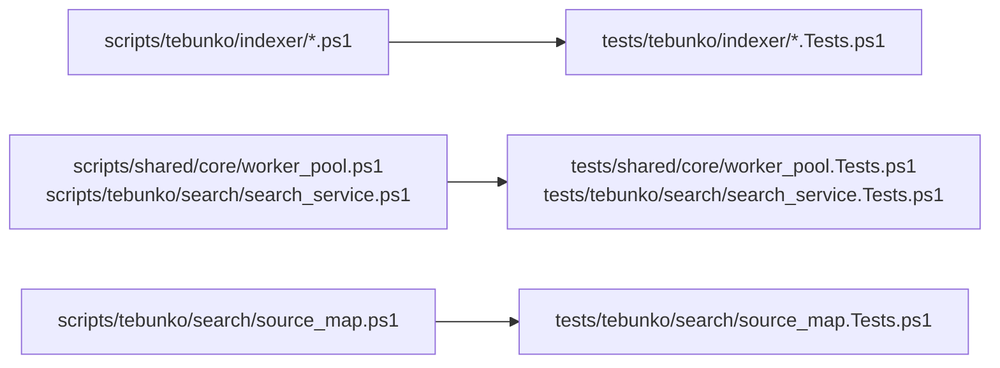

# 単体テスト（インデックス作成）

扱うこと: インデックス作成（`tests/tebunko/indexer/`）・スレッドとプール・元のファイルの特定の単体テストが何を確かめるか。扱わないこと: インデックス名・インデックスの管理・本文インデックスのテスト（[単体テスト（インデックスと検索）](unit-index.md)）、Office のテスト（[単体テスト（Office）](unit-office.md)）。先に読むページ: [単体テスト（インデックスと検索）](unit-index.md)。

**インデックス作成（`tests/tebunko/indexer/`）**

| 対象 | 主な確認内容 |
|---|---|
| `readStatusFile` / `writeStatusFile`（`tests/tebunko/core/status_file`） | クロール対象フォルダと各列の往復（`[` `]`・先頭の空白を含むパス）、1 行目・見出し行の書式、エラーのタブ・改行をスペースに、列数の合わない行の無視、書き直し時の置き換え、ファイル無しは空、まとめて書き出した行と `toStatusLine`（1 件ずつの追記）の整形が同じ（速さのため別々に書いているため）、ほかから共有せずに開かれているときの読み込み、使えない名前・相対パスの行の読み飛ばしと `Rejected` の数（同じ名前の 2 行目以降も 1 行目と同じ結果）、予約名（`aux.backup`・`CON.txt`・`CON`）のインデックスはそのまま読む、最後が `.` や空白の名前のフォルダ行は `LegacyFolders` で返す |
| `writeUnits`（`tests/tebunko/indexer/extract_office`） | 場所ごとの TSV 出力、空の場所は出力しない、`[` `]` を含むパス |
| `addStatusRow` | 追記した行の優先（大文字・小文字を区別しない）、追記した行の抽出版 |
| `readStatusLines` / `renameStatusIndexName` / `removeStatusIndexName` | 名前の変更（クロール対象フォルダの行と各行の相対パス）、インデックスの記録の削除 |
| `readStatusRelPaths` | 取り込み一覧の相対パスを順に返す（同じ相対パスの追記も数える・壊れた行と見出しは数えない） |
| `IngestJournal`・`convertToIngestJournalLine`・`newIngestJournalHead`・`convertFromIngestJournal` | ジャーナルの追記と読み戻し（途中で切れた最後の行を捨てる）、新しい回の頭の行（版・回・持・未の順。未が 0・1・2 件のとき、持と未が両方あるとき）、記録の種類ごとの復旧（書き出すフォルダ・やり直す仕事・済んだ仕事。「未」の持ち越しと「出」の打ち消し）、書き出せなかった回のあとの書き出し直し、行数がずれたときの全部やり直し、前の版の記録の読み込み |
| `flushPendingPublish`・`recoverIngestJournal`・`writeStatusWithJournal`（Io。`tests/tebunko/indexer/indexer`） | 書き出せたフォルダ（`publishIndexFolders` の `Published`）にだけ「出」を足す、書き出せなかったフォルダだけを返す（2 フォルダのうち 1 つが失敗したとき・置き場の外を指すパスで飛ばしたとき・例外のときは全部）、始めの復旧が書き出せなかった・中止で飛ばしたフォルダを次の回へ持ち越す、ジャーナルが読めないとき（フォルダが 0 件・2 件）今ある書き出し前のフォルダだけを書き出す、前の版の `ingesting.txt` を足して重ねない、「書」と（`-Finish` のときだけ）「終」の記録 |
| `describeIngestError` | 取り込みの例外から失敗の原因を作る（パスが長すぎる場合を含む） |
| `getIndexingState` | 状態ごとの件数、失敗したファイルの行の並び（`未取り込み` でエラーがある行は失敗に数え、エラーが空の `未取り込み` は待ちのまま）、指定した時刻以降に取り込んだ件数 |
| `newIndexerChannel` / `writeIndexingProgress` / `readIndexingProgress` | 画面が決めた条件を入れスレッドをまたいで使える形にする、段階・件数・内容の往復（タブ・改行はスペース）、受け渡しの口が無ければ何もしない |
| `requestIndexingStop` / `answerIndexingPlan` | 中止を求めると確認を待っていても待つのをやめる、取り込む返事は中止にしない、取りやめの返事（`$null`）は中止にする |
| `testIndexerRunning` | ミューテックスだけ・鍵のファイルだけのどちらをほかが持っていても Running（Error 無し）、調べた後は鍵を持たない、残った鍵のファイル（誰も開いていない）だけなら Running でない、アクセス拒否は Running と Error を返し待たずに返る |
| `enterIndexerLock` / `exitIndexerLock` | 取れれば両方持ち放すと取れる状態に戻る（2 回放しても例外にならない）、鍵のファイルを取れない・例外のときはミューテックスも放している |
| 鍵の取り方（`tests/meta/locks.Tests.ps1`） | `newAppMutex "indexer"` を書くのは `indexer_state.ps1` だけ、`enterIndexerLock` はミューテックスの後に鍵のファイルを開く |
| `writeIndexerLog`（`tests/tebunko/core/diagnostics`） | ログを開いていればログに書く、コンソールに出すときは色を付ける、ログに書けなくても止めない |
| `getExtractVersion` / `getIngestDecision` | 形式ごとの抽出版、取り込むかどうかと理由（新規・更新あり・前回未完了（`未取り込み` でエラーがあっても同じ）・インデックスなし・前回失敗・前の抽出版） |
| `getIngestApp` / `getRerouteApp` / `selectIngestWorker` | Excel はすべて Excel、旧形式の Word・PowerPoint はそのアプリ、新形式は Office が要らない（空）。回し直すときは、PowerPoint のファイルは PowerPoint、それ以外は Word。表（`$officeFileKinds`）に無い拡張子（`.pptz` など）は Office とみなさない。渡し先は、持ち主へ（満杯なら待つ・諦めていれば後回し）・持ち主がいなければ持ち主のいないいちばん空いているワーカー・Office が要らないファイルは持ち主のいないワーカーを先に・すべて諦めていれば後回し（`-TestCases` の表） |
| `createTargetList` / `findTargetFiles` | 新規・更新あり・前回未完了・インデックスなし・前の抽出版は取り込み対象、更新の無い取り込み済み・前回失敗は対象外、元のファイルが無くなったらインデックスと行を消す（本文インデックスから外すよう `Removed` で返す）、アクセスできないフォルダがあったときは行とインデックスを残す、tebunko が作ったファイル（ワークスペース・名前で分かるもの）は対象に含めない、ジャンクション・親を指す輪・ファイルのシンボリックリンクは辿らず取り込まずに 1 件 1 行でログに出す（リンクかどうか確かめられないものは取り込む）、クロール対象フォルダそのものがリンクなら、これまでどおり先の中を読み、中のリンクだけを辿らない、中止の合図（`shouldStop`）が立てば一覧化を途中で止め（`Stopped`）、無くなったファイルのインデックスは消さない（`IngestPlanner.Crawl` も残りのフォルダの前回の行を残す） |
| `StatusLedger`（`indexer_state.Tests.ps1`） | コンストラクタで渡した `Workspace` の場所を読み書きする（既存の関数と同じ結果）、今回の失敗・元ファイルが無くなった行を集める |
| `PendingPublish`（`pending_publish.Tests.ps1`） | 取り込んだ・無くなったファイルの記録、外し終えていない削除（Unpublished。取り出しても残り、MarkPublished で外れ、Restore で戻る）、取り込み中・まだ渡していないファイルが 1 つでもあるフォルダは取り出さない、無くなれば取り出せる、一度取り出したフォルダは消える |
| `IngestPlanner`（`indexer_plan.Tests.ps1`） | 名前の割り当てと外れたインデックス、クロールでの取り込み・チェックなし・フォルダなしの分け方、選んだインデックスだけの更新、取りやめるときの行、前回の失敗の再取り込み、強制終了したファイルを最後に回す・失敗にする、名前の保存（`$TestDrive` の設定。保存の間に外れたフォルダを落とす）、`kinds` の不足と呼ぶ順番の例外、元のファイルが無くなったファイル |
| `IndexingReporter`（`indexing_reporter.Tests.ps1`） | 進み具合を受け渡しの口に書く、画面の返事を受け渡しの口で待つ（返事は別のスレッドから渡す。中止・前に残った返事・制限時間を含む） |
| `IngestDispatcher`（`ingest_dispatcher.Tests.ps1`） | 渡す順番とワーカーの空き、先読みで満杯の持ち主のファイルを飛ばす、元のファイルが無くなった・クロール対象フォルダが無い・中止、諦めたワーカーの取り込み中・列のファイルの後回し（`TakeAbandonedWorker`）、回し直し先の持ち主が諦めていたとき、遅れて届いた結果を捨てる、後回しの理由、止まった取り込みスレッド、`Stop` が諦めたワーカーのスレッドを待たない |
| `clearTmpDir` / `initTmpDir` / `newWorkerTmpDir` の作業領域のリンク | 作業フォルダ・`tmp\<PC の鍵>` がジャンクションなら先に書かず消さない（`initTmpDir` は理由 `Link` でスキップ、`clearTmpDir` と `newWorkerTmpDir` はログに出す）、先に置かれた `<PID>`・`w<番号>` のジャンクションは先を消さずに外して作り直す、`tmp` 自身・出力用のフォルダの親がジャンクションでも使え、片付けと終了のあともジャンクションは外れず先は消えない（`removeEmptyDir` はリンクを消さない）、終了したプロセスのフォルダの中・名前そのもののジャンクションは先を消さない、削除できない（開いたまま）フォルダ・確かめられないフォルダを含むものは、原因をログに出して次回に回す、作り直したあともリンクが残れば置けない扱い（`newDirectoryReplacingExisting` の偽、`initTmpDir` の理由 `Link`、`newWorkerTmpDir` の空） |
| `publishTsv` / `removeStaleTmpDirs` / `findDroppedIndexes` / `getDroppedStatusRows` / `writeStatusKeepingDropped` / `removeDroppedFolders` | 作業フォルダの TSV をインデックスへ移す（`[` `]`・260 文字超のパス）、終了したプロセスの作業フォルダだけを削除する、設定から外れたインデックスだけを見つける（大文字・小文字だけ違う名前は返さない）、外れたインデックスの前回の行だけを返す（名前の先頭が同じだけの別のインデックスは返さない）、状態の記録に外れたインデックスのフォルダと前回の行を足して渡す（外れたものが無ければ足さない。今の決まりに合わない前の版の名前は、書き戻して読み直すと `LegacyFolders` に入り、各ファイルの行は残らない）、渡されたインデックスだけを削除する（確認で承認した回でだけ呼ぶ。`tests/meta/index_delete.Tests.ps1` が、インデックスのフォルダを消す関数を許した一覧に限る） |
| `indexer.ps1`（起動口） | 設定とインデックスを `$TestDrive` に差し替え、`indexer.ps1 -Channel` で通しで動かす（受け渡しの口の `Workers` を 0 にし、取り込みは司令のスレッドで行う。Excel は使わず、`.docx`・`.pptx` を取り込む）。代表的な場面だけを確かめる（関数の単位で確かめられることは各モジュールのテストで確かめる）。続けられないエラーと終了コード、ほかのインデックス作成が実行中なら触らない、基本の流れ（取り込み・本文インデックス）、2 回目は更新の無いファイルを取り込まない、フォルダが見つからないときは前回の結果を残す、強制終了したファイルを最後に回す・続けて強制終了したら失敗にする、画面の確認での取りやめと失敗分の取り込み直し、中止（終了コード 2。元のファイルごとのフォルダを残さず、対応済みにしない）、制限時間、取り込み中に元のファイル・フォルダが無くなった場合、名前に記号（` ' `・` [ ] `・` & `・バッククォート）を含むクロール対象フォルダ・ワークスペースでテキストファイルを取り込んで検索できる（ワークスペースは `[ ]` を除く。`indexer_path_chars.Tests.ps1`）、前回残った TSV を次の作成の始めに本文インデックスへ入れる、既定のワークスペースが空でなければ何も書かない。利用者の PowerPoint が起動していれば `.ppt` を取り込まず、理由付きの失敗に数え（一覧は未取り込みのまま、エラーの列に理由。実際に PowerPoint を起動して確かめる）、ほかのファイルは取り込む。閉じれば、失敗分の再取り込みを選ばなくても次回に取り込む |
| `indexer.ps1`（取り込みのスレッド） | 取り込みのスレッドで取り込んでも、取り込み一覧・本文インデックスがスレッドを使わないときと同じになる、取り込みのスレッドが始められなければ続けられないエラーで 1 を返す |
| `getIngestWorkerCount` | Office を使わずに読む仕事の数。指定があればその数、無ければ設定（`ingestThreads`）、設定が 0 ならコア数から決める、ファイルの数より多くしない |
| `completeIngestJob`（`indexer.Tests.ps1`） | 司令の結果の受け方（成功・失敗・後回し・渡さずに残したファイルの後回し・中止）が、取り込み一覧・書き出し待ち・進み具合・ログに反映される（取り込みのワーカーの数 0 の形で、司令のスレッドから呼ぶ） |
| `runIngestWorker` / `invokeIngestTask`（ワーカー） | 列の順に取り込み、結果を 1 件に 1 つ返して、列が閉じられたら終わる、Office を使わないファイルだけを取り込んだワーカーは Office を起動し直さない。「Office が要る」の例外なら、失敗にせず回し直し（`Reroute`）として返し、Office も終了しない。利用者の PowerPoint が使用中の例外なら、失敗にせず後回し（`Postponed`）として返し（司令が理由付きの失敗として数える）、Office も終了しない。後回しは取り込んだ件数に数えず、起動し直しを早めない。**暗号化の判定でOfficeにまだ触れていない失敗**（[暗号化されたファイルの判定](../indexing/office-apps.md#暗号化されたファイルの判定office_protectionps1office_protection_viewps1)の`throwProtectionFailure`）は失敗にするがOfficeは終了しない。ふつうの失敗は今までどおりOfficeを終了する。**諦められたワーカー**（制限時間を過ぎても利用者の PowerPoint を止めなかったとき）のファイルは、取り込む前・取り込んだ後・例外のどこでも、公開せず `Postponed` を返し、Office を終了しない。司令は、そのワーカーの取り込み中と列のファイル、持ち主が諦めたワーカーのアプリのファイルを、理由付きの失敗にして（状態は「未取り込み」のまま）、遅れて届いた結果は捨て、スレッドの終わりを待たずに止める。回し直し先の持ち主のワーカーを諦めていれば渡さずに後回しにする（司令の流れ）。諦めたワーカーのスレッドが正常に終わっても失敗にしない（`IngestDispatcher` の `Receive`）。取り込みのスレッドのスクリプトが、ワーカーの状態と利用者が使った印の入れ物を見張りに渡し、諦めたワーカーでは Office を片づけない（配線） |
| `IndexingSession`（`indexing_session`） | インデクサを別のスレッド（MTA・優先度を下げる）で動かし終了コードを返す、中止を求めると受け渡しの口の `Stop` を立てて返事を待つのをやめさせる、終了コードを入れずに止まったら 1 と止まった理由、インデクサが入れたエラーの内容、`Close` は動いていれば中止を求めて待つ（何度呼んでもよい）、`KillOffice` は記録した PID のうちプロセス名と起動時刻が同じものだけを止める（利用者が使っていた印のあるものと、窓のある PowerPoint は止めない） |

**元のファイルが変わらないこと（`tests/tebunko/indexer/source_unchanged`）**

| テスト | 確かめること |
|---|---|
| `source_unchanged`（`-Tag Io`） | テキスト・PDF・Word・PowerPoint・読み取り専用・パスワード付きのファイルと、外のフォルダを指すジャンクションを置いたフォルダで、インデックスの作成・更新・エクスポート・削除の前後に、元のフォルダと外のフォルダのファイルの数・種類・ハッシュ・属性・作成日時・更新日時（ファイルのみ）が変わらない。ジャンクションの先は取り込まれない。ジャンクションを作れない環境ではジャンクションの分を飛ばし、ジャンクションの無い場面だけで確かめる |
| `source_unchanged`（`-Tag Office`） | 上に Excel（パスワード付きを含む）と旧形式の PowerPoint を足した場面。Office がある機械でだけ流れ、CI の既定では外れる（リリース前に `.\tests\run.ps1 -All`） |
| 比べ方の自己テスト（`-Tag Io`） | 中身の書き換え（日時を戻した場合も）・更新日時だけ・作成日時だけ・属性だけ・削除・追加のどれも、前後の比べが見逃さない |

**スレッドとプール（`tests/shared/core/worker_pool`・`tests/tebunko/search/search_service`）**

| 対象 | 主な確認内容 |
|---|---|
| `getWorkerCount` / `newWorkerState` | 画面のために 1 コアを残し 1〜上限に収める、指定した関数と値だけを各スレッドに読み込む |
| `WorkerPool` | 仕事の出力と引数の受け渡し、指定した優先度、PowerShell のインスタンスの使い回し、同時に複数の仕事、仕事の例外を投げても次の仕事を続けられる、止めた仕事は使い回さない、閉じた後は受け付けない（`Close` は何度呼んでもよい）、`Prelude` は各スレッドで 1 回だけ実行する |
| `BackgroundQueue` | 終わった仕事の出力を onDone に渡す、失敗は errorText で渡す、終わっていない仕事の数、閉じると終わっていない仕事を止める |
| `newSearchRequest` / `invokeSearchRequest` | ヒットを列に入れて件数と終わったことを伝える、照合のプールを渡しても同じ結果、始める前に取り消されていたら検索しない、検索できなかった理由を `Error` に入れる（例外は投げない）、どの段（gram 索引・列挙・照合）の途中で止めても先の段に進まず `Cancelled` にしてヒットを列に入れない、各段に要求そのものが止める合図として渡る、呼ぶ段が表に無い関数を足すと落ちる |
| `SearchService` | 要求を順に実行し同じスレッドを使い続ける、次の要求を渡すと前の要求を取り消す、閉じるとスレッドを止める、司令のスレッドが止まっていたら理由を返し次の要求で作り直す |
| `trimTsvTextCache` | 上限の 9 割以下なら追い出さずに世代だけ進める、超えていたら今の世代で使わなかったものを古い世代から追い出す、今の世代で使ったものは残す、入れたとき・使ったときの世代を残す |

**元のファイルの特定（`tests/tebunko/search/source_map`）**

| 対象 | 主な確認内容 |
|---|---|
| `getIndexNameMap` / `resolveSourcePath` | インデックス名から元のフォルダを引いた元のファイルのパス、ドライブ直下、元のフォルダが分からない結果は `$null`、**設定（`targetFolders` / `indexSources`）を元のフォルダの記録・取り込み一覧より優先**、既定のインデックスは取り込み一覧を元のフォルダの記録より優先 |
| `writeSourceFolderFile` / `readSourceFolderFile` / `getSourceLocation` | 各インデックスのフォルダへの書き出しと読み込み（説明の行は無視）、別の場所にコピーしたインデックス、インデックス名のフォルダを検索対象にした場合（そのフォルダの記録）、分からない場合は Known = `$false`・Folder は空でインデックス名を返す、キャッシュ |
| `findMovedSource` | 元のフォルダ・ファイルのあるフォルダ・途中のフォルダを選んだ場合も同じ `Root` を返す、相対フォルダが無い場合、見つからない場合 |
