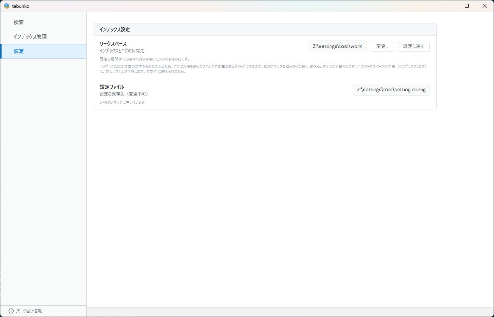
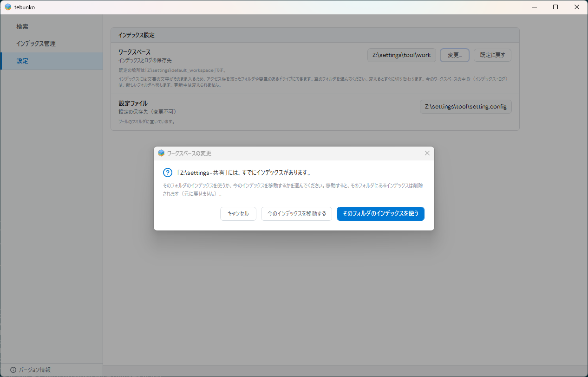

# 設定

設定の画面では、インデックスの保存先（**ワークスペース**）と、検索結果の件数の上限を変更できます。設定ファイルの場所もこの画面で確認できます。

検索オプションと元のファイルの開き方は、［検索］タブで指定します（[検索](search.md#検索オプション)・[元のファイルを開く](open-files.md#開き方の指定)）。これらの設定は自動的に保存され、次回起動時にも引き継がれます。

## ワークスペース

ワークスペースは、インデックス・ログを保存するフォルダです。既定の場所は `%USERPROFILE%\Documents\tebunko_ws` です。

| 種類 | ファイル・フォルダ |
|---|---|
| インデックス | `store\`（検索に使うデータ。本文インデックスと取り込みの記録）、`system_index\`（高速検索のために Windows Search に索引させるデータ） |
| 取り込みの記録 | `store\ingest_status.tsv`、`ingesting.txt` |
| ログ | `indexing_log.txt`（インデックス作成ごとに、前回の分を `indexing_log_previous.txt` に移す）、`gui_error_log.txt`（1 MB 以上で `gui_error_log_previous.txt` に移す） |
| 出力 | `search_results.txt`（［結果をファイルに出力］） |

!!! warning "インデックスには文書の本文がそのまま含まれます"
    元のファイルのアクセス権は引き継がれません。ワークスペースには、検索対象のフォルダと同等以上のアクセス制限を設定してください。

### ワークスペースの変更

アクセス制限を設定したフォルダや、空き容量の大きいドライブに保存先を変更する場合に使用します。

1. ［変更…］を選択し、**空のフォルダ**を指定します。
2. 「へ移動します」の確認で内容を確認し、実行します。

現在のワークスペースの内容（インデックス・ログ）は、新しいフォルダへ移動します。変更は即時に反映されるため、インデックスを再作成する必要はありません。更新中は変更できません。

空でないフォルダを指定した場合は、次の選択肢を表示します。

| 指定したフォルダ | 選択肢 |
|---|---|
| tebunko 以外のファイルがある | ［中に「workspace」を作って使う］、または指定し直す |
| tebunko のインデックスがある | ［あるインデックスを使う］（現在のワークスペースの内容は移動せず、元の場所に残します）、または［消して、最初からやり直す］（指定したフォルダのインデックスを削除し、現在の内容を移動します。この操作は元に戻せません） |

他の利用者が作成・共有したインデックスを使用する場合は、そのフォルダを指定して［あるインデックスを使う］を選択します。インデックスの一覧も、そのワークスペースの内容に切り替わります。

［既定に戻す］は、ワークスペースが既定以外の場所にある場合に表示されます。

!!! note "起動時に［設定］が表示される場合"
    既定のワークスペース（`Documents\tebunko_ws`）に tebunko 以外のファイルがある場合、起動時に［設定］を表示し、別の空のフォルダを指定するよう案内します。

## 設定ファイル

設定（登録したフォルダ・検索オプション・開き方・ワークスペースの場所）は `setting.config` に保存します。保存場所は［設定］の「設定ファイル」に表示されます。

| tebunko の配置場所 | 設定ファイルの場所 |
|---|---|
| 書き込み可能なフォルダ（zip の展開先など） | tebunko のフォルダ内の `setting.config` |
| 書き込み可能なフォルダ（単一 .ps1 版を置いたフォルダ） | `.ps1` と同じフォルダの `setting.config` |
| 書き込み不可のフォルダ（`C:\Program Files` など） | 既定のワークスペース（`%USERPROFILE%\Documents\tebunko_ws`）の直下の `setting.config` |

設定は画面から変更するため、通常は設定ファイルを直接編集する必要はありません。画面から変更できない設定は次の 1 項目のみです。

| キー | 内容 |
|---|---|
| `ingestThreads` | Office を使用せずに読み込むファイル（.docx・.pptx など）の読み取りスレッド数。1〜4 を指定します。0 の場合は CPU のコア数から自動的に決定します（既定：0）。メモリが少ない環境で動作が重い場合は 1 を指定します |

設定ファイルを直接編集する場合は、tebunko を終了してから行ってください。JSON として読み込めない状態になると、インデックス作成が「setting.config を読み込めません」というエラーで停止します。キーの一覧は設計書の [設定ファイル](../design/structure/settings-file.md) を参照してください。

## 検索結果の件数の上限

検索結果として表示する件数の上限を、［設定］の「検索結果」で変更します。既定は 10,000 件です。

- ［制限あり］を選び、欄に 1,000〜100,000 の数を入力します。Enter か欄から出たときに確定し、Esc で取り消します。範囲の外の数や数字でない文字を入力した場合は、欄の下に理由を表示し、変更しません。
- ［制限なし］を選ぶと、上限で打ち切らずに、見つかった結果をすべて表示します。

確定した値は、次の検索から使います。検索中の結果は変わりません。大きくするほど、結果の表示に時間とメモリを使います。制限なしにすると、よく出る語では画面が長く止まることがあります。

## 関連する設計書

画面の仕様は [設定の画面](../design/gui/settings-tab.md)、ワークスペースの構成は [データの置き場所とパスの決め方](../design/structure/data.md) を参照してください。
