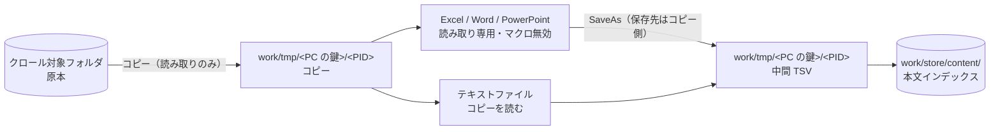

# ファイルの読み書きの範囲

## 書き込み・削除する場所

書き込みは次の場所に限られる。`tests/meta/safety.Tests.ps1` の「書き込み先が限られていること」が、これらの定義と、ドライブ直下・システムフォルダを指す書き込み先が無いことを確かめる。

| 場所 | 内容 | 定義 |
|---|---|---|
| `work/` 配下（既定は `%USERPROFILE%\Documents\tebunko_ws`。テスト・実機の確かめでは環境変数 `TEBUNKO_DEFAULT_WORKSPACE` の場所に差し替わる。利用者が画面で選んだフォルダ（ワークスペース）にも置ける） | 本文インデックス（`work/store/content/`）、取り込み一覧・制御用ファイル、インデックス作成の鍵のファイル（`indexing.lock`。空のファイルで、インデックス作成・エクスポート・インポートの間だけ作り、閉じると消える）、検索結果、ログ（`indexing_log.txt`・`gui_error_log.txt` と、それぞれ前回の分 `*_previous.txt`。インデックス作成を始めるとき・1 MB 以上のとき、前回の分へ移す。移すときは前の `*_previous.txt` を上書きする。先頭には版と環境の見出しを書く: [ログに書く版と環境の情報](disclosure.md#ログに書く版と環境の情報)） | `tebunko/core/paths.ps1`（`$workspace`）、`tebunko/core/workspace.ps1`（`Workspace`） |
| `work/office_pids/<PC の鍵>/<PID>.txt` | インデックス作成が起動した Office の PID の記録（起動時の確認で、記録のあるものだけを終了するため）。Office を終了したとき・起動時の確認のときに消す | `tebunko/core/workspace.ps1`（`OfficePidRoot`）、`shared/office/office_process.ps1`（`addOfficeRecord`） |
| `work/tmp/<PC の鍵>/<PID>` 配下（ワークスペースのパスに `[` `]` があるか長すぎるときは作らない。どのファイルも中間 TSV などをこの作業領域に作るため、テキストファイルを含めすべての取り込みをスキップする） | 取り込みの作業領域（原本のコピー・中間 TSV）。インデックス作成の完了時・開始時に空にする | `tebunko/indexer/index_migrate.ps1` の `initTmpDir` |
| `work/tmp/<PC の鍵>/search_overflow/<PID>/`（`<PID>` の下に検索の要求ごとの `<要求の番号>\*.tsv` と、［出力 ▾］の本文の一時ファイル `export\body.tmp`。根が `tmpRoot\<PC の鍵>\search_overflow` そのものでリンクでないときだけ作る） | 上限を超えた検索結果の溢れ（検索の続きの置き場所）と、その書き出しの途中の本文。次の検索の始め・画面を閉じるときに中ごと消す。強制終了で残ったものは、次の起動時に、動いていないプロセスの `<PID>` のものだけを消す | `tebunko/search/search_overflow.ps1`、`tebunko/search/search_export.ps1` の `getSearchExportBodyPath` |
| `work/tmp/<PC の鍵>/open_copy/<12 桁の英数字>/<ファイル名>`（`<PID>` の下ではない。強制終了の片付けは数字の名前のフォルダだけを消すので残る） | ［新規で開く］のコピー（Office 以外の元のファイルを共有で読んで写したもの。開いたアプリが使う間は消さない）。起動のたびに 1 回、最後に使ってから 1 日より古いものだけを消す | `tebunko/core/open_copy.ps1` の `copySourceForOpen`・`clearOldOpenCopies` |
| `setting.config`（ツールを置いたフォルダの直下。書き込めないときは既定のワークスペース `%USERPROFILE%\Documents\tebunko_ws` の直下） | 画面が保存する設定（クロール対象フォルダ・検索対象インデックス・`work` の置き場所など）。書き込めない場所（Program Files・読み取り専用の共有フォルダ）に置いたときだけ、ワークスペースの既定の場所に置く（[データの置き場所とパスの決め方](../design/structure/data.md)）。保存のときの一時ファイル `setting.config.tmp` と、壊れた設定の退避 `setting.config.broken-<日時>` も同じフォルダに置く | `shared/core/data_dir.ps1`、`tebunko/core/settings.ps1` の `getSettingsFilePath` |
| `startup_error.txt`（ツールを置いたフォルダの直下。書き込めなければ作らない） | 起動そのものに失敗したとき（画面が開く前）の記録（`gui.ps1` の追記は、1 MB 以上なら次の記録を書く前に `startup_error_previous.txt` へ移す）。起動の前はワークスペースが決まらないため、ツールのフォルダに置く（[起動に失敗したときの知らせ](disclosure.md#起動に失敗したときの知らせtebunkobat)） | `tebunko.bat`、`tebunko/ui/startup_error.ps1` の `writeStartupErrorFile` |
| 利用者が指定した出力先 | ［出力 ▾］の出力先（.xlsx・.csv・.tsv。出力先のダイアログで選ぶ。クロール対象のフォルダ・インデックスのフォルダの中は選べない）と、書き終えてから置き換えるまでの間だけ残る `<出力先>.new`、溢れの置き場所が使えない CSV・TSV のときだけ作る本文の一時ファイル `<出力先>.part`（どちらも強制終了すると残ることがある。次の出力の始めに消す） | 画面のダイアログで利用者が指定 |
| 利用者が指定したエクスポート先 | インデックスのエクスポート（`exportIndex`）の保存先の zip と、書き終えてから置き換えるまでの間だけ残る `<保存先>.tmp`（強制終了すると残ることがある） | 画面のダイアログで利用者が指定 |

単一 .ps1 版（試験版）は、`tebunko.bat` の代わりに `.ps1` ファイル自身を実行する形のため、上の表の「ツールを置いたフォルダ」は `.ps1` ファイル自身がある場所を指す。`setting.config` は `.ps1` のある場所に置き、書き込めないときは既定のワークスペースの直下に置く（`getSettingsFilePath`。zip 版と同じ決め方）。ワークスペースの既定の置き場所（`%USERPROFILE%\Documents\tebunko_ws`）は、別のフォルダに置いた zip 版と同じ場所になる（[単一 PowerShell のビルド](../design/structure/single-script.md)「実行時の違い」）。

削除（`Remove-Item`・`[System.IO.File]::Delete` など）の対象はすべてワークスペース配下（取り込みの作業領域 `work/tmp/` を含む）、すなわち**本ツールが自分で作ったファイル**である（前の版（`%TEMP%\tebunko\<PID>` に一時ファイルを置いていた版）が残した作業フォルダの片付けだけ例外。`removeStaleTmpDirs`）。［新規で開く］のコピーは、`open_copy` の中（`testOpenCopyDir` で、置き場所がワークスペースの `tmp/<PC の鍵>/open_copy` そのものであり、リンクでないことを確かめる）で、最後に使ってから 1 日より古いものだけを消す（`clearOldOpenCopies`。リンク（ジャンクション・シンボリックリンク）は辿らず、中のリンクも消さない）。フォルダの削除は `removeDirectoryUnder`（置き場の下で途中にリンクが無いことを確かめ、中で `removeDirectoryRetry`・`removeTreeNoFollow` を呼ぶ）にまとめてある。リンク（ジャンクション・シンボリックリンク）は辿らず、中にあるリンクはリンクだけを外して、先のファイル・フォルダは消さない。削除するフォルダそのものがリンクのときも、リンクだけを外す。リンクかどうかは `testLinkItem` で決める（属性の `ReparsePoint` が付き、種類がジャンクションかシンボリックリンクのもの。ファイルは `ReparsePoint` でも種類が違えば普通のファイルとして消す）。フォルダで `ReparsePoint` が付いているのに、種類がジャンクションにもシンボリックリンクにも確かめられないものは、リンクかどうか分からないものとして、辿らず、何も消さずに削除を失敗させる（`removeTreeNoFollow` は、先に全体を数えてから消すため、数える段で見つけたこのときは、何も消えずに失敗する。読めるかどうかや権限には頼らず、権限も変えない）。使用中のファイルや、数えたあとに足されたものがあるときは、途中まで消えて例外になる。消す前にフォルダごとにリンクでないかを確かめ直し、数えたあとにリンクに替わっていれば、そこで例外にする（それまでに消した分は戻らない）。確かめ直すのは、そのフォルダ自身だけで、上の階層が途中で替わったときは見つけられない。失敗の理由は、削除を呼ぶ側の扱いで出る。終了時の作業フォルダの削除（`removeTmpDir`）と、終了したプロセスの作業フォルダの片付け（`removeStaleProcessDirs`）は、原因を付けてログに出して次回に回す。インデックスの削除（`RemoveIndex`）・外したフォルダのインデックスの削除（`removeDroppedFolders`）などは、例外として呼び出し元に返る。ボリュームのマウントポイントもジャンクションと判定されるため、置き場の中にあれば、リンクとして外す（先のボリュームのファイルは消さない）。OneDrive の「オンデマンド」のフォルダがこれに当たると、削除できないことがあるが、データは失われない。インデックスの削除（`RemoveIndex`・`removeDroppedFolders`・本文インデックスの書き出し後の TSV の削除）も、この関数を通る。`removeDirectoryRetry` は、消したあとにフォルダが残っていれば（予約名に拡張子の付いた名前（`aux.backup`・`CON.txt`）のフォルダを `Remove-Item` で消すと、例外も出さずに残る）、成功にせず例外にする。呼ぶ側は、消えたことを確かめられてから取り込み一覧・状態・ログに記録する。フォルダの有無は `Test-Path` でなく `[System.IO.Directory]::Exists` で見る。有無が分からない（届かない・読めない）ときは、試し直さずに例外にし、記録を進めない。呼ぶ側は、有無を見て削除を飛ばさない（有無を見るのは、フォルダかファイルかを分けるときだけ。`RemoveEntries`）。これらは `tests/meta/remove_entry.Tests.ps1` が確かめる（`Remove-Item -Recurse` など別の消し方を `scripts/` に足さない・`removeTreeNoFollow` は `removeDirectoryRetry` だけが呼ぶ・`removeDirectoryRetry` を呼ぶ関数は `Test-Path` を使わない）。クロール対象フォルダ内のファイルを削除する処理は無い。

フォルダを消す・移す・作る呼び出しは、置き場の下で途中にリンクが無いことを確かめる入口（`removeDirectoryUnder`・`moveDirectoryUnder`・`newDirectoryUnder`。確かめは `testRemovablePath`）を通す。置き場の外、または置き場から先までの途中の階層がジャンクション・シンボリックリンクのパスは、置き場の下に見えても、何も消さず・移さず・作らずに偽を返す（呼ぶ側が、ログに出して続けるか、例外にするかを決める）。通せない呼び出し（ワークスペースを移す処理・設定の画面が選んだ根を作る処理など）は、`tests/meta/remove_entry.Tests.ps1` の一覧に、置き場が決まっている理由とともに置く。インポートで zip から展開するファイルは、`FileMode.CreateNew`（同じ名前が既にあれば失敗）で書き、展開の途中に置かれたリンクの先へ書かない。インデックスの書き出し（publishIndexFolders）も、置き場の下で途中にリンクがあるフォルダは飛ばしてログに出し、リンクの先の本文インデックスのファイルを書かず・消さない。

削除の対象になるフォルダの置き場（`store\`・`content_index\`・`tmp\`）そのものが、利用者によって別の場所へのリンク（ジャンクション）にされているときは、これまでどおり使える（置き場そのものは調べない）。この場合、リンクの先に新しいフォルダが作られることはあるが、先の既存のファイルを消す・上書きすることはない。削除の前に確かめてから消すまでの間に、別のプロセスがフォルダをリンクに差し替えることは想定していない（`removeTreeNoFollow` は、下りる直前と、フォルダのファイルを消す直前にもう一度リンクかどうかを確かめて、この間を短くしている）。

［設定］でワークスペースを変えるときは、前のワークスペースの中の本ツールが作ったファイル・フォルダ（`Workspace.Entries`：`store`・前の版の `content_index`・前の前の版の `index`・状態・鍵のファイル・ログ・`publish`）だけを新しいワークスペースへ移す（`WorkspaceMover.ChangeWorkspace`）。別のドライブへは写してから元を削除する（元を消せなければ移し先を正とし、元に残ったフォルダの場所を警告で知らせて、利用者が手で消す）。選んだフォルダにすでにインデックスなどがあり、利用者が［消して、最初からやり直す］を選んだときは、そのフォルダの本ツールのファイル・フォルダ（同じ `Workspace.Entries`）だけを削除する（`WorkspaceMover.RemoveEntries`）。利用者がワークスペースに置いたほかのファイルは移さず、削除しない。

前の版が作った `system_index\`（フォルダ）と `system_index_state.tsv`（ファイル）は、この版では使わない。画面の起動のとき（裏の仕事）、インデックスの作成と更新の始め、インデックスのインポートで登録する前に、`removeOldSystemIndex` が消す（フォルダは `removeDirectoryUnder`、ファイルは `removeFileUnder` を通す。途中にリンクがあれば消さずに記録に出し、続ける。リンクそのものは、先を辿らずに消す）。ワークスペースを移す・書き出す・消す対象には含めない。前の版の `index\` そのものは読まず、削除しない（利用者が消す）。

作り直しが最後まで終わったインデックスについて、前の版の置き場（`content_index\<名前>\`。空になれば `content_index\` と前の版の `ingest_status.tsv` も）は、インデクサが消す（`removeOldIndexOf`）。消す対象は、前の版の置き場として決めた 2 つ（`oldIndexEntries`）の配列に書いたものと、作り終えたインデックスのフォルダだけで、インデックスの名前が空・`.`・`..`・ファイル名に使えない文字を含むときは何も消さない。フォルダはジャンクションを辿らずに消し（`removeDirectoryUnder`）、中止したときは消さない。

インデックスのインポート（`importIndex`）の書き込みは、ワークスペースの中（`publish\<PID>\import\`・`store\content\<名前>\`・取り込み一覧・目録・`setting.config`）だけである。zip から展開したファイルは、確かめた目録のパスからだけファイル名を組み立てる（zip のエントリー名は使わない）。インポートを始めるときは、エクスポートと同じくインデックス作成の鍵（`enterIndexerLock`。ミューテックスと鍵のファイル）を取り、ほかの操作と同時に走らせない。

**状態ファイルの値を信用しない。** ワークスペースは共有でき、`store\ingest_status.tsv`・`store\format.tsv`・`store\journal\ingest.tsv`・と設定の `targetFolders` は他の人が書き換えられる。そこから読んだインデックス名・相対パスは、読むときに確かめ（取り込み一覧・状態ファイルは `testStoredIndexName`・`testIndexRelPath`、設定の名前は `getTargetFolders` が `getFolderNameProblemText`。`..`・最後の `.` や空白・使えない文字を含むものは、行なら読み飛ばし、設定の名前なら空にして割り当て直す。`aux.backup` のような予約名は、既にある実在のフォルダの名前なので、空にも読み飛ばしにもせず、そのまま使い続ける。厳しくするのは新しく付ける名前（`newIndexName`・画面の入力・インポート）だけ）、フォルダを消す・移す前にも、先が置き場（`content_index`）の下であることを `testPathUnder` で確かめる（`removeBookDir`・`IndexCatalog.RemoveIndex`・`IndexCatalog.RenameIndex`）。外を指すものは消さず、黄色のログに出す（`RemoveIndex`・`RenameIndex` は例外にして、フォルダも取り込み一覧も動かさない）。`RenameIndex` は元の名前を `testStoredIndexName`、新しい名前を `testIndexName` で、`RemoveIndex` は名前を `testStoredIndexName` で確かめる（最後が `.` のような今の決まりに合わない名前は、設定を読むときに空になって届かない）。予約名のフォルダは `Test-Path` では無いことになるため、フォルダの有無は `Directory.Exists`（`removeDirectoryRetry` の中）で見る。設定から外れたインデックスの削除（`removeDroppedFolders`）は、名前でパスを組まず、`content_index` 直下のフォルダを一覧して名前が同じものだけを消す。今の名前の決まりに合わない前の版の名前（最後が `.` など）は、取り込み一覧の読み込みで分けて、同じ確認で削除できる。ジャーナルから読んだ相対パス（やり直す仕事・書き出すフォルダ）も、読むときに `testIndexRelPath` で確かめ、使えないものは読み飛ばす。

確認コマンド（[検査項目と結果](checks.md#検査項目と結果) の `scan` を使う）:

```powershell
# 削除・書き込みの呼び出し箇所をすべて列挙し、対象のパスが work / tmpDir 由来であることを目で確かめる
scan 'Remove-Item','WriteAllText','WriteAllLines','StreamWriter','\.SaveAs','::Move','Move-Item'
# Windows Search への問い合わせと、索引の対象から外す属性の書き込みが無いことを確かめる（0 件）
scan 'OleDb','CommandText','NotContentIndexed'
```

### 取り込みの作業フォルダに置くもの

取り込みの作業フォルダ（既定 `work\tmp\<PC の鍵>\<PID>\w<番号>\`）には、原本のコピー（テキストを含む）・Excel のシートごとの一時保存・旧形式から変換した一時ファイル・公開前の中間 TSV を置く。置き場所はワークスペースの下である。

| 内容 | 今の置き場所 | 定義 |
|---|---|---|
| 原本のコピー（Excel・Word・PowerPoint が開く対象） | `work\tmp\<PC の鍵>\<PID>\w<番号>\<元のファイル名>` | `extract_office.ps1` の `invokeWithSourceCopy` 呼び出し |
| テキストファイルのコピー（読み終えたら消す） | 同上の下の `source.copy` | `extract_text.ps1` の `extractTextFile` |
| PDF ファイルのコピー（読み終えたら消す） | 同上の下の `source.copy` | `extract_pdf.ps1` の `extractPdfFile` |
| Excel のシートごとの一時保存（`sheet<番号>.tmp`） | 同上の下 | `extract_office.ps1` の `extractWorkbook` |
| 旧形式・不明な形式から変換した一時ファイル（`converted.docx`・`converted.pptx`、リネームした `source.doc`・`source.ppt`） | 同上の下 | `extract_office.ps1` の `extractDocument` |
| 公開前の中間 TSV（本文・シート・図形などの TSV。テキストファイルの `doc_body.tsv` を含む） | 同上の下 | `index_migrate.ps1` の `publishTsv`、`extract_text.ps1` の `extractTextFile` |

ワークスペースのパスに `[` `]` を含む・長すぎて置けないときは、作業フォルダを作らず、取り込みをすべてスキップする（`selectTmpDir`・`initTmpDir`。[データの置き場所とパスの決め方](../design/structure/data.md)）。

作業領域は、`tmp\<PC の鍵>` から下の各階層（`<PID>`・`w<番号>`）を、使う前にリンクかどうか確かめる（`testPathHasLink`）。途中にリンクがあれば置けない扱いにし（`initTmpDir` は理由 `Link` を返して取り込みをすべてスキップする。`newWorkerTmpDir` は空文字を返す）、リンクの先には書かない。`<PID>`・`w<番号>` と同じ名前が既にあれば、リンクを辿らずに消してから作り直す。`tmp` そのものは確かめない（上の削除の置き場と同じ）。作業フォルダそのものがリンクのときは、`clearTmpDir` は何も消さずにログに出す。強制終了で残った作業フォルダの片付け（`removeStaleTmpDirs`）も、`tmp\<PC の鍵>` の途中にリンクがあれば何も消さない。

### ワークスペースの外に、まだ書くもの

上の作業フォルダをワークスペースの下に寄せた後も、次のものはワークスペースの外（または、そもそもディスクに書かない）のままである。

| 種類 | 置く場所 | 中身 | 外に置く理由 |
|---|---|---|---|
| 利用者ごとの設定データ | `setting.config`（ツールのフォルダに書き込めるときはその直下。書き込めないときだけ、既定のワークスペース `%USERPROFILE%\Documents\tebunko_ws` の直下） | 画面が保存する設定 | ツールを置いたフォルダ（`Program Files`・読み取り専用の共有フォルダ）に書けないときの代わりの場所。`%LOCALAPPDATA%\tebunko` には置かない（ツールのフォルダ自体が `%LOCALAPPDATA%\Programs\tebunko` にあるインストーラー版では、書き込めるのでその直下に置く）。ワークスペースより先に（設定を読む前に）決まる必要があるため、ワークスペースの既定の場所に固定する |
| 起動失敗の記録 | ツールのフォルダの `startup_error.txt`（書けなければ作らない） | 起動に失敗した理由・日時・実行環境の情報 | 画面が開く前（ワークスペースも設定も読めないことがある）に書くため、ツールのフォルダにする |
| Office アプリの PID | メモリ上の `OfficePids`（画面を閉じるとき用）と、ワークスペースの `office_pids\<PC の鍵>\<PID>.txt`（次の起動時の確認用） | 起動した Office の PID → プロセス名・起動時刻・起動した側の PID | 画面を閉じるときは、応答の無い Office だけを、PID とプロセス名・起動時刻が控えたものと同じときに止める。強制終了などで残ったものは、次の起動時に記録のあるものだけを確認して止めるため、ファイルに残す |
| 書き込み中の一時ファイル（`<出力先>.tmp`。置き換えたら消える） | 書く先のすぐ隣（`setting.config.tmp`・`store\ingest_status.tsv.tmp`・`store\format.tsv.tmp` などの TSV の隣・利用者が指定したエクスポート/インポート先の隣・［出力 ▾］の出力先の隣の `<出力先>.new` など） | 書き込み中の内容 | 途中で強制終了してもファイルが壊れないよう、一時ファイルに書いてから置き換える（`writeTextLinesAtomic` など）。置き換え（`File.Replace`）は同じフォルダ内でしか使えない |
| 書き込みテストの確認用 | ツールのフォルダ直下 `.tebunko_write_test_<GUID>.tmp` | 空（`DeleteOnClose` でファイルを閉じた瞬間に消える） | 起動のたびに、ツールのフォルダに書き込めるかを確かめるため（`testWritableFolder`） |
| Office・PowerShell が自分で書く一時ファイル | `%TEMP%` 配下（本ツールは関与しない） | Office のロックファイル（`~$<ファイル名>`）・自動回復用のファイルなど、PowerShell・.NET ランタイムが内部で使う一時ファイル | tebunko が選べる場所ではなく、Office・PowerShell・.NET 自身の既定の動きのため |
| 開発用の出力 | リポジトリ直下 `work/test/`・`work/release/`・`work/site/`・`work/cache/`（配布物には含めない） | テスト結果・カバレッジ・配布 zip・設計書のサイト・サイトのビルドキャッシュ | 開発・CI の道具（`tests/run.ps1`・`tools/`）が使う出力で、配布した tebunko 自体は書かない |

### 検索結果の出力先の確かめ

［出力 ▾］の出力先は、利用者が出力先のダイアログで選んだ名前だけから決める（`resolveExportTarget`。ほかのパスから出力先を作らない。`tests/meta/safety.Tests.ps1` が確かめる）。書く前に、次の 2 つを確かめる。

- 出力先のダイアログの確定のとき、出力先がクロール対象のフォルダ・インデックスのフォルダの中なら断る（`testExportForbiddenPath`）。出力したファイルが次の取り込みの対象になるのを防ぐため。確かめるのは文字列の比べだけで、ファイルには触れない。
- 書く直前に、司令のスレッドで出力先のフォルダを作れるか・同じ名前のファイルが開かれていないかを調べる（`testSearchExportTarget`）。

この確かめには限りがある。

- 文字列の比べのため、ドライブの割り当て（`subst`・割り当てたネットワークドライブ）、UNC パスとドライブ文字の別の書き方、ジャンクション（フォルダのリンク）、8.3 形式の短い名前を通した書き方では、同じ場所を指していても見抜けない。見抜けないときは、出力したファイルが次の取り込みの対象になることがある（取り込みでは、ほかのファイルと同じく、読み取りだけを行う）。
- 出力先のダイアログは OS のものなので、届かない共有を選ぶと、OS のダイアログが応答を待つ間、画面が止まることがある。tebunko は、ダイアログが閉じたあとの出力先に、画面のスレッドでは触れない（有無の確かめも書き込みも、司令のスレッドで行う）。

## 取り込み対象のファイルは書き換えない

本ツールは、クロール対象フォルダのファイルを**直接開かない**。作業フォルダへコピーし、そのコピーだけを開く（`tebunko/indexer/extract_office.ps1:192`・`434` と `tebunko/indexer/extract_text.ps1`（`extractTextFile`）の `invokeWithSourceCopy`。中で `copyFileShared` を呼ぶ）。コピー元は読み取り専用で開く（`shared/core/fs.ps1:140`。`FileAccess::Read` で開き、ほかのアプリの読み書き・削除を妨げない）。

この設計は、原本に絶対に影響を出さないために入れたもので（効果として、インデックス作成中も利用者が原本を上書き保存・移動できる）、結果として原本への書き込み経路そのものが存在しない。



Office の `SaveAs` は 3 か所あるが、保存先は常に作業フォルダ内のパス（`$tmpPath` / `$destPath`）である（`extract_office.ps1:156`・`210`・`234`）。原本のパスを `SaveAs` に渡す経路は無い。

テキストファイル（`.txt` 等）も、Office と同じく作業フォルダの `source.copy` へコピーし（`invokeWithSourceCopy`）、そのコピーを読み（`shared/core/text_file.ps1` の `readTextFile`）、読み終えたら消す。原本は直接読まず、書き込みの API には渡さない。

PDF ファイルもテキストファイルと同じく、作業フォルダの `source.copy` へコピーし（`invokeWithSourceCopy`）、そのコピーを読み（`shared/core/pdf_file.ps1` の `readPdfFile`）、TSV を書く前に消す（`extractPdfFile`）。

`tests/meta/safety.Tests.ps1` の「取り込み対象のファイルを書き換えないこと」が、原本のパスを書き込み・削除の API に渡さないこと、原本を読むのは `copyFileShared` の読み取りだけであること、`SaveAs` の保存先が作業フォルダだけであること、Word・PowerPoint を読み取り専用で開くことを確かめる（Excel を読み取り専用で開くことは「Office ファイルを安全に開くこと」が確かめる）。

### リンクは辿らない

クロール対象フォルダの中にあるジャンクション・シンボリックリンクは辿らない。リンクの先のフォルダへ降りず、リンクのファイルも取り込まない（`getFilesNoFollow`）。先が取り込み対象の外（別のドライブ・共有・システムのフォルダ）でも、親を指す輪でも、読まない。飛ばしたリンクは 1 件 1 行でログに出す。クロール対象フォルダそのものがリンクのときは、利用者が選んだ場所のため、これまでどおりその先の中を読む（中のリンクだけを辿らない）。

同じく、インデックスの zip への書き出しも、置き場の中のリンクへは降りず、リンク自身にも触れない。再帰の列挙（`Get-ChildItem -Recurse`・`SearchOption.AllDirectories`）を、許した関数の一覧の外で書けないことは、`tests/meta/link_safety.Tests.ps1` が確かめる（一覧にあるのは、リンクを辿っても読むだけで済む関数）。

## クラウドにだけあるファイル

OneDrive・SharePoint のオンデマンドで、中身がこの PC に無いファイルは、フォルダの一覧と同時に分かる属性だけで見分け、既定ではファイルを開かない。開けばダウンロードが始まり、ネットワークの帯域・ディスクの空きを使い、ファイルがこの PC に残るため。利用者が確認のダイアログで選んだとき（または設定 `cloudFiles` が `download` のとき）だけ、ほかのファイルと同じようにコピーして読む。見分けのための属性の読み取りは、ファイルを書き換えない。

## 読み取りのみであることの実証

静的な確認に加えて、実際に動かして確認できる。第三者が再現できる手順は次の 2 つ。

**手順 A: ハッシュの比較**

```powershell
$target = "C:\確認用\対象フォルダ"
$before = Get-ChildItem $target -Recurse -File | Get-FileHash
# ここで tebunko.bat を起動し、$target を対象にインデックスを作成する
$after  = Get-ChildItem $target -Recurse -File | Get-FileHash
Compare-Object $before $after -Property Path,Hash   # 何も出力されなければ、原本は 1 バイトも変わっていない
```

**手順 B: 書き込み権限を外して実行**

対象フォルダに読み取りの権限だけを与えたアカウントで、インデックス作成を最後まで実行する。書き込みを試みていれば失敗するため、完走することが「読み取りのみ」の裏付けになる。
